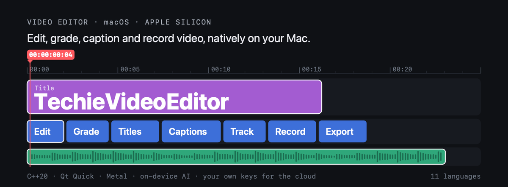
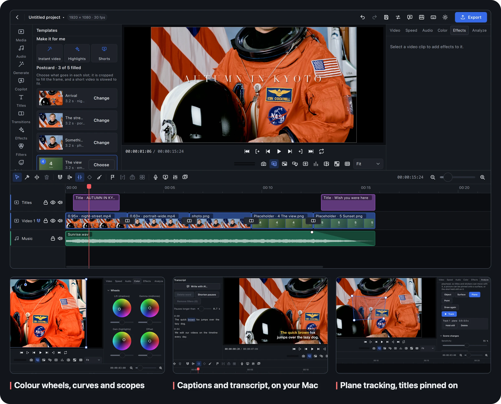
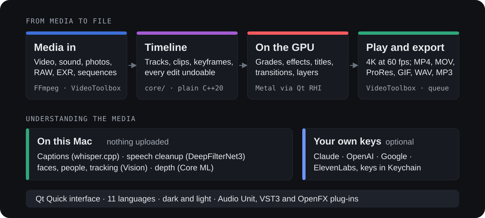

<p align="center">
  
</p>

<p align="center">
  <b>A video editor for Macs with Apple silicon.</b><br>
  Multi-track editing, colour grading, titles, captions, screen recording and templates, with
  analysis that runs on your Mac and optional AI on your own keys.
</p>

<p align="center">
  <a href="#get-started">Get started</a> ·
  <a href="docs/user-guide.md">User guide</a> ·
  <a href="web/README.md">Feature guide</a> ·
  <a href="docs/design-system.md">Design system</a>
</p>

<p align="center">
  
</p>

## What it is

TechieVideoEditor is a desktop video editor written from scratch for macOS, in C++20 with a Qt
Quick interface and a Metal renderer. It aims at what people expect from a modern editor —
a multi-track timeline, grading, effects, titles, captions, recording, templates and export in
every common format — and keeps the heavy lifting on the Mac: speech to text, noise reduction,
tracking and people work run locally, and cloud features only start when you add a key of your
own.

## Why it's different

- **Native, and fast because of it.** Hardware decoding and encoding (VideoToolbox) and GPU
  compositing on Metal play 4K at 60 fps with effects; proxies and render files cover the heavy
  stretches.
- **Private by default.** Captions (whisper.cpp), speech cleanup (DeepFilterNet3), faces,
  tracking and depth run on the Mac. Models download once, from their makers, checked before use.
- **Your keys, your choice.** Claude, OpenAI, Google and ElevenLabs are optional, kept in the
  Keychain, and the copilot shows every change before applying it.
- **Original throughout.** Every effect, transition, title, sticker, sound, template and icon was
  made for this project; FFmpeg is an LGPL build and the app ships every licence it uses.
- **Eleven languages.** English, Tamil, French, German, Spanish, Hindi, Japanese, Korean, Thai,
  Vietnamese and Chinese (Simplified), in dark and light themes.

## How it works

<p align="center">
  
</p>

## Get started

### Requirements

- macOS 13+ on Apple Silicon, Xcode Command Line Tools
- CMake ≥ 3.25, Ninja, pkg-config, Qt 6.7+ (`brew install cmake ninja pkg-config qt`)
- vcpkg (`git clone https://github.com/microsoft/vcpkg ~/vcpkg && ~/vcpkg/bootstrap-vcpkg.sh`)

vcpkg builds FFmpeg (LGPL, with VideoToolbox and LAME 3.100 for MP3, LGPL), Catch2, nlohmann-json, miniaudio, ThorVG (MIT, for Lottie stickers), whisper.cpp with ggml (MIT, with its Metal backend, for speech to text),
RNNoise 0.2 (BSD-3-Clause, model data CC0; through an overlay port in `cmake/ports/rnnoise` that fetches the model
0.2 was released with — vcpkg's own port pairs it with a later one that barely reduces noise — and builds it with
CMake, so it builds on arm64 without autotools) and ONNX Runtime (MIT, built from source; its first build takes a while)
from `vcpkg.json`. The vcpkg `overrides` pin ONNX Runtime's dependencies to the checked-out baseline, so a shallow
vcpkg clone works.
Models are not in the repository: the app downloads the one you choose — Whisper (MIT) from the
official whisper.cpp model repository on Hugging Face, DeepFilterNet3 (MIT / Apache-2.0) from the
DeepFilterNet repository on GitHub — and checks its SHA-256 before using it.
Qt comes from Homebrew because building it through vcpkg takes hours.

### Build and test

```bash
export VCPKG_ROOT=~/vcpkg
cmake --preset macos-release -DCMAKE_PREFIX_PATH="$(brew --prefix qt)"
cmake --build --preset macos-release
tools/make_test_media.sh          # synthetic test videos, a spoken sample (via `say`) and a public-domain NASA portrait (1.1 MB, SHA-256 checked) with clips made from it, and clips with known motion and sound offsets, in samples/
tools/fetch_models.sh             # the models the tests use (Whisper 57 MB, DeepFilterNet3 8 MB, Depth Anything V2 Small 50 MB, SHA-256 checked) into samples/models/
ctest --preset macos-release
```

The suite includes `tve_golden_tests`: 531 fixed projects (every effect at its defaults and
changed, every transition at four moments, blend modes, placement, keyframes, colour, looks,
masks, keys, mattes, titles, stickers, compound clips, adjustment layers) built from generated
pictures, rendered by the real renderer offscreen and compared at 128 × 72 with the reference
PNGs in `tests/golden/metal/` (mean channel difference ≤ 2, at most 1 % of pixels far off).
`tve_perf_tests` measures the performance budgets (playback of three 4K layers with effects,
scrubbing with and without proxies, start-up, opening a 200-clip project, export speed,
memory) with the real engine and renderer, and fails when one is missed. They run one at a
time; on their own:

```bash
ctest --preset macos-release -L perf
```

After a deliberate change to how something looks, rewrite the references and review them:

```bash
TVE_GOLDEN_UPDATE=1 build/macos-release/tests/tve_golden_tests
```

A failing case leaves its picture, the reference and a difference image in
`$TMPDIR/tve_golden_failures/`.

The screenshots in `docs/images` (used here, in the design system and in the feature guide) are
taken from the app itself: `tools/make_screenshots.sh` runs the scenes in `tests/screens/`, each
setting up the editor and saving a picture in the dark and the light theme, then rebuilds the
feature guide's images.

```bash
tools/make_screenshots.sh                 # every scene
tools/make_screenshots.sh delivery titles # only tests/screens/tst_delivery.qml and tst_titles.qml
```

### Run

```bash
build/macos-release/app/TechieVideoEditor.app/Contents/MacOS/TechieVideoEditor
```

Media files given on the command line are imported and appended to the main track; a
`.tve` file is opened. For an unattended measurement:

```bash
build/macos-release/app/TechieVideoEditor.app/Contents/MacOS/TechieVideoEditor --stats --quit-after 15 samples/4k60_h264.mp4
build/macos-release/app/TechieVideoEditor.app/Contents/MacOS/TechieVideoEditor --effects all --screenshot shot.png samples/4k60_h264.mp4
build/macos-release/tools/tve_decode_bench samples/4k60_h264.mp4
```

`--effects` applies output effects to the whole canvas (all, or comma-separated ids); `--screenshot` saves the window
after `--screenshot-at` seconds (default 3); `--screen home|editor` picks the start
screen; `--theme dark|light` picks the theme; `--play` starts playback; `--seek <s>` moves the
playhead.

Set `TVE_AUDIO=null` to render audio without a sound card (used by the tests), or
`TVE_AUDIO=none` to disable audio output.

### Make a disk image to share

```bash
tools/make_dmg.sh
```

builds `build/dmg/TechieVideoEditor-<version>.dmg`: the app with Qt's frameworks inside it,
the licences of everything it is made from (in `Contents/Resources/Licenses`), a link to
Applications to drag it onto and a short read-me. It builds the `macos-dist` preset first: the
app and the libraries linked into it for Apple Silicon and macOS 14.4 and later (the libraries
in their own folder, `build/vcpkg_installed_dist`; the first run builds them, which takes a
while). The script checks that nothing in the app points outside it, and works out the oldest
macOS it opens on from what is inside, writing it into the app's Info.plist and the read-me.

That oldest macOS is set by Qt's frameworks, which are copied in as they are. Homebrew builds
its Qt for the macOS of the Mac that installed it, so a DMG made with Homebrew's Qt opens only on
that macOS and later. For older Macs (down to 14.4), install Qt with Qt's own installer
(qt.io) and point the script at it — `QT_PREFIX=~/Qt/6.12.0/macos tools/make_dmg.sh`, after
removing `build/macos-dist` so it configures with that Qt.

The app is signed ad hoc unless you have an Apple Developer ID: then it is signed with the
hardened runtime (entitlements in `app/TechieVideoEditor.entitlements`) and, with a notary
profile, notarized by Apple and stapled, so it opens like any app downloaded from the web:

```bash
TVE_SIGN_IDENTITY="Developer ID Application: Your Name (TEAMID)" TVE_NOTARY_PROFILE=<profile> tools/make_dmg.sh
```

(The profile is saved once with `xcrun notarytool store-credentials`; the script never sees
your password.) Without notarization, the person installing it allows it once in System
Settings › Privacy & Security › Open Anyway — the DMG's read-me says how.

## Features

- **A real timeline.** Multi-track editing with ripple, blade, J K L, source monitor, compound and
  multicam clips, keyframes with easing, speed ramps and 60 transitions.
- **Colour that holds up.** Wheels, curves, HSL, LUTs, scopes, HDR (PQ and HLG) and grades compared
  side by side with the original.
- **Titles and motion.** 51 title templates, animated text, charts, stickers, drawing, masks, keying,
  and titles that follow a tracked surface or plane.
- **Sound and captions.** Mixer, 45 audio effects, Audio Unit and VST3 plug-ins, loudness, speech
  cleanup, and captions and a word-by-word transcript made on your Mac.
- **Recording.** Screen, window or area with camera and microphone, cursor effects, a countdown, a
  teleprompter and drawing on the screen.
- **Made for you.** Templates in six shapes, instant videos cut to the beat, and shorts from the best
  moments of a long video.
- **AI where you want it.** Analysis runs on the Mac; writing, voices, generation and a copilot that
  proposes every change before it happens use your own keys.
- **Delivery.** MP4, MOV, ProRes, transparent video, GIF, MP3 and more; presets, a render queue,
  render files, and timelines for Final Cut Pro, Resolve and Premiere (FCPXML, OpenTimelineIO, EDL).

<details>
<summary><b>Every feature, area by area</b></summary>

### Media import and timeline editing

- Import video, audio and image files.
- Import numbered image sequences as one video, SVG drawings, camera RAW photos and OpenEXR.
- Import a whole folder, its folders becoming folders in the media library.
- Arrange media on a multi-track timeline, scrolling up and down through as many tracks as you add.
- Drag media, titles, transitions, effects, filters, stickers, music and sound effects from the library onto the timeline: effects and filters onto the clip under the pointer, the rest at the track and time where you drop them.
- Move, trim, split and delete clips.
- Support ripple deletion on the main track, or on every track with auto ripple.
- Replace a clip's media in place, turn clips off and on, and stand in for shots with placeholders.
- Extend an edit to the playhead, jump to the next or previous edit, and select everything after or before the playhead.
- Send the playhead to the start or the end of the timeline from the player's buttons (Home, End); the timeline scrolls to it.
- Move tracks up and down, lock them all, and delete every transition or marker at once.
- Rotate pictures by right angles and flip them; see the frame's border in the player, pictures snapping to it.
- Undo and redo editing operations.
- Layer clips with support for position, scale, rotation, crop, opacity and blend modes.
- Animate clip properties using keyframes, including volume.

### Colour grading and visual adjustments

- Apply individual colour grading to each clip.
- Compare a grade with the picture before it, side by side on a divider you drag.
- Support basic colour corrections, colour wheels, curves, HSL adjustments and hue curves.
- Apply LUTs (Look-Up Tables).
- Keep a clip's grade, or a `.cube` or `.3dl` LUT, as a filter of your own in the Filters library.
- Display colour scopes for accurate grading.
- Apply looks (filters) and overlays to individual clips.
- Protect skin tones from a grade or look, so faces keep their colour.
- Smooth and brighten the skin on every face and whiten teeth, found frame by frame on the Mac.
- Blur the background behind people, and put stickers on faces that follow them.
- Lift dark shots with night view, and blur what is away from the focus with depth of field, on the Mac.
- Add adjustment layers above clips to apply effects across multiple clips.

### Masks, keying and compositing

- Cut out clips using shape masks and pen-based masks.
- Support chroma keying and track mattes.
- Arrange clips side by side.
- Create picture-in-picture compositions.
- Track an object, a turning surface, a flat plane in perspective (by its four corners) or a single point; have titles and stickers follow it, pin a picture or video onto a plane, or hold the shot still on it.

### Effects library

- Access a library of 61 visual effects.
- Apply individual effects to each clip.
- Support shadows, outlines and fills that extend beyond the original picture boundaries.
- Keep a clip's effects and their settings as one effect of your own, under Mine.
- Write new effects in the shader editor (GLSL, with sliders and colours of your own, checked and previewed as you type), and share them as `.tveeffect` files.
- Add stickers of your own: pictures with transparency, GIFs and Lottie animations, or a frame of a clip.

### Transitions

- Apply any of the 60 available transitions between clips.
- Apply a selected transition to every cut simultaneously.
- Randomly assign transitions across cuts.
- Support constant-power audio crossfades.
- Bridge a cut with an AI transition: a shot made from the last frame before it and the first after it (your Google key).

### Titles and text

- Customize fonts, sizes, colours, bold and italic styles.
- Configure text alignment, letter spacing and line spacing.
- Add outlines and shadows.
- Add shapes or speech bubbles behind text.
- Apply entrance, exit and looping text animations.
- Animate text by individual letters, words or lines.
- Create rolling credits and tickers.
- Choose from 51 built-in title templates, six logo reveals and presets saved from your own titles.
- Make titles pulse, bounce, flash or shake with the music under them.
- Draw animated bar and line charts from typed values or a CSV file.
- Have Claude check the spelling and grammar of every title and caption, fixes applied only when you choose.
- Add audio visualisers that move with the spectrum of the music.

### Speed and playback

- Adjust clip playback speed from 0.01× to 100×.
- Create speed ramps.
- Play clips in reverse.
- Insert freeze frames.
- Loop playback, skim the timeline with the pointer, and match a frame to its media.

### Audio editing and mixing

- Display audio waveforms.
- Adjust clip volume and audio fades.
- Change, set or normalize the volume of many selected clips at once.
- Fit music to a length (such as the video's end), whole bars taken out or played again, on the Mac.
- Detach audio from video clips.
- Mute, hide and lock individual tracks.
- Display audio level meters.
- Hear a clip in mono, one channel on both sides, or swapped.

### Media management and preview

- Display thumbnails in the media bin and timeline.
- Keep media in folders, sort and group it, see it as small, medium or large thumbnails or a list, and mark it with colour labels.
- Remove media nobody uses, and archive a project with every file it needs into one folder.
- Search the media bin for what is in the pictures, what is said and the text on screen, and open the moment found.
- Play and scrub through video content.
- See a checkerboard where the canvas is transparent, and where vertical social apps' bars, captions and buttons will cover the picture.
- Watch a full-screen preview on a second display.
- Keep favourite effects, transitions, titles, stickers and looks, with tags.
- Switch workspaces (panel layouts) and save your own.
- Use shortcut presets like Premiere Pro's or Final Cut Pro's, see them on a keyboard map, and carry them in a file.
- Edit heavy 4K media smoothly using proxy files.
- Save and reopen `.tve` project files; double-clicking one in Finder opens it in the app (which
  gives projects their own icon), and videos, sounds and pictures open with it too (Open With,
  or dropped on its Dock icon).
- Get the models on-device features use in one go: offered the first time the app opens, and
  from **On-device models…** on the Home screen.
- Automatically save unsaved work.
- Recover projects after unexpected application crashes.

### Export and delivery

- Export MP4 or MOV in H.264 or HEVC (10-bit for HDR), ProRes from Proxy to 4444, animated GIF, and
  video with transparency as WebM VP9 or HEVC.
- Export sound only as WAV (16-bit, 24-bit or 32-bit float), M4A (AAC), FLAC or MP3.
- Start from presets — 1080p or 4K for the web, a small file, vertical 9:16, square 1:1, a ProRes master
  or editing copy, an animated GIF, sound only — or your own.
- Export the whole timeline, the selected clips, a marker range (or one file per range), In to Out, or
  any stretch, with the mix normalized to a loudness target.
- Queue exports and pause, resume or cancel them from the render queue.
- Export under a chosen file size, in several formats in one go, or as a Live Photo.
- Hand the edit to another editor as OpenTimelineIO, Final Cut Pro XML or an EDL, and open
  OpenTimelineIO and Final Cut Pro XML timelines.
- Render heavy stretches to files so they play smoothly, and preview at half resolution.

### Analysis and AI on your Mac

Nothing here leaves the Mac: Apple's Vision and Core ML, Whisper and ONNX models run locally.

- Find pauses, scene changes and the beat; lower music under speech automatically.
- Make captions from speech (English, or many languages with the multilingual models), import and export
  SRT and VTT, style them (highlight, pop, karaoke or word by word), and cut the video by deleting words
  from its transcript.
- Clean up speech and reduce noise.
- Cut out people, cover faces (blurred or as a mosaic) and reframe a wide video for a tall screen,
  following the subject.
- Stabilize shaky footage, remove flicker and noise, and track objects, surfaces, planes and points.
- Sync multicam angles by their sound, cut out any subject, upscale, make smooth slow motion and remove
  an object.

### AI with your own keys

Cloud AI is optional and uses keys you add in AI settings (stored in the macOS Keychain): Anthropic
(Claude), OpenAI, Google and ElevenLabs. Nothing is sent until you add a key and ask.

- Write titles, descriptions and chapters from the transcript; translate captions.
- Read text aloud in a cloud voice, with captions timed to its words.
- Generate pictures, stickers, music, sound effects and videos (from words, or from a first and a last
  picture).
- Edit by asking in plain words with the Copilot; every change is listed for you to apply or skip.
- Copy a voice, only with the speaker's recorded consent.

### Recording

- Record the entire screen, one window, or an area drawn and sized on the display, marked by a frame while recording.
- Record a camera and microphone with it; the cursor's clicks can ring, be spotlighted, zoomed on and heard.
- Blur or remove the camera's background when recording.
- Count down before a screen recording starts, and pause and resume it as often as needed.
- Read your script from a teleprompter while recording.
- Draw on the screen while recording it.
- Record voice-overs directly from a microphone at the current playhead position.

### Templates and automatic edits

- Start from eight original templates in six shapes (16:9, 9:16, 1:1, 4:3, 3:4, 21:9), each a storyboard
  of shots, texts and music to fill in; save your own project as a template.
- Make an instant video cut to the beat of a style's music, a highlight montage, or up to five shorts
  from the best moments of a long video.

### Extending the editor

- Use Audio Units and VST3 audio effects, and OpenFX video effects, installed on your Mac.
- Install packs of sounds, stickers and templates from the store; the catalogue's signature is checked
  before anything is installed.
- Keep your own effects (or write them in GLSL in the shader editor), filters, stickers, title presets,
  export presets and sound packs.

### Languages and interface

- Use the app in English, Tamil, French, German, Spanish, Hindi, Japanese, Korean, Thai, Vietnamese or Chinese (Simplified), switched at once from the Home screen.
- Menus, drop-down lists, dialogs and panels open and close with short animations; library and inspector tabs cross-fade, and inspector sections fold smoothly.
- Drop-down lists look and open like the menus, with the current choice ticked and the row under the pointer highlighted.
- The player's transport bar wraps onto two rows when the player is narrow, so no control is cut off.

</details>

## Learn the editor

- **[User guide](docs/user-guide.md)** — how each part of the editor works, by topic, and every
  shortcut.
- **Feature guide** — every feature with a screenshot, where to find it and the steps to use it:
  open `web/index.html` ([about it](web/README.md)).
- **[Design system](docs/design-system.md)** — the interface's tokens and components, with
  screenshots of every screen in both themes.
- **[Build plan](docs/TechieVideoEditor_Build_Plan.md)** — the plan the project was built to.

The essential keys: Space plays, S splits at the playhead, ⌫ deletes, ⌘Z undoes, M adds a
marker, ⌘E exports, and ⌘/ lists (and changes) every shortcut.

## Project layout

- `core/` — project model (tracks, clips, media, keyframes with easing), undoable edit commands (add, move, trim,
  split, delete/ripple delete), timeline queries, JSON project save/load. Plain C++20, no Qt.
- `engine/encode/` — `Mp4Writer`: H.264/HEVC through VideoToolbox plus AAC (or video
  only), muxed to a fast-start MP4 (LGPL FFmpeg encoders only); `makeProxy`: 720p H.264
  proxies with a keyframe every 10 frames, from 8- or 10-bit sources; `WavWriter`: float
  WAV files whose header stays current, so a take cut short by a crash still opens.
- `engine/` — FFmpeg video decoder (VideoToolbox, software fallback, frame-accurate and
  keyframe seek) and audio decoder (48 kHz stereo float, sample-accurate seek); timeline
  playback that stitches video across tracks and gaps, plays clips at any speed, in
  reverse (decoded a group of pictures at a time) or as freeze frames, and mixes all
  audible clips with volume, fades, speed and mute; miniaudio output slaved to the shared
  play/pause/seek clock; `AudioRecorder`: miniaudio microphone capture to WAV through a
  lock-free ring and a writer thread; waveform peak cache; thumbnail extraction.
- `effects/` — built-in packages, all original (manifest + GLSL shaders): 61 video effects,
  60 transitions (basic, slides, wipes, shapes, zooms, 3D, distortions, luma wipes, light) and
  45 audio effects (manifest chains, no shaders). See [effects/README.md](effects/README.md) for the
  manifest format and shader contract.
- `engine/gpu/` — effect library (manifests cross-checked against shader reflection), the
  GPU effect chain, and the compositor that places layers on the project canvas
  (fit, crop, scale, rotation, position, opacity, seven blend modes) on Qt RHI.
- `ui/player/` — `FrameCompositor` (zero-copy CVPixelBuffer → Metal textures, YUV → RGB
  per layer, per-clip effects, titles, transitions, compositor), shared by `VideoView`
  (plus output effects, aspect-fit, live preview of uncommitted slider changes) and the
  `Exporter`; `ProjectController`, which exposes the project, edits,
  transport and file I/O to QML, the title text renderer, and image providers for video
  thumbnails, transition previews and title previews.
- `ui/theme/` — design system: color/type/spacing tokens (dark and light), original icon
  set and base components. See [docs/design-system.md](docs/design-system.md).
- `ui/shell/` — the Home screen and the editor: the library (media, audio, generate, copilot,
  titles, transitions, effects, filters, stickers, captions, transcript, templates, store), the
  player with its transport, the inspector (Video, Speed, Audio, Color, Effects and Analyze tabs),
  the timeline, and the dialogs and panels (export, render queue, recorder, mixer, AI settings…).
- `engine/` also holds `analysis/` (pauses, scenes, beats, motion, faces, tracking), `speech/`
  (whisper.cpp captions), `audio/` (effects, plug-in hosts, time stretching, loudness), `capture/`
  (screen, camera and microphone recording), `imports/` (Photos, Music, devices) and `packs/`
  (the store's signed packs).
- `app/` — the application window and command-line options.
- `i18n/` — the translations (`tve_<language>.ts`), checked by `tools/i18n/check_translations.py`.
- `tests/` — Catch2 tests for `core/` and `engine/`, the golden-frame suite (`golden/`), performance
  budgets (`perf/`), QML tests that drive the real editor (`qml/`), the screenshot scenes
  (`screens/`), and test OpenFX and VST3 plug-ins.
- `tools/` — test media and model fetching, the screenshot and web-image scripts, the disk image
  (`make_dmg.sh`) and app icon (`make_icon.swift`), pack publishing (`packtool`), the plug-in
  scanner, and generators for looks and stickers.
- `licenses/` — the GNU licence texts shipped with the app (for Qt, FFmpeg and LAME).
- `assets/readme/` — this page's pictures: the hero (`source/make_hero.py` draws `hero.svg` and,
  with `--gif`, the animated `hero.gif`), the screenshot board (`source/make_showcase.swift`, from
  `docs/images`) and the how-it-works diagram (`how-it-works.svg`, by hand).
- `docs/user-guide.md` — how each part of the editor works, by topic.
- `cmake/triplets/` — the vcpkg triplet for the shared build (macOS 14.4 and later).
- `web/` — the feature guide: a static website (plain HTML, CSS and JavaScript, no backend)
  listing every feature with a screenshot, where to find it and the steps to use it. Open
  `web/index.html` from the folder or serve it from any static host; see [web/README.md](web/README.md).

## Development history

The editor was built in slices, each ending in a working, tested app.

<details>
<summary>Every slice, phase by phase</summary>

**Phase 1 – MVP Editor: Complete**

- Slices 1–4: Core MVP editor functionality.
- Slices 5a–5e:
  - Export
  - Autosave and crash recovery
  - Proxy media support
  - Voice-over recording
  - Still images

**Phase 2 – Advanced Editing Features: Complete**

- Slice 6a: Keyframes.
- Slice 6b: Curves with effect keyframes.
- Slice 6c: Speed ramps.
- Slice 7a: Colour grading.
- Slice 7b: HSL, hue curves and scopes.
- Slice 7c: Looks, overlays and adjustment layers.
- Slice 8a: Masks, keying and split screens.
- Slice 8b: Effects library.
- Slice 9a: Audio effects, mixing and loudness.
- Slice 9b: Titles system.
- Slice 10a: 60 transitions.
- Slice 10b: Stickers.
- Slice 11a: Markers, groups and compound clips.
- Slice 11b: Delivery features, including export formats, presets, ranges and render queue.
- Slice 11c: Hardening, including missing-media relinking, shortcut editor and a 531-case golden-frame test suite.

**Phase 3 – AI-Powered Editing and Advanced Media Processing: Complete**

- Slice 12a: Analysis features, including pauses, scene changes, beat detection and audio ducking.
- Slice 12b: Speech-to-text with captions and SRT/VTT support.
- Slice 12c: Caption styles and transcript-based editing.
- Slice 13a: Audio AI, including speech enhancement and noise reduction.
- Slice 13b: People-related features, including portrait cutout, face covering and automatic reframing.
- Slice 13c: Motion processing, including stabilization, flicker removal, temporal denoising and tracking.
- Slice 14a: Advanced vision features, including multicam synchronization by sound, smart cutout, upscaling, smooth slow motion and object removal.

**Phase 4 – Recording, Generative AI and Creative Tools: Complete**

- Slice 15a: Screen and camera recording with cursor effects.
- Slice 15b: Music and sound library, with imports from Photos, Music and connected devices.
- Slice 16a: AI writing, caption translation and AI voices using user-provided API keys.
- Slice 16b: AI-generated pictures, stickers, videos, music and sound effects.
- Slice 17a: Templates in six aspect ratios.
- Slice 17b: Instant videos, highlight montages and smart shorts.
- Slice 18a: Drawing, paths and overlay transitions.
- Slice 18b: Asset and template pack store.

**Phase 5 – Professional Editing and Extensibility: Complete**

- Slice 19a: Audio plug-ins supporting Audio Units and VST3.
- Slice 19b: Video plug-ins supporting OpenFX.
- Slice 20a: Colour management with HDR support, including PQ and HLG, an HDR viewer and 10-bit HEVC export.
- Slice 20b: 360° video support, including reframing, navigation and 360° export.
- Slice 21a: Project interchange supporting OpenTimelineIO and Final Cut Pro XML import/export, plus EDL export.
- Slice 21b: AI copilot supporting natural-language editing through Claude, with every proposed change displayed for review before application.
- Slice 22a: Voice cloning with consent.
- Slice 22b: Application localization in English and Tamil.
- Slice 22c: Performance hardening, including render files for resource-intensive sections, half-resolution previews and measured performance budgets.

**Additional Enhancements – Complete**

The following improvements were completed after Phase 5:

- Slice 23a: Speed and transition support for compound clips.
- Slice 23b: Transparent video export using WebM VP9 and HEVC.
- Slice 23c: MP3 audio export.
- Slice 24a: Right-click menus on clips, tracks, empty timeline space and media; adding, renaming and deleting tracks; cut, copy, paste, duplicate and ripple delete with shortcuts; the home screen's Record screen and Instant mode.
- Slice 24b: Drag and drop from Finder onto the timeline and player, and moving, resizing and rotating the selected clip by hand in the player.
- Slice 24c: Timeline tools — J K L shuttle, typing a timecode, Mark In/Out, the blade tool, closing gaps, track height, pasting attributes and transitions, crossfades on sound tracks, and speeds from 0.01× to 100×.
- Slice 24d: A source monitor (In and Out, insert, overwrite, append), compound clips opened in timeline tabs, projects imported as compound clips, and multicam clips with angle switching.
- Slice 25a: The anchor point, corner pin, clip animation presets, pan and zoom, colour clips, and snapshots of the player.
- Slice 25b: Motion blur that follows keyframed movement, effect and colour masks, and player guides, safe areas, rulers and zoom.
- Slice 25c: One-click auto colour and colour match, HDR colour wheels, and lens-correction presets for wide cameras.
- Slice 26a: Curved and vertical text, an underline style, gradient and picture fills, and 3D titles.
- Slice 26b: Title presets of your own, titles that move with the music, animated bar and line charts from your data, and logo reveals.
- Slice 27a: Batch gain (several clips turned up, set or normalized together) and 32-bit float WAV export.
- Slice 27b: Audio visualisers — bars, mirrored bars, a wave or a ring moving with the spectrum of the music.
- Slice 28a: A teleprompter that scrolls your script while you record, left out of screen recordings.
- Slice 28b: Drawing on the screen while recording it — pen, highlighter and arrow, fading away or kept.
- Slice 29a: Importing image sequences, SVG drawings, camera RAW photos and OpenEXR pictures.
- Slice 29b: Exporting to a file size, in several formats at once, and as a Live Photo.
- Slice 29c: Shortcut presets and a keyboard map, favourites with tags, workspaces, and a full-screen preview on a second display.
- Slice 30a: A beauty filter for faces (smoothing and brightening skin, whitening teeth) and protecting skin tones from a grade, on the Mac.
- Slice 30b: Background blur behind people, a blurred or removed camera background in the recorder, and stickers that follow faces.
- Slice 30c: Smart search across what media shows, says and has on screen; Claude proofreading titles and captions, and writing a prompt from a picture.
- Slice 30d: Music fitted to a length on the Mac, AI transitions made from the frames either side of a cut, and a video from an idea.
- Slice 30e: Night view for dark shots, and cinematic depth of field from a depth model on the Mac.
- Slice 31a: Timeline handling — replacing media, clips turned off, placeholders, extend edit, match frame, loop, auto ripple, moving and locking tracks, the default transition, rotate and flip, skimming; a frame border pictures snap to; recording the entire screen, a window or an area.
- Slice 31b: Media and project — library folders, sorting, grouping, list and thumbnail sizes, colour labels, removing unused media, importing a folder, archiving a project with its media, changing the canvas and frame rate, export presets of your own, and mono or one-sided sound for a clip.
- Slice 31c: Player and recorder — before and after a grade with a divider to drag, a transparency grid, safe areas for vertical social apps, and pausing, resuming and a countdown in the screen recorder.
- Slice 31d: Eleven languages (English, Tamil, French, German, Spanish, Hindi, Japanese, Korean, Thai, Vietnamese and Chinese); planar and point tracking, holding a shot still on a track and pinning a picture onto a plane; go to start and end in the player; effects, filters and stickers of your own, with a shader editor; and smoother menus, dialogs and panels.

The gaps found after Phase 5 (slices 23a–23c) are closed. A few planned items were never taken on
by a slice and are still open — recent projects on the Home screen, roll and slip edits, an undo
history panel, a Preferences window, crash reports and updates; see §9.10 of the
[build plan](docs/TechieVideoEditor_Build_Plan.md#910-still-open-checked-against-7-november-2026).

</details>

## Rules

- Never copy files from another product's app bundle into this repo (effects, LUTs, presets,
  models, fonts, sounds, templates). See §1 of the build plan.
- FFmpeg must stay an LGPL build; `tve_engine_tests` fails if a GPL build is linked.
