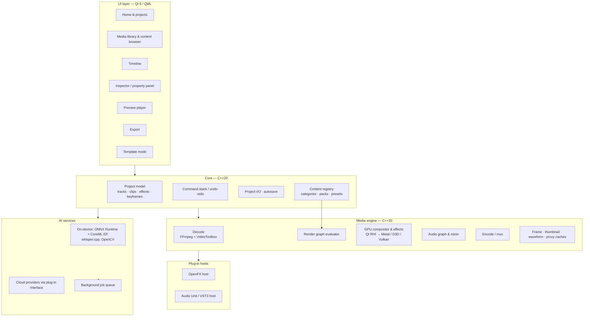

# TechieVideoEditor — Build Plan

**Product:** TechieVideoEditor (TVE), a desktop video editor for macOS (Apple Silicon first, Windows second)
**Goal:** feature parity with the editor surveyed in the REA static scan, built as an original implementation
**Status:** Phases 0 and 1 complete (Phase 1: timeline, audio, compositing, speed & thumbnails, transitions, titles, MP4 export, autosave & recovery, proxies, voice-over) — see §9.1; Phase 2 under way: keyframes (6a), curves & effect keyframes (6b) and speed ramping (6c), colour grading (7a), qualifiers & scopes (7b), looks (7c), masks & keying (8a), the effects library (8b), audio DSP (9a), the titles system (9b), transitions to 60 (10a), stickers (10b), structure (11a), delivery (11b) and hardening (11c) done — the Phase 2 slices are complete (the §7 P1 gaps are noted in §9.2); Phase 3 under way: analysis (12a), speech to text (12b), caption styles with text editing (12c) and audio AI (13a) done, people (13b) next — see §9.3 — see §9.2
**Date:** 2026-10-27

---

## 1. Ground rules

TechieVideoEditor matches *features*, not *assets or code*. Feature ideas are fair game; the reference product's bundled material is not.

| Allowed | Not allowed |
|---|---|
| Implementing the same kinds of features (timeline, keyframes, chroma key, AI cutout…) | Copying any file from the reference `.app` bundle: effects, LUTs, `.conf` presets, shaders, sounds, fonts, templates, thumbnails, ML models |
| Our own UI design, names, icons and branding | Reference product names, logos, UI layouts traced 1:1, or its marketing wording |
| Open-source libraries and models whose licenses allow commercial use | GPL code linked into a closed-source app; models with non-commercial licenses |
| Hosting third-party OpenFX / Audio Unit / VST3 plug-ins that *users* install | Shipping the reference product's bundled Boris FX or NewBlue plug-ins |
| Importing open interchange formats (FCPXML, EDL, OpenTimelineIO) | Reading or writing the reference product's proprietary `.wfp` project format |

Every third-party dependency and model goes through a license check (§12) before it is merged.

---

## 2. What the REA scan established

Scan target: `Wondershare Filmora Mac.app` 16.0.12 (build 16.0.12.13437, arm64). Static only; the app was never launched.

| REA operation | Evidence ID | Finding |
|---|---|---|
| `inspect_desktop_application` | `ev_16c83faa6dec…` | 5,888 entries; **no Electron / app.asar, .NET, Unity or other managed runtime**. Native app. |
| `inspect_plist` | `ev_c9ecd7ecbfcd…` | Project files `.wfp`/`.wfpbundle`, templates `.wfpts`; ~60 importable media formats; camera, microphone, Photos and removable-volume permissions. |
| `inspect_macho` (main executable) | `ev_201f1a3c0d8a…` | Qt 5.15.2 + AppKit/AVFoundation/WebKit; 46 linked libraries, ~20 in-house UI modules. |

Supporting static reads of the bundle (catalog JSON, config folders, embedded source paths) gave the architecture and feature inventory below.

**Observed architecture (reference product):**

1. **UI modules** — separate libraries per area: timeline, property panel (inspector), media library, player, export, templates, home page.
2. **Engine services** — about 40 service libraries: player, decoder, encoder, effects, captions, proxy, thumbnails, frame interpolation, object removal, OpenFX host, audio processing.
3. **GPU effect managers** — Metal and OpenGL.
4. **On-device AI** — about 130 small model libraries on ONNX Runtime / MNN / TNN / CoreML / ggml, mapped to features by a `model_tree.json` file.
5. **Data-driven content** — effects, transitions, titles and presets are *data* (category tree JSON + effect description folders + preset `.conf` files), mostly downloaded from a CDN.

TechieVideoEditor keeps that **layered, data-driven shape** because it suits this kind of app, but every layer is our own implementation.

**Limits:** static evidence shows *which* features exist and how they are organized, not *how* each algorithm behaves internally (no decompiler was configured). Behavior specs in this plan are our own design.

---

## 3. Architecture



### 3.1 Key design decisions

1. **Our own engine, GPU-first.** The render graph evaluates the timeline at a time `t` into a DAG of nodes (source → effects → transform → composite → output). All pixel work runs as GPU shaders through Qt RHI (Metal on macOS). The CPU only decodes and orchestrates.
2. **Effects are data.** Each effect, transition, filter, title animation and sticker is a folder: `manifest.json` (id, category, parameters with types/ranges/defaults, keyframable flags) + shaders + optional assets. Adding content needs no code change. This is the same idea the reference product uses, with our own format.
3. **One parameter system.** Every adjustable value (transform, color, effect, audio, text) is a typed `Param` that can be static or keyframed (linear / hold / Bezier). The timeline keyframe panel, the inspector and the render graph all read the same model.
4. **Command pattern for everything.** Every edit is a reversible `Command`, which gives undo/redo, autosave journaling and scripted tests.
5. **AI behind interfaces.** `ISegmenter`, `ITranscriber`, `IAudioSeparator`, `IGenerator`… each has a local and/or cloud implementation, chosen at runtime. Long jobs run in a cancellable background queue with progress shown in the UI and results cached per media hash.
6. **Non-destructive and proxy-aware.** Source media is never modified. Heavy analysis results (transcripts, beats, masks, tracking data, proxies) are cached sidecars keyed by content hash.

---

## 4. Tech stack

| Area | Choice | Why |
|---|---|---|
| Language | C++20 (engine/core), QML + JavaScript (UI), Python only for tooling | Real-time media needs native code; QML makes a fluid, custom-styled UI |
| UI framework | **Qt 6.8 LTS** (Quick/QML, Qt RHI, Qt Multimedia for capture helpers) | Proven for NLEs, cross-platform, GPU-abstracted rendering. LGPL — link dynamically. |
| Build | CMake + vcpkg, Ninja; GitHub Actions CI (macOS arm64, Windows x64) | Reproducible native builds |
| Decode / encode | **FFmpeg 7.x (LGPL build, no `--enable-gpl`)** + VideoToolbox (macOS) / Media Foundation, NVENC/QSV (Windows) | Broad format coverage plus hardware acceleration. Use platform H.264/HEVC encoders to avoid x264/x265 (GPL). |
| ProRes | AVFoundation encoder on macOS; FFmpeg `prores_ks` for decode | Native, licensed through the OS |
| GPU | Qt RHI → Metal / D3D12 / Vulkan; shaders in Vulkan-style GLSL compiled by `qsb` | One shader source, every backend |
| Color | OpenColorIO 2 (BSD) for color management and LUT handling | Industry standard |
| Audio I/O & DSP | miniaudio (MIT/PD) for device I/O; our own DSP graph; r8brain (MIT) for resampling | Low latency, permissive licenses |
| Text rendering | HarfBuzz (MIT) + FreeType (FTL) + Skia (BSD) for vector text, shapes and paths | Complex scripts, outlines, glows, path text |
| Computer vision | OpenCV 4.x (Apache 2.0): stabilization, trackers, homography | Mature, permissive |
| ML runtime | ONNX Runtime (MIT) with CoreML / DirectML execution providers; whisper.cpp (MIT) | Hardware-accelerated local inference |
| Database | SQLite (public domain) for the media library index, content catalog and caches | Embedded, robust |
| Interchange | OpenTimelineIO (Apache 2.0): FCPXML / EDL / AAF import-export | Interop with other NLEs |
| Plug-ins | OpenFX host (BSD headers); Audio Unit v2/v3 (macOS); VST3 (check current Steinberg SDK license terms) | Users bring their own plug-ins |
| Crash reporting | Crashpad (BSD) + Sentry | Self-hostable |
| Updates | Sparkle 2 (MIT) on macOS; WinSparkle on Windows | Signed delta updates |
| LLM features | Provider interface; default Claude API (`claude-sonnet-5-5` for speed, `claude-opus-5-5` for quality) | Copywriting, translation, editing copilot |

---

## 5. Repository layout

```
TechieVideoEditor/
├── CMakeLists.txt
├── cmake/                 # toolchains, vcpkg triplets, signing
├── app/                   # main(), app bootstrap, menus, windows
├── ui/                    # QML modules
│   ├── home/  library/  timeline/  inspector/  player/  export/  templates/  common/
├── core/
│   ├── model/             # Project, Sequence, Track, Clip, Param, Keyframe
│   ├── commands/          # undo/redo commands
│   ├── io/                # .tve project format, autosave, OTIO bridge
│   └── content/           # content registry, categories, packs, favorites
├── engine/
│   ├── decode/  encode/  graph/  gpu/  audio/  cache/  proxy/  capture/
├── effects/               # built-in effect packages (manifest.json + shaders)
│   ├── video/  transitions/  filters/  overlays/  titles/  motion/  audio/
├── ai/
│   ├── runtime/           # ORT session mgmt, model download & verification
│   ├── local/             # segmentation, STT, denoise, tracking, beat…
│   └── cloud/             # provider adapters (gen-video, TTS, music, LLM)
├── plugins/               # OpenFX, AU, VST3 hosts
├── content-tools/         # CLI to author, validate and package content packs
├── tests/                 # unit, render-golden, audio-null, perf, UI
└── docs/
```

**Project file format:** `.tve` = a zip containing `project.json` (versioned schema), a thumbnail and an optional media manifest. `.tvebundle` = a folder variant that also holds copied media for "save with media". `.tvet` = template.

---

## 6. Core data model

```
Project
 ├── settings (resolution, frame rate, aspect ratio, color space, sample rate)
 ├── mediaPool: MediaItem[] (id, path, hash, probe info, proxy, analysis sidecars, labels)
 ├── sequences: Sequence[]  (main + compound clips)
 │    ├── tracks: Track[] (video | audio | title | subtitle | effect/adjustment)
 │    │     flags: locked, hidden, muted, solo, magnetic (main track), height
 │    │     clips: Clip[]
 │    │       ├── sourceRef (media | compound sequence | generator | title | sticker)
 │    │       ├── timelineIn/Out, sourceIn/Out, speedMap (constant | ramp curve), reverse
 │    │       ├── transform/crop/opacity/blend Params
 │    │       ├── effects: EffectInstance[] (ordered stack, each with Params + mask)
 │    │       ├── audio: gain, pan, fades, audioEffects[], ducking role
 │    │       ├── animation: in/out/loop presets
 │    │       └── links: groupId, linkedAudioId, multicamAngles
 │    ├── transitions: Transition[] (between adjacent clips, alignment, duration)
 │    └── markers: Marker[] (time, duration, color, note, chapter flag)
 └── history: command journal (for crash recovery)
```

`Param<T>` = { value, keyframes[] (time, value, interpolation, bezier handles), expression? }

---

## 7. Feature modules

Priority: **P0** = MVP, **P1** = core parity, **P2** = advanced parity, **P3** = optional/late.
Phase numbers refer to the roadmap in §9.

### 7.1 Timeline & editing

| Feature | Approach | Pri | Phase |
|---|---|---|---|
| Multi-track timeline (video, audio, title, adjustment tracks) | QML scene graph, virtualized clip rendering; track headers with lock/hide/mute/solo | P0 | 1 |
| Split, trim, ripple delete, roll and slip; delete gap | Edit commands on model; trim handles with live preview | P0 | 1 |
| Magnetic main track, track linking, snapping, snap lines | Snap service collects candidate edges (clips, playhead, markers, beats) | P0 | 1 |
| Zoomable ruler, playhead, virtual (hover) playhead, J/K/L shuttle | Time ↔ pixel mapper; hover scrub renders a low-res frame | P0 | 1 |
| Copy/paste clips and attributes, duplicate, replace clip | Clipboard of serialized clip subtrees | P0 | 1 |
| Markers with colors, notes and ranges; chapters | Marker model; chapters export to MP4 chapter atoms | P1 | 2 |
| Group / ungroup; compound clips (nested sequences) and saved compound presets | Compound = nested `Sequence` rendered as one source | P1 | 2 |
| Keyframes for any parameter, keyframe panel on timeline, Bezier curve editor | Shared `Param` keyframes; curve editor widget | P1 | 2 |
| Speed: constant, reverse, freeze frame | `speedMap` + frame-accurate source time mapping | P0 | 1 |
| Speed ramping with curve + presets (bullet time, flash in/out, hero moment, jumper, montage, custom) | Piecewise speed curve integrated to source time; audio pitch-preserving time-stretch | P1 | 2 |
| Optical-flow slow motion / AI frame interpolation | RIFE (MIT) via ONNX; cached result | P2 | 3 |
| Crop & zoom; pan & zoom presets (pan L/R, zoom in/out, to corner, original) | Keyframed crop rect | P0/P1 | 1/2 |
| Transform: position, scale, rotation, flip, opacity, blend modes | GPU transform + 25 blend modes in shader | P0 | 1 |
| Picture-in-picture & split-screen layouts (with split-screen animation) | Layout presets = data packages that set transform + mask per slot | P1 | 2 |
| Multi-camera clips with angle switching | Sync by timecode/audio waveform cross-correlation; angle viewer | P2 | 3 |
| Masks: rectangle, ellipse, line, double line, star, heart, text, custom pen; feather, invert, track | Vector masks rasterized on GPU; combine as an effect-chain mask | P1 | 2 |
| Track matte (alpha/luma) | Composite node using upper track as matte | P1 | 2 |
| Drop shadow, border, background fill (blur/color/image) | GPU effect packages | P1 | 2 |
| Motion blur | Accumulation or velocity-based shader | P2 | 3 |
| Brush paths: draw a path, trim-path animation, objects following a path, shape tools | Skia paths; path-follow binds transform to arc length | P2 | 4 |
| Stabilization | OpenCV video stabilization (feature tracking + smoothing), analysis cached | P1 | 3 |
| Motion tracking (attach title/sticker/mosaic to object) | OpenCV CSRT tracker → keyframed transform | P2 | 3 |
| Planar tracking | Feature matching + homography per frame → corner-pin | P2 | 3 |
| Camera tracking | Defer; consider open-source structure-from-motion libraries after license review | P3 | 5 |
| Silence detection & removal | RMS/VAD (Silero VAD, MIT) → proposed cut list user can review | P1 | 3 |
| Scene detection | Histogram/content-difference detector (own implementation) | P1 | 3 |
| Auto beat sync / beat markers | Onset + tempo tracking (own DSP or permissively licensed beat-tracking model) | P1 | 3 |
| Auto reframe (change aspect ratio, follow subject) | Saliency/face detection → smoothed crop path | P2 | 3 |
| Text-based editing (edit video by editing transcript) | whisper.cpp word timestamps → transcript editor that issues cut commands | P1 | 3 |
| Proxy media & render-preview cache | Background transcode to ProRes Proxy / H.264 low-res; auto-switch for playback | P1 | 2 |
| Lossless trim/export of untouched segments; standalone "instant cutter" for quick lossless cuts | Stream copy with FFmpeg when no re-encode is required | P2 | 5 |
| 360° / panorama clips (view angle, rectify) | Equirectangular reprojection shader | P3 | 5 |
| Undo/redo with history panel; autosave & crash recovery | Command journal | P0 | 1 |
| Keyboard shortcut editor | Action registry + user keymap JSON | P1 | 2 |

### 7.2 Media

| Feature | Approach | Pri | Phase |
|---|---|---|---|
| Import files/folders (drag-drop); ~60 formats: MP4, MOV, MKV, AVI, MXF, MTS/M2TS, WEBM, GIF, HEIC, WEBP, DNG, PNG, JPG, TIFF, WAV, MP3, AAC, FLAC, OGG, SRT, LRC… | FFmpeg probe + decode; HEIC via ImageIO (macOS) / libheif | P0 | 1 |
| Media library: icon/list views, folders/bins, search, sort, user labels, favorites, "used in project" | SQLite index; thumbnail & waveform caches | P0 | 1 |
| Thumbnails, filmstrips, audio waveforms | Background workers; mip-mapped strips | P0 | 1 |
| Import from Apple Photos and Music libraries | PhotoKit / iTunesLibrary frameworks | P2 | 4 |
| Import from devices (iPhone, cameras, SD cards) | ImageCaptureCore (macOS); MTP on Windows | P2 | 4 |
| Phone upload via QR code (local network) | Embedded HTTPS server + pairing QR; LAN only | P3 | 5 |
| Built-in sample colors and color mattes | Generator clips | P0 | 1 |
| Stock-media and content panels (music, video, stickers) | Content registry + optional provider APIs (license-cleared stock) | P2 | 4 |
| Media repair for damaged files (e.g. VOB) | FFmpeg remux with error concealment | P3 | 5 |
| Relink missing media | Hash + filename search | P1 | 2 |

### 7.3 Audio

| Feature | Approach | Pri | Phase |
|---|---|---|---|
| Clip gain, track volume, pan, volume keyframes (rubber-band on timeline) | Audio graph nodes; envelope drawn on clip | P0 | 1 |
| Fade in/out handles; audio crossfade transitions (constant gain, constant power, exponential, logarithmic) | Gain curves | P0 | 1 |
| Detach audio from video | Split linked clip into A/V pair | P0 | 1 |
| Mixer with meters (peak/RMS/LUFS) | Real-time metering | P1 | 2 |
| Equalizer (graphic + parametric presets) | Biquad filters | P1 | 2 |
| Dynamics: compressor, limiter, expander, noise gate | Own DSP | P1 | 2 |
| Pitch shift; voice changers (man, woman, child, chipmunk, robot, radio, phone, walkie-talkie, underwater, etc.) | Phase vocoder / formant shifting + filter chains, all defined as audio effect packages | P1 | 2 |
| Spatial/space reverbs (hall, church, cave, corridor, room sizes), echo, chorus, stereo widener (Haas), surround/rotating | Algorithmic reverb (Freeverb-style) + delays; presets as data | P1 | 2 |
| Restoration: denoise, de-hum, de-hiss, de-wind, de-click, de-reverb | DeepFilterNet (MIT/Apache) for speech; spectral gating; notch filters | P1 | 3 |
| AI speech enhancement | DeepFilterNet / own model | P1 | 3 |
| Auto ducking | Sidechain: detect speech on dialogue track, apply gain envelope to music track | P1 | 3 |
| Loudness normalization (EBU R128 / target LUFS) | Measure integrated loudness, apply gain | P1 | 2 |
| AI vocal remover / stem separation | Demucs (MIT) via ONNX | P2 | 3 |
| Audio sync (align external audio to camera audio) | Cross-correlation of waveforms | P2 | 3 |
| Beat detection & BPM estimation | See 7.1 | P1 | 3 |
| Voice-over recording to the timeline | miniaudio capture, punch-in at playhead | P0 | 1 |
| Text-to-speech | System voices (AVSpeechSynthesizer) offline + cloud TTS providers | P1 | 4 |
| AI voice cloning | Cloud provider only; **requires recorded consent statement from the voice owner** | P3 | 4 |
| AI music / AI sound effects generation | Cloud providers (license-cleared output) | P2 | 4 |
| Music library (categories: moods/genres, sound effects, my music) | Content packs of royalty-free tracks we license or commission | P1 | 4 |
| Audio Unit / VST3 plug-ins | Plug-in host with sandboxed scanning | P2 | 5 |

### 7.4 Color

| Feature | Approach | Pri | Phase |
|---|---|---|---|
| Basic: exposure, brightness, contrast, highlights, shadows, whites, blacks, saturation, vibrance, temperature, tint | One GPU color node | P0 | 1 |
| Vignette, sharpen, grain | Shader effects | P1 | 2 |
| RGB/luma curves; hue-vs-sat / hue-vs-hue / luma-vs-sat curves | 1D LUT textures generated from curves | P1 | 2 |
| Color wheels (lift/gamma/gain/offset) and HDR wheels | Shader math in scene-linear space | P1 | 2 |
| HSL qualifier (8-hue ranges) | Shader | P1 | 2 |
| 3D LUT import (.cube, .3dl) and preset browser | OpenColorIO / 3D texture lookup | P0 | 2 |
| Color presets (save/load), copy grade between clips | Preset = serialized param set | P1 | 2 |
| Auto enhance / auto white balance | Histogram analysis → initial params | P1 | 3 |
| AI color match / palette transfer from reference image | Statistical color transfer (LAB mean/std) + optional model | P2 | 3 |
| Scopes: waveform, vectorscope, histogram, RGB parade | GPU compute on preview frame | P2 | 2 |
| Color management (Rec.709, Rec.2020, HLG/PQ, Log input transforms) | OCIO config; per-clip input color space | P2 | 5 |
| Adjustment layers | Adjustment track clip applies its effects to the composite below | P1 | 2 |

### 7.5 Effects (video)

Target: **60 built-in effects at Phase 2, 150+ by Phase 5**, all original shaders and content.

| Group | Examples to author | Pri |
|---|---|---|
| Blur & focus | Gaussian, directional, radial/zoom, tilt-shift, blur bars, background blur | P0–P1 |
| Stylize | Sketch, charcoal, cartoon, comic, emboss, ASCII, mosaic, pixelate, halftone, oil | P1 |
| Distortion | Ripple, wave, whirl, fisheye, bulge, kaleidoscope, mirror, tunnel | P1 |
| Glitch & retro | RGB split / chromatic aberration, VHS, scanlines, TV static, digital glitch, jitter | P1 |
| Light | Glow, bloom, light leaks, lens flare (procedural), light rays | P1 |
| Film | Film grain, damaged film, old film, sepia, black & white variants | P1 |
| Utility | Crop, flip, rotate, letterbox (21:9 cinema bars), background fill, tile/video wall | P0 |
| Keying | Chroma key (with spill suppression, edge feather, matte view), luma key | P0 (P1 for advanced controls) |
| Face & body (AI) | Face mosaic/blur with tracking, beauty smoothing, body segmentation effects | P2 |
| Particles & generators | Snow, rain, bubbles, confetti, plexus particles | P2 |

**Effect package format** (`effects/video/<id>/manifest.json`):

```json
{
  "id": "tve.blur.gaussian",
  "version": 1,
  "kind": "video-effect",
  "category": ["blur"],
  "title": { "en": "Gaussian Blur" },
  "params": [
    { "id": "radius", "type": "float", "title": { "en": "Radius" }, "min": 0, "max": 100, "default": 12, "keyframable": true }
  ],
  "passes": [
    { "fragment": "blur_h.frag" },
    { "fragment": "blur_v.frag" }
  ],
  "license": "TVE-Original"
}
```

Parameters reach shaders by name: each param id is a member of the pass's `EffectParams` uniform block, and the loader matches them through shader reflection (implemented in Phase 0 — see `effects/README.md` for the full shader contract and `core/content/EffectManifest.cpp` for validation). Thumbnails and previews are added with the content pipeline (§8).

AI-backed effects declare `"requires": ["model:portrait-seg@1"]`; the AI runtime downloads and verifies models on first use, mirroring the module → model mapping the reference product keeps in `model_tree.json`.

### 7.6 AI tools (non-generative, on-device)

| Feature | Candidate model / method (verify license) | Pri | Phase |
|---|---|---|---|
| Speech-to-text, auto subtitles, word timing | whisper.cpp (MIT), Whisper models (MIT) | P1 | 3 |
| AI portrait cutout (background removal) | MediaPipe selfie segmentation (Apache 2.0) or own model | P1 | 3 |
| Smart cutout (click to select any object, propagate) | SAM 2 (Apache 2.0) + mask propagation | P2 | 3 |
| Object remover (inpainting) | LaMa (Apache 2.0) per frame + temporal smoothing | P2 | 3 |
| Video denoise | Temporal bilateral / lightweight CNN | P2 | 3 |
| AI video enhancer / upscale | Real-ESRGAN (BSD-3) | P2 | 3 |
| Face detection, landmarks, face mosaic, eye-contact correction | MediaPipe Face Mesh (Apache 2.0) | P2 | 3 |
| Auto reframe | Face/saliency detection + crop smoothing | P2 | 3 |
| Smart scene cut, highlight detection, long-to-short | Scene detection + audio energy + transcript ranking (LLM optional) | P2 | 4 |
| Media search (find shots by text/image/face) | CLIP-style embeddings (license-checked) + SQLite vector index | P3 | 5 |
| AI relighting | Depth/normal estimation + shading shader | P3 | 5 |
| Flicker removal | Temporal luminance smoothing | P2 | 3 |

### 7.7 Generative AI & assistants (cloud)

All behind `ai/cloud` provider adapters, opt-in, with usage credits and clear disclosure that media is uploaded.

| Feature | Notes | Pri | Phase |
|---|---|---|---|
| AI copywriting (titles, descriptions, scripts) | LLM provider (Claude API) | P2 | 4 |
| AI translation of subtitles | LLM provider; keeps timing | P2 | 4 |
| AI copilot (natural-language editing commands → TVE commands) | LLM with tool calls mapped to our command API | P3 | 5 |
| Text-to-video, image-to-video, start/end-frame-to-video, video extend | Third-party video-generation APIs; results imported as media | P3 | 4 |
| Text-to-image, image-to-image, AI stickers | Image-generation APIs; sticker = cutout image with alpha | P3 | 4 |
| Audio-to-video, animated charts | Template-driven generators fed by audio/beat analysis or CSV data | P3 | 5 |

### 7.8 Titles & text

| Feature | Approach | Pri | Phase |
|---|---|---|---|
| Text clip: font, size, color, alignment, line/letter spacing, bold/italic | HarfBuzz + Skia text layout; rendered to GPU texture | P0 | 1 |
| Outline, shadow, glow, background box, gradient/texture fill | Multi-pass Skia rendering | P1 | 2 |
| Text shapes/bubbles (rounded rect, bubble, arrow, triangle, square, line…) | Shape library as data | P1 | 2 |
| 3D/perspective text adjustments | Transform with perspective matrix | P2 | 3 |
| Title templates: openers, titles, lower thirds, subtitles, end credits, callouts, labels/badges, themed packs | **Title package** = layout JSON (layers, text slots, shapes, images) + animation timeline | P1 | 2 |
| Text animation presets: in / out / loop (fade, slide, zoom, spin, flip, bounce, typewriter, wavy, blur-in, per-character / per-word) | Animator evaluates per glyph with stagger and easing | P1 | 2 |
| Text-on-path animation | Skia path + glyph placement | P2 | 4 |
| Subtitles: SRT/LRC import-export, subtitle track, batch styling, advanced subtitle editor | Subtitle track type; list editor | P1 | 3 |
| Dynamic/AI captions (word highlight, keyword emphasis, pop/bounce/glow styles) | Word timings from STT drive per-word style changes | P1 | 3 |
| Rolling credits | Scroll animator | P1 | 2 |

Content targets: **40 title templates and 30 text animations by Phase 2; 200+ titles by Phase 5** (original designs).

### 7.9 Transitions

| Feature | Approach | Pri | Phase |
|---|---|---|---|
| Transition engine: duration, alignment (center/start/end), handles check | Transition node blends two inputs with `progress` uniform | P0 | 1 |
| Core set (20+): dissolve, dip to black/white, push, slide, wipe (linear/radial/clock), zoom, cross zoom, spin, pixelate, blur, door, iris, page curl, morph | Shader packages | P0–P1 | 1–2 |
| 3D: cube, flip, sphere/fisheye | Shaders with 3D projection | P1 | 2 |
| Warp & speed blur (directional blur, zoom-through) | Shaders | P1 | 2 |
| Mask/shape/luma-wipe transitions (any grayscale image as a wipe) | Luma-matte shader + bundled matte images | P1 | 2 |
| Overlay transitions (light leaks, film burns, paint strokes) | Video-with-alpha overlays + blend | P2 | 4 |
| Apply to all / random transitions | Batch command | P1 | 2 |

Content targets: **20 at MVP, 60 by Phase 2, 200+ by Phase 5.**

### 7.10 Filters, overlays & LUTs

| Feature | Approach | Pri | Phase |
|---|---|---|---|
| Filters (one-click looks): cinematic, vintage/faux film, lomo, B&W, sepia, night, instagram-style, seasonal | Each filter = color params + optional LUT + grain/vignette | P1 | 2 |
| Overlays: frames, light leaks, bokeh, lens flares, old/damaged film, TV static, viewfinder, grunge, sci-fi HUD | Video/image overlays with blend modes | P1 | 2 |
| LUT library (cinematic, color correction, blockbuster-style) | Our own `.cube` LUTs | P1 | 2 |
| Filter intensity slider | Mix original/filtered | P0 | 2 |
| Filters as adjustment-track clips | Adjustment track | P1 | 2 |

Content targets: **50 filters + 30 overlays + 20 LUTs by Phase 2.**

### 7.11 Stickers & elements

| Feature | Approach | Pri | Phase |
|---|---|---|---|
| Animated stickers (shapes, hand-drawn, emoji, badges, arrows, nature, pets, tutorial, web, VFX) | Lottie (via ThorVG, MIT) + alpha video (HEVC with alpha / ProRes 4444 / WebM VP9 alpha) | P1 | 2 |
| AR stickers attached to faces | Face landmarks → sticker transform per frame | P2 | 3 |
| Sticker motion tracking | Uses 7.1 tracker | P2 | 3 |
| AI sticker generation | 7.7 | P3 | 4 |
| Cursor effects for screen recordings (click rings, click sound, highlight, magnify, spotlight) | Recorder logs cursor events → effect keyframes | P2 | 4 |

Content target: **100 stickers by Phase 2, 300+ by Phase 5.**

### 7.12 Templates & quick creation

| Feature | Approach | Pri | Phase |
|---|---|---|---|
| Template mode: storyboard with replaceable media slots, editable text, music trim | Template = `.tvet` project with slot metadata; storyboard UI swaps sources | P1 | 4 |
| Templates browser (categories, previews, favorites) | Content registry | P1 | 4 |
| Instant mode: pick media + style → auto-edited video | Rules engine: beat sync + scene scoring + transitions/filters from style | P2 | 4 |
| Montage layouts in 6 aspect ratios (16:9, 9:16, 1:1, 4:3, 3:4, 21:9) | Layout presets | P1 | 4 |
| Smart short clips (long video → vertical shorts) | Highlights + auto reframe + captions | P2 | 4 |
| Auto highlight montage | Scene + audio energy scoring | P2 | 4 |
| Save own project as template | Mark slots in existing project | P2 | 4 |
| Project templates & seeds (project presets: resolution, fps) | Project settings presets | P0 | 1 |

### 7.13 Recording

| Feature | Approach | Pri | Phase |
|---|---|---|---|
| Screen recording (full/window/region) with system audio | ScreenCaptureKit (macOS 13+), Windows Graphics Capture | P1 | 4 |
| Webcam recording | AVFoundation / Media Foundation | P1 | 4 |
| Voice-over | 7.3 | P0 | 1 |
| Picture-in-picture webcam over screen | Two synced recordings placed on two tracks | P2 | 4 |

### 7.14 Export & sharing

| Feature | Approach | Pri | Phase |
|---|---|---|---|
| Local export: MP4 (H.264, HEVC), MOV (ProRes Proxy/LT/422/4444), GIF, audio-only (MP3, AAC, WAV, FLAC) | Encoder abstraction over VideoToolbox / FFmpeg | P0 (MP4) / P1 (others) | 1–2 |
| Presets & advanced settings (resolution, fps, bitrate CBR/VBR, quality, 10-bit, color space) | Rule-checked encoder parameter tables (our own), validated per format | P1 | 2 |
| Export range / selected clips / per-marker batch export | Batch render queue | P1 | 2 |
| Device and platform presets (YouTube, TikTok, Instagram, Vimeo) | Preset JSON | P1 | 2 |
| Direct upload to social platforms | OAuth integrations (user-authorized) | P3 | 5 |
| Chapters and subtitles embedded or sidecar | MP4 chapter atoms; SRT/VTT sidecar; burned-in option | P1 | 3 |
| Background render queue with progress, pause, cancel | Job queue | P1 | 2 |
| Export with transparent background (ProRes 4444 / HEVC alpha) | Alpha pipeline | P2 | 3 |
| DVD/ISO authoring | Low value today — **deferred** | P3 | — |
| Interchange export (FCPXML, EDL, OTIO) | OpenTimelineIO | P2 | 5 |

### 7.15 App shell & services

| Feature | Pri | Phase |
|---|---|---|
| Home screen: new project (aspect ratio/fps), recent projects with covers, open/import | P0 | 1 |
| Workspace layouts (resizable/dockable panels), dark/light themes | P1 | 2 |
| Preferences (performance, GPU, cache location, autosave interval, proxy rules) | P0 | 1 |
| Localization (start with en; 20+ languages later) | P1 | 5 |
| Accounts, licensing/activation, credits for cloud AI | P2 | 4 |
| Cloud project backup/sync | P3 | 5 |
| Content store/CDN for downloadable packs | P2 | 4 |
| In-app onboarding/feature guides | P2 | 5 |
| Crash reporting, telemetry (opt-in), auto-update | P1 | 2 |
| Hardware controller support (e.g. jog dials) | P3 | 5 |

---

## 8. Content pipeline

The reference product shows hundreds of categories of effects, titles, transitions and stickers. Matching that is a **content production** effort as much as an engineering one.

1. **Authoring tools** — `content-tools/` CLI validates manifests, compiles shaders with `qsb`, renders thumbnails/previews, and packs `.tvepack` archives (signed).
2. **Category tree** — `categories.json` (id, parent, localized titles, order), same idea as the reference product's category tree, with our own taxonomy.
3. **Built-in vs downloadable** — ship a core set in the app; deliver themed packs from a CDN with a signed index, versioning and delta updates.
4. **Team** — 2 motion designers + 1 technical artist from Phase 2 onward produce titles, transitions, stickers, overlays, LUTs and templates.
5. **Licensing** — every asset records its author and license in its manifest; CI rejects packs without it.

---

## 9. Roadmap

Assumed team: 8 engineers (3 engine, 2 UI, 2 AI/audio, 1 platform/infra), 1 product designer, 2 motion designers, 1 QA. Estimates are planning ranges, not commitments.

| Phase | Months | Scope | Exit criteria |
|---|---|---|---|
| **0. Foundations** | 0–1 | Repo, CMake/vcpkg, CI on macOS arm64; Qt app shell; LGPL FFmpeg build; decode→GPU→display spike; project model + command stack | 4K H.264 file plays at full rate in a QML window on an M1; unit tests green in CI |
| **1. MVP editor** | 1–4 | Import & media library; multi-track timeline (split/trim/ripple/snap/magnet); preview player; transform/crop/opacity/blend; constant speed/reverse/freeze; basic color; 20 transitions; basic text; volume/fades/voice-over; MP4 export; autosave & undo | Edit and export a 10-minute 1080p project with 3 video + 2 audio tracks; no data loss in crash-recovery tests |
| **2. Core parity** | 4–8 | Keyframes + curves; full color (curves, wheels, HSL, LUT, scopes); effect framework + 60 effects; filters/overlays/LUTs; masks, track matte, chroma key; audio DSP suite + loudness; titles system + animations; 60 transitions; stickers (Lottie/alpha video); compound clips, groups, markers; speed ramping; proxies; export formats & presets; adjustment layers | Feature checklist §7 P0+P1 (non-AI) complete; golden-frame suite ≥ 500 cases |
| **3. On-device AI** | 8–12 | STT subtitles & dynamic captions; text-based editing; silence/scene/beat detection; auto ducking; audio restoration & speech enhance; stem separation; stabilization; motion/planar tracking; portrait & smart cutout; object remover; denoise/upscale/frame interpolation; auto reframe; face mosaic; multicam | Each AI feature has accuracy/latency benchmarks on a fixed test set; all models pass license review |
| **4. Templates, recording, cloud AI** | 12–15 | Template mode, instant mode, montage, smart shorts; screen/webcam recording + cursor effects; TTS; generative AI adapters; music/SFX library; content store/CDN; accounts | Users can create a templated video in < 2 minutes; recorder works on macOS 13+ |
| **5. Advanced & polish** | 15–20 | OpenFX/AU/VST3 hosts; brush/path animation; 360°; color management/HDR; interchange (OTIO/FCPXML); AI copilot; localization; Windows port; performance hardening | Windows beta; perf budgets (§10) met on reference hardware |

**Calendar estimate:** about 18–20 months to broad parity with this team; MVP in about 4 months.

### 9.1 Phase 1 slices

Phase 1 is delivered in five vertical slices, each usable on its own:

| Slice | Scope | Status |
|---|---|---|
| 1. Project-backed timeline | Media import/probe, media bin, timeline bound to the model, move/trim/split/ripple delete with snapping, undo/redo, timeline playback with play/pause/scrub/frame step, frame-accurate seek, save/open `.tve` | **Done** |
| 2. Audio | Audio decode, mixer, clip volume/fades, waveforms, A/V sync, detach audio, track mute/hide/lock, level meter | **Done** (voice-over moved to slice 5) |
| 3a. Compositing | Multi-layer compositor on the project canvas: transform, crop, opacity, blend modes; per-clip effects (Color Adjust as basic colour); live preview; canvas from first clip | **Done** |
| 3b. Speed & thumbnails | Constant speed, reverse, freeze frame (video and audio), timeline and media-bin thumbnails | **Done** (4K60 reverse at 60 fps; 4K60 2× reverse is at the hardware decoder's ceiling until proxies) |
| 4a. Transitions | Transition engine (handles, alignment, held edge frames, constant-power sound crossfade), 21 original transitions as shader packages, library with GPU previews, timeline markers, inspector | **Done** |
| 4b. Titles | Text clips on video or title tracks: font, size, colour, bold/italic, alignment, letter/line spacing, outline, shadow, position; 8 original title styles with previews; inspector Text section | **Done** (Qt text layout rather than Skia; outline and shadow pulled forward from Phase 2) |
| 5a. Export | MP4 export (H.264/HEVC via VideoToolbox, AAC), sizes, quality, progress and cancel, shared renderer with the preview, `--export` CLI | **Done** |
| 5b. Autosave & recovery | Autosave of unsaved work (debounced, per document session), recovery from crashes, quits and project switches on Home, atomic project saves | **Done** (snapshot autosave; the command journal stays a later option) |
| 5c. Proxies | 720p short-GOP proxies made in the background (automatic above 1080p, or on request), cached by source identity, used by the preview only; media-bin state and actions, player toggle | **Done** |
| 5d. Voice-over | Microphone recording at the playhead with the timeline playing (count-in, optional mute, input picker and level), take placed on a free audio track or a new Voice-over track in one undo step, crash-safe WAV takes, macOS microphone permission | **Done** |
| 5e. Still images | Import of PNG, JPEG, HEIC/HEIF, WebP, TIFF, BMP and one-frame GIFs (EXIF orientation applied; animated GIFs play as video): 5-second clips of any length with no speed, thumbnails, the full picture pipeline (transform, colour, looks, effects, keyframes, transitions) and export | **Done** (added after Phase 1 closed: the P0 import row covered images, the slices had missed them) |

### 9.2 Phase 2 slices

Phase 2 is split the same way. Keyframes come first because animation, masks, title
animations and speed ramps all build on them. Proxies, listed in Phase 2 above, were
pulled forward into Phase 1 (5c).

| Slice | Scope | Status |
|---|---|---|
| 6a. Keyframes | Keyframes on clip placement (position, scale, rotation), opacity, crop and volume; linear, ease in/out and hold; inspector keyframe toggles, add/remove, step between, easing, clear; auto-key while animated; timeline keyframe marks (click to go, drag to move); keyframes follow trims, splits, speed changes and freeze frames; preview, export and mix evaluate them | **Done** (effect parameters followed in 6b) |
| 6b. Curves & effect keyframes | Custom cubic-Bezier timing curve per keyframe with an inspector curve editor (drag the handles; overshoot, anticipate and snap presets; values clamped to their range), keyframes on effects' keyframable parameters (stored with the effect, so they follow reordering and removal), one keyframe model for clip properties and effect parameters | **Done** |
| 6c. Speed ramping | Speed ramps: points along the clip with linear speed between them, same footage so the length follows the average; 8 original presets (ramp up/down, flash in/out, bullet time, hero moment, montage, jumper); ramp graph editor (drag, add, remove points); exact splits; reverse keeps the ramp; video, sound (pitch follows speed), thumbnails and waveforms follow the ramp | **Done** (pitch-preserving time-stretch moved to 9a with the other pitch/time DSP) |
| 7a. Color | Per-clip grade on the GPU before the effects: exposure, contrast, saturation, temperature, tint; lift/gamma/gain/offset wheels; master and R/G/B tone curves (monotone cubic); `.cube`/`.3dl` 3D LUT import with intensity; copy/paste grade; saved colour presets | **Done** (HSL qualifier and hue curves moved to 7b with the scopes) |
| 7b. Qualifiers & scopes | HSL adjustments in 8 hue bands (blended between neighbours, greys untouched), hue-vs-sat / hue-vs-hue / luma-vs-sat curves, all in the grade pass; waveform, RGB parade, vectorscope (75 % targets, skin-tone line) and histogram of the preview, from a 256-pixel copy read back from the GPU only while shown | **Done** (scopes measure the preview, not the full-resolution export) |
| 7c. Looks | 12 original looks (10 generated 3D LUTs plus 2 grades, `tools/make_looks.py`) in a Filters tab with CPU-rendered previews, applied before the clip's grade at an intensity; the LUTs as a built-in library in the Color tab; 6 procedural overlays as effect packages (light leak, film grain, dust & scratches, VHS, viewfinder, bokeh); adjustment layers that grade and filter everything below them, blended by opacity | **Done** (overlays are procedural effects rather than stock footage) |
| 8a. Masks & keying | Rectangle, ellipse, line, star, heart and pen masks (up to 8 per clip, 32 pen points; position, size, rotation, roundness, feather, invert) as signed distances in one GPU pass with the chroma key (CbCr distance, tolerance, softness, spill suppression), in the clip's own picture after its grade; on-player mask handles and a key colour picker; track mattes (alpha, luma and inverted, from the clip on the track above); 6 PiP and split-screen layouts applied as one undo step | **Done** (masks are not keyframed yet: their sliders set the whole clip) |
| 8b. Effects library | 61 original effect packages in 8 categories (blur & sharpen, colour, stylize, distort, glitch, light, frame, overlay): drop shadow, outline, outer glow, background fill, rounded corners, sharpen, smoothing, warps, glitches, light and more; framework additions: `tve_input` (any pass reads the effect's input), canvas-space effects that run after placement with `tve_bounds`, a three-texture pass pool; library category chips, search and GPU-rendered previews | **Done** (grain is the 7c Film Grain overlay) |
| 9a. Audio DSP | 40 original audio effect packages (data in `effects/audio`, embedded at build time) chaining 13 built-in processors: 10-band EQ with 24 dB/octave cuts, compressor, look-ahead limiter, gate/expander, algorithmic reverb (8 rooms), delay/ping-pong, chorus/flanger, widener, auto-pan, granular pitch shifter, distortion, ring modulator, noise; voice changers (deeper, higher, child, chipmunk, monster, robot, radio, telephone, walkie-talkie, underwater, megaphone); effect tails past the clip; pitch-preserving time-stretch (WSOLA) for speed changes and ramps; BS.1770 loudness metering, clip normalization and export normalization with a limiter; mixer with track volume, balance, mute, solo, peak/RMS meters and master LUFS | **Done** (formant-preserving voices and audio-effect keyframes later) |
| 9b. Titles system | 33 text animations (14 in/out presets — fade, rise, drop, slide left/right, zoom, pop, spin, flip, bounce, typewriter, focus, wipe, tracking — played forwards in and backwards out, and 5 loops: wave, pulse, flicker, shake, swing) on the whole text, lines, words or characters with stagger, evaluated per glyph; 10 shapes and bubbles behind the text (box, rounded, pill, speech and thought bubbles, banner, underline, circle, arrow, tag); rolling credits and crawling tickers; 40 original title templates in 5 categories with animated previews | **Done** (gradient fills, text on a path and shape-only elements later) |
| 10a. Transitions to 60 | 39 new original transition packages (60 in all): 3D (cube, card flip, page turn, fold, swing in, fall, tumble, doorway, fly through, carousel), distortions (swirl, water drop, morph, dreamy, pinch, stretch, kaleidoscope, glitch, chromatic, whip pan), ten procedural luma wipes, growing shapes (heart, star, diamond, inset, corner, zigzag, polka dots, tiles) and film burn; library category chips; apply one to every cut, or a random one to each, as one undo step | **Done** (luma wipes from user images later) |
| 10b. Stickers | Lottie stickers drawn by ThorVG (MIT; Skottie would need all of Skia) into textures per frame, looping for the clip's length; 100 original stickers (25 designs × 4 looping motions, `tools/make_stickers.py`) in a Stickers tab with categories, search and animated previews; Lottie import; video with alpha (ProRes 4444, GIF, APNG, WebP) decoded in software to BGRA and composited with its transparency | **Done** (WebM VP9 alpha needs libvpx; HEVC with alpha later) |
| 11a. Structure | Markers (colour, note, range, chapter; ruler flags, snapping, M and ⌥←/⌥→) with chapter markers written into exported MP4s; multi-select, groups that select, move and delete together; compound clips holding a sequence of tracks, rendered on a canvas of their own (nested up to 8 deep) and mixed from their sequence's tracks, with break apart | **Done** (compound clips take no speed or transitions yet) |
| 11b. Delivery | Formats: MP4/MOV with H.264 or HEVC, MOV with ProRes Proxy/LT/422/HQ/4444 (VideoToolbox, `prores_ks` fallback), animated GIF (per-frame median-cut palette, ordered dither), sound-only M4A, WAV 16/24-bit and FLAC; 11 presets in `export_presets.json` (web 1080p/4K, small, vertical, square, ProRes master and proxy, GIF, AAC, WAV, FLAC); frame rate, sound on/off, fill-and-crop for other shapes; ranges (selection, marker, custom) and a file per marker range; a render queue running jobs one after another from snapshots, with pause, resume, cancel, remove; chapters cut to the range; ProRes 4:2:2/4:4:4 decode in preview and thumbnails | **Done** (MP3 needs LAME, not in the LGPL build; transparent-background export later) |
| 11c. Hardening | Relink missing media: content fingerprints at import, a missing-media bar and dialog, folder search by name then fingerprint (renamed copies), Locate with a confirmation for different content, one undo step; a shortcut editor over an action registry (19 actions) with a user keymap JSON, recording, conflicts, reset, live tooltips; the golden-frame suite: 531 cases rendered by `StillRenderer` and compared with reference PNGs per GPU backend (`tests/golden/metal`) | **Done** |

Known gaps against the §7 P0+P1 (non-AI) checklist before Phase 3: MP3 export (needs LAME),
transparent-background export, speed and transitions on compound clips, WebM VP9 alpha and
HEVC-with-alpha decode.

### 9.3 Phase 3 slices

On-device analysis first (no models: own DSP and image statistics), then the model-backed
features, each with the model runtime, a license-reviewed model and a fixed benchmark set.
Analysis runs as cancellable background jobs; results are cached per media fingerprint.

| Slice | Scope | Status |
|---|---|---|
| 12a. Analysis | Silence detection with a reviewable cut list and ripple removal; scene detection (colour-histogram differences) to split or mark; beat and tempo detection (onset strength, tempo by autocorrelation, beat tracking by dynamic programming) to beat markers; auto ducking of music under speech as volume keyframes; a background analysis queue with progress and a fingerprint-keyed cache | **Done** (energy-based pauses and speech; Silero VAD can replace them in 13a) |
| 12b. Speech to text | whisper.cpp 1.8.6 + ggml 0.26 (MIT, Metal) via vcpkg; five Whisper models (Base, Small, Large v3 Turbo; English-only and multilingual) downloaded on first use with size and SHA-256 checks (`SpeechModels`); transcription in the background with cancel, word times from DTW alignment heads refined against the sound's loudness, transcripts cached per media fingerprint, model and language; captions laid out (42 × 2, pauses, sentence ends) as title clips on a Captions track keeping word timing; SRT/WebVTT import and export | **Done** (on the spoken test sample: every word right, word edges within 0.1 s of the pause) |
| 12c. Captions & text editing | Caption motions drawn per word from the words' timing (Highlight, Pop, Karaoke, Word by word) with a highlight colour, kept when captions are made again; a Transcript tab (paragraphs at pauses, click / shift-click / ⌘-click, ⌫) whose deletions cut the words' time from their tracks and remake the captions in one undo step; verbatim transcription (an initial prompt keeps fillers) with filler removal and pause shortening; five golden-frame caption cases | **Done** |
| 13a. Audio AI | ONNX Runtime 1.31 (CPU; the vcpkg port has no Core ML feature, and DeepFilterNet3 runs many times faster than real time without it); speech enhancement with DeepFilterNet3 (downloaded on first use, 8 MB, SHA-256 pinned): an offline Enhance speech action that cleans the clip's whole file into a WAV of the same timing which the clip then plays (any speed, player and export), a strength (attenuation limit) that only re-mixes, Original sound, undoable; live noise reduction with RNNoise 0.2 as a `denoise` processor (30 ms latency, per-channel, voice-activity gating between words) and five Clean-up presets (Noise Reduction, Light Noise Reduction, Quiet Between Words, Voice Cleanup, Podcast Voice) | **Done** (stem separation deferred: the Demucs and Spleeter weights have no clear licence for use in an app — revisit when a model with a permissive weight licence is found; Silero VAD not adopted, RNNoise's voice probability covers the gating) |
| 13b. People | Portrait cutout (MediaPipe selfie segmentation), face detection with face mosaic and auto reframe | Next |
| 13c. Motion | Stabilization, point and planar tracking (attach titles and stickers), flicker removal, temporal denoise | Planned |
| 14a. Advanced vision (P2) | Smart cutout with propagation (SAM 2), object remover (LaMa), upscale (Real-ESRGAN), frame interpolation (RIFE), multicam sync by audio | Planned |

---

## 10. Quality, performance & verification

**Performance budgets (Apple M1, 16 GB):**

| Scenario | Budget |
|---|---|
| 4K30 H.264, 3 layers + 2 effects, preview at half resolution | real-time, < 1 dropped frame per 10 s |
| Scrub latency (seek to displayed frame) | < 80 ms with proxies, < 150 ms without |
| App cold start to home screen | < 2.5 s |
| Open 200-clip project | < 3 s |
| 1080p H.264 export of 10-min project, no heavy AI effects | ≥ 2× real-time |

**Test layers:**

1. **Unit tests** — model, commands (do/undo/redo round-trip property tests), time mapping, keyframe interpolation.
2. **Golden-frame render tests** — render fixed projects at fixed times; compare to reference PNGs with a perceptual tolerance (per GPU backend).
3. **Audio null tests** — render audio graph and compare against reference buffers (−90 dB threshold).
4. **Project I/O fuzzing** — fuzz `project.json` loader and every media demuxer entry point.
5. **Performance benchmarks** in CI on dedicated Apple Silicon runners; fail on > 10 % regression.
6. **UI automation** — Qt Quick Test plus scripted end-to-end edit scenarios.
7. **AI benchmarks** — WER for STT, IoU for segmentation, latency per minute of media.

**Using REA during the build:**

- **Dependency and license audit:** run `inspect_macho` on every TVE release build to list linked libraries and confirm no GPL-only library is linked.
- **Parity tracking:** re-run the static catalog scan of the reference bundle when it updates, and diff the feature inventory against §11 to find new features.
- **Reconstruction verification:** once features exist, record each one as an obligation, with its evidence from the reference scan and a TVE test case that demonstrates it. Then run `build_reconstruction_obligation_ledger` and `evaluate_reconstruction_coverage` to get a pass/partial/unknown report per feature. This needs finished TVE test cases, so it starts in Phase 2.
- **Behavior capture of our own CLI renderer:** `capture_process_scenario` to record and compare headless render runs between builds.

---

## 11. Feature traceability checklist

Every feature area found in the REA scan, mapped to this plan. ✅ = planned, ⏸ = deferred/optional.

| Reference feature area (from scan) | Count/notes observed | TVE section | Status |
|---|---|---|---|
| Multi-track timeline, split/trim/ripple, magnet, snapping, track link | timeline module source files | 7.1 | ✅ |
| Keyframes + Bezier curves | keyframe panel & curve classes | 7.1 | ✅ |
| Speed: uniform, reverse, ramping + 6 presets | `configs/Speed` | 7.1 | ✅ |
| Crop & zoom; pan & zoom (6 presets) | `configs/PanZoom` | 7.1 | ✅ |
| Markers, chapters | marker & chapter modules | 7.1, 7.14 | ✅ |
| Group, compound clips, multicam | timeline modules | 7.1 | ✅ |
| Masks (shape, text, custom, complex, AI) | `desc_service` mask descriptors | 7.1 | ✅ |
| Track matte, drop shadow, border, background, layout, motion blur | inspector widgets | 7.1 | ✅ |
| Brush paths, trim-path animation, path follow | `BrushPath`, `TrimPathAnimation` | 7.1 | ✅ (Phase 5) |
| Stabilization, motion, planar, camera tracking | AI/vision libs & inspector | 7.1 | ✅ / camera ⏸ |
| Silence detection, scene detect, auto beat sync, auto reframe | modules + AI libs | 7.1, 7.6 | ✅ |
| AI text-based editing | `AITextClipper` | 7.1 | ✅ |
| Proxy, lossless export, 360° panorama | engine services, `PanoramaView` | 7.1, 7.14 | ✅ |
| Media import (~60 formats), library, search, labels | Info.plist + media library module | 7.2 | ✅ |
| Photos / iTunes / device / phone QR import | frameworks + `MobileScan` | 7.2 | ✅ (P2–P3) |
| Cloud drive | `CloudDisk` | 7.15 | ⏸ P3 |
| 76 audio effects (EQ, dynamics, reverbs, voice changers, restoration) | `resources/audio_effect` | 7.3 | ✅ |
| 4 audio transition curves | `resources/transition` | 7.3 | ✅ |
| Ducking, normalization, vocal remover, voice enhancer, audio sync | inspector + AI libs | 7.3 | ✅ |
| TTS, voice cloning, AI music, AI sound effects | AIGC configs | 7.3, 7.7 | ✅ (cloning with consent) |
| VST plug-ins | `EffectVst` | 7.3 | ✅ |
| Color: basic, curves, HSL, wheels, HDR wheels, LUT, vignette, auto enhance, AI palette | inspector widgets, `ColorAnd3dLutPreset` | 7.4 | ✅ |
| 192 built-in video effects | `wfx_effect/nle_default` | 7.5 | ✅ (original set, 150+ target) |
| Advanced: green screen, blur background, border, cinema, face, mirror, mosaic | `configs/Advance` | 7.5 | ✅ |
| Third-party OpenFX effects (Boris, NewBlue) | `ofx_effect` | 7.5 / plug-in host | ✅ host only — no bundled third-party plug-ins |
| AI effects: portrait cutout, smart cutout, object remover, enhancer, denoise, face mosaic, eye contact, relight, frame interpolation | AI libs + inspector | 7.6 | ✅ |
| Generative AI: text/image/audio-to-video, video extend, AI image, AI sticker, copywriting, translation, copilot, animated charts | `AIGCModuleConfigs`, AI toolbox | 7.7 | ✅ (cloud, opt-in) |
| Titles: 307 categories (openers, lower thirds, subtitles, end credits, callouts…) | `AllCategory.json` | 7.8 | ✅ (original packs) |
| 197 text-art, 23 text styles, 9 bubble shapes | `configs/TextArt`, `TextStyle`, `TextShape` | 7.8 | ✅ |
| 87 motion + 150 animation presets; base text animations | `configs/Motion`, `AnimationNew`, `captions/Base` | 7.8 | ✅ |
| AI dynamic captions, advanced subtitles, SRT | `AI_Caption_*`, subtitle modules | 7.8 | ✅ |
| 21 core transitions + 241 transition categories | `wfx_effect/Transition`, catalog | 7.9 | ✅ |
| Filters (19 groups), overlays (21 groups), LUTs (3 groups) | catalog | 7.10 | ✅ |
| Elements/stickers: 286 categories incl. AR | catalog | 7.11 | ✅ |
| Cursor effects (5) | `configs/Cursor` | 7.11 | ✅ |
| Template mode, instant mode, montage (6 ratios), smart shorts, highlight montage | `TemplateMode`, `Montage`, AI toolbox | 7.12 | ✅ |
| Screen, webcam, voice recording | capture libs, `ScreenRecorderUX` | 7.13 | ✅ |
| Export: H.264 8/10-bit, ProRes Proxy/LT/Std/4444, GIF, audio formats, social presets | `EncParams_Config.xml`, export modules | 7.14 | ✅ |
| DVD authoring | `DVDBuilder` | 7.14 | ⏸ deferred |
| Home page, creator community, feature intro, A/B SDK, surveys | home-page modules | 7.15 | partial — community/A-B ⏸ |

---

## 12. Risks & mitigations

| Risk | Impact | Mitigation |
|---|---|---|
| Scope is very large (hundreds of engineer-years in the reference product) | Missed dates | Strict phase gates; ship MVP early; content team scales separately from engine |
| Codec licensing (H.264/HEVC/AAC patents, GPL encoders) | Legal | Use OS hardware encoders; LGPL FFmpeg only; legal review before launch |
| ML model licenses (many popular models are non-commercial) | Legal | License gate in CI; prefer Apache/MIT/BSD; train own models where needed |
| Real-time performance with many layers/effects | Poor UX | GPU-only pixel path, proxies, render cache, perf CI from Phase 0 |
| GPU backend differences (Metal vs D3D) | Rendering bugs | Golden-frame tests per backend |
| Cloud AI costs | Margin | Credit system, caching, local fallbacks |
| Voice cloning / face features misuse | Trust & legal | Consent capture, watermarking, clear terms |
| Content volume | Thin library | Dedicated motion-design team + pack pipeline from Phase 2 |
| Accidentally copying reference assets | Legal | Clean-room rule: no reference bundle files in repo; CI hash check against a blocklist of reference asset hashes |

---

## 13. Immediate next steps (first 2 weeks)

1. Create the repo skeleton (§5), CMake + vcpkg manifest, CI for macOS arm64.
2. Build LGPL FFmpeg via vcpkg with VideoToolbox; verify license flags in CI.
3. Spike: decode a 4K H.264 file → upload to Metal texture via Qt RHI → display in a QML item at full frame rate.
4. Define `project.json` schema v1 and the `Command` base class with do/undo tests.
5. Draft the effect manifest schema (§7.5) and the first 5 shader effects to prove the pipeline.
6. Design system: color tokens, typography, panel layout wireframes for home, library, timeline, inspector, player.
