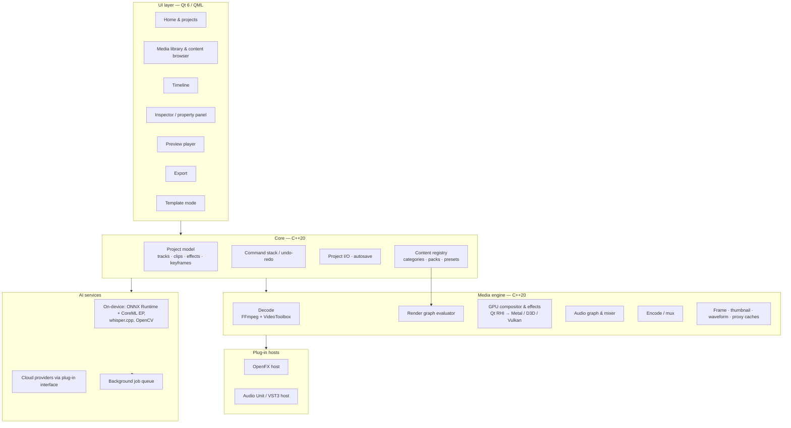

# TechieVideoEditor — Build Plan

**Product:** TechieVideoEditor (TVE), a desktop video editor for macOS (Apple Silicon; macOS only — decided at Phase 5 planning, November 2026: no Windows port)
**Goal:** feature parity with the editor surveyed in the REA static scan, built as an original implementation
**Status:** Phases 0 and 1 complete (Phase 1: timeline, audio, compositing, speed & thumbnails, transitions, titles, MP4 export, autosave & recovery, proxies, voice-over) — see §9.1; Phase 2 under way: keyframes (6a), curves & effect keyframes (6b) and speed ramping (6c), colour grading (7a), qualifiers & scopes (7b), looks (7c), masks & keying (8a), the effects library (8b), audio DSP (9a), the titles system (9b), transitions to 60 (10a), stickers (10b), structure (11a), delivery (11b) and hardening (11c) done — the Phase 2 slices are complete (the §7 P1 gaps are noted in §9.2); Phase 3: analysis (12a), speech to text (12b), caption styles with text editing (12c), audio AI (13a), people (13b), motion (13c) and advanced vision (14a) done — the Phase 3 slices are complete (stem separation waits for a model with a clear licence); Phase 4 under way: recording (15a), library and imports (15b) and the cloud foundation with words and voices (16a), generative media (16b), templates and montage (17a), auto-editing (17b), paths and overlays (18a) and content packs (18b) done — the Phase 4 slices are complete; Phase 5 under way (macOS only, personal use, own keys): audio plug-ins (19a), video plug-ins (19b), colour management with HDR (20a), 360° video (20b), interchange (21a), the AI copilot (21b), voice cloning with consent (22a), localization in Tamil (22b) and performance hardening (22c) done — the Phase 5 slices are complete — see §9.5; after them, closing the known gaps (§9.6): speed and transitions on compound clips (23a), transparent VP9 and HEVC video (23b) and MP3 export (23c) done — the known gaps are closed — see §9.3 and §9.4 — see §9.2
**Date:** 2026-11-10

---

## 1. Ground rules

TechieVideoEditor matches *features*, not *assets or code*. Feature ideas are fair game; the reference product's bundled material is not.

| Allowed | Not allowed |
|---|---|
| Implementing the same kinds of features (timeline, keyframes, chroma key, AI cutout…) | Copying any file from the reference `.app` bundle: effects, LUTs, `.conf` presets, shaders, sounds, fonts, templates, thumbnails, ML models |
| Our own UI design, names, icons and branding | Reference product names, logos, UI layouts traced 1:1, or its marketing wording |
| Open-source libraries and models whose licenses allow commercial use | GPL code linked into a closed-source app; models with non-commercial licenses |
| Hosting third-party OpenFX / Audio Unit / VST3 plug-ins that *users* install | Shipping the reference product's bundled Boris FX or NewBlue plug-ins |
| Importing open interchange formats (FCPXML, EDL, OpenTimelineIO) | Reading or writing the reference product's proprietary `.wfp` project format |

Every third-party dependency and model goes through a license check (§12) before it is merged.

---

## 2. What the REA scan established

Scan target: `Wondershare Filmora Mac.app` 16.0.12 (build 16.0.12.13437, arm64). Static only; the app was never launched.

| REA operation | Evidence ID | Finding |
|---|---|---|
| `inspect_desktop_application` | `ev_16c83faa6dec…` | 5,888 entries; **no Electron / app.asar, .NET, Unity or other managed runtime**. Native app. |
| `inspect_plist` | `ev_c9ecd7ecbfcd…` | Project files `.wfp`/`.wfpbundle`, templates `.wfpts`; ~60 importable media formats; camera, microphone, Photos and removable-volume permissions. |
| `inspect_macho` (main executable) | `ev_201f1a3c0d8a…` | Qt 5.15.2 + AppKit/AVFoundation/WebKit; 46 linked libraries, ~20 in-house UI modules. |

Supporting static reads of the bundle (catalog JSON, config folders, embedded source paths) gave the architecture and feature inventory below.

**Observed architecture (reference product):**

1. **UI modules** — separate libraries per area: timeline, property panel (inspector), media library, player, export, templates, home page.
2. **Engine services** — about 40 service libraries: player, decoder, encoder, effects, captions, proxy, thumbnails, frame interpolation, object removal, OpenFX host, audio processing.
3. **GPU effect managers** — Metal and OpenGL.
4. **On-device AI** — about 130 small model libraries on ONNX Runtime / MNN / TNN / CoreML / ggml, mapped to features by a `model_tree.json` file.
5. **Data-driven content** — effects, transitions, titles and presets are *data* (category tree JSON + effect description folders + preset `.conf` files), mostly downloaded from a CDN.

TechieVideoEditor keeps that **layered, data-driven shape** because it suits this kind of app, but every layer is our own implementation.

**Limits:** static evidence shows *which* features exist and how they are organized, not *how* each algorithm behaves internally (no decompiler was configured). Behavior specs in this plan are our own design.

---

## 3. Architecture



### 3.1 Key design decisions

1. **Our own engine, GPU-first.** The render graph evaluates the timeline at a time `t` into a DAG of nodes (source → effects → transform → composite → output). All pixel work runs as GPU shaders through Qt RHI (Metal on macOS). The CPU only decodes and orchestrates.
2. **Effects are data.** Each effect, transition, filter, title animation and sticker is a folder: `manifest.json` (id, category, parameters with types/ranges/defaults, keyframable flags) + shaders + optional assets. Adding content needs no code change. This is the same idea the reference product uses, with our own format.
3. **One parameter system.** Every adjustable value (transform, color, effect, audio, text) is a typed `Param` that can be static or keyframed (linear / hold / Bezier). The timeline keyframe panel, the inspector and the render graph all read the same model.
4. **Command pattern for everything.** Every edit is a reversible `Command`, which gives undo/redo, autosave journaling and scripted tests.
5. **AI behind interfaces.** `ISegmenter`, `ITranscriber`, `IAudioSeparator`, `IGenerator`… each has a local and/or cloud implementation, chosen at runtime. Long jobs run in a cancellable background queue with progress shown in the UI and results cached per media hash.
6. **Non-destructive and proxy-aware.** Source media is never modified. Heavy analysis results (transcripts, beats, masks, tracking data, proxies) are cached sidecars keyed by content hash.

---

## 4. Tech stack

| Area | Choice | Why |
|---|---|---|
| Language | C++20 (engine/core), QML + JavaScript (UI), Python only for tooling | Real-time media needs native code; QML makes a fluid, custom-styled UI |
| UI framework | **Qt 6.8 LTS** (Quick/QML, Qt RHI, Qt Multimedia for capture helpers) | Proven for NLEs, cross-platform, GPU-abstracted rendering. LGPL — link dynamically. |
| Build | CMake + vcpkg, Ninja; GitHub Actions CI (macOS arm64, Windows x64) | Reproducible native builds |
| Decode / encode | **FFmpeg 7.x (LGPL build, no `--enable-gpl`)** + VideoToolbox (macOS) / Media Foundation, NVENC/QSV (Windows) | Broad format coverage plus hardware acceleration. Use platform H.264/HEVC encoders to avoid x264/x265 (GPL). |
| ProRes | AVFoundation encoder on macOS; FFmpeg `prores_ks` for decode | Native, licensed through the OS |
| GPU | Qt RHI → Metal / D3D12 / Vulkan; shaders in Vulkan-style GLSL compiled by `qsb` | One shader source, every backend |
| Color | OpenColorIO 2 (BSD) for color management and LUT handling | Industry standard |
| Audio I/O & DSP | miniaudio (MIT/PD) for device I/O; our own DSP graph; r8brain (MIT) for resampling | Low latency, permissive licenses |
| Text rendering | HarfBuzz (MIT) + FreeType (FTL) + Skia (BSD) for vector text, shapes and paths | Complex scripts, outlines, glows, path text |
| Computer vision | OpenCV 4.x (Apache 2.0): stabilization, trackers, homography | Mature, permissive |
| ML runtime | ONNX Runtime (MIT) with CoreML / DirectML execution providers; whisper.cpp (MIT) | Hardware-accelerated local inference |
| Database | SQLite (public domain) for the media library index, content catalog and caches | Embedded, robust |
| Interchange | OpenTimelineIO (Apache 2.0): FCPXML / EDL / AAF import-export | Interop with other NLEs |
| Plug-ins | OpenFX host (BSD headers); Audio Unit v2/v3 (macOS); VST3 (check current Steinberg SDK license terms) | Users bring their own plug-ins |
| Crash reporting | Crashpad (BSD) + Sentry | Self-hostable |
| Updates | Sparkle 2 (MIT) on macOS; WinSparkle on Windows | Signed delta updates |
| LLM features | Provider interface; default Claude API (`claude-sonnet-5-5` for speed, `claude-opus-5-5` for quality) | Copywriting, translation, editing copilot |

---

## 5. Repository layout

```
TechieVideoEditor/
├── CMakeLists.txt
├── cmake/                 # toolchains, vcpkg triplets, signing
├── app/                   # main(), app bootstrap, menus, windows
├── ui/                    # QML modules
│   ├── home/  library/  timeline/  inspector/  player/  export/  templates/  common/
├── core/
│   ├── model/             # Project, Sequence, Track, Clip, Param, Keyframe
│   ├── commands/          # undo/redo commands
│   ├── io/                # .tve project format, autosave, OTIO bridge
│   └── content/           # content registry, categories, packs, favorites
├── engine/
│   ├── decode/  encode/  graph/  gpu/  audio/  cache/  proxy/  capture/
├── effects/               # built-in effect packages (manifest.json + shaders)
│   ├── video/  transitions/  filters/  overlays/  titles/  motion/  audio/
├── ai/
│   ├── runtime/           # ORT session mgmt, model download & verification
│   ├── local/             # segmentation, STT, denoise, tracking, beat…
│   └── cloud/             # provider adapters (gen-video, TTS, music, LLM)
├── plugins/               # OpenFX, AU, VST3 hosts
├── content-tools/         # CLI to author, validate and package content packs
├── tests/                 # unit, render-golden, audio-null, perf, UI
└── docs/
```

**Project file format:** `.tve` = a zip containing `project.json` (versioned schema), a thumbnail and an optional media manifest. `.tvebundle` = a folder variant that also holds copied media for "save with media". `.tvet` = template.

---

## 6. Core data model

```
Project
 ├── settings (resolution, frame rate, aspect ratio, color space, sample rate)
 ├── mediaPool: MediaItem[] (id, path, hash, probe info, proxy, analysis sidecars, labels)
 ├── sequences: Sequence[]  (main + compound clips)
 │    ├── tracks: Track[] (video | audio | title | subtitle | effect/adjustment)
 │    │     flags: locked, hidden, muted, solo, magnetic (main track), height
 │    │     clips: Clip[]
 │    │       ├── sourceRef (media | compound sequence | generator | title | sticker)
 │    │       ├── timelineIn/Out, sourceIn/Out, speedMap (constant | ramp curve), reverse
 │    │       ├── transform/crop/opacity/blend Params
 │    │       ├── effects: EffectInstance[] (ordered stack, each with Params + mask)
 │    │       ├── audio: gain, pan, fades, audioEffects[], ducking role
 │    │       ├── animation: in/out/loop presets
 │    │       └── links: groupId, linkedAudioId, multicamAngles
 │    ├── transitions: Transition[] (between adjacent clips, alignment, duration)
 │    └── markers: Marker[] (time, duration, color, note, chapter flag)
 └── history: command journal (for crash recovery)
```

`Param<T>` = { value, keyframes[] (time, value, interpolation, bezier handles), expression? }

---

## 7. Feature modules

Priority: **P0** = MVP, **P1** = core parity, **P2** = advanced parity, **P3** = optional/late.
Phase numbers refer to the roadmap in §9.

### 7.1 Timeline & editing

| Feature | Approach | Pri | Phase |
|---|---|---|---|
| Multi-track timeline (video, audio, title, adjustment tracks) | QML scene graph, virtualized clip rendering; track headers with lock/hide/mute/solo | P0 | 1 |
| Split, trim, ripple delete, roll and slip; delete gap | Edit commands on model; trim handles with live preview | P0 | 1 |
| Magnetic main track, track linking, snapping, snap lines | Snap service collects candidate edges (clips, playhead, markers, beats) | P0 | 1 |
| Zoomable ruler, playhead, virtual (hover) playhead, J/K/L shuttle | Time ↔ pixel mapper; hover scrub renders a low-res frame | P0 | 1 |
| Copy/paste clips and attributes, duplicate, replace clip | Clipboard of serialized clip subtrees | P0 | 1 |
| Markers with colors, notes and ranges; chapters | Marker model; chapters export to MP4 chapter atoms | P1 | 2 |
| Group / ungroup; compound clips (nested sequences) and saved compound presets | Compound = nested `Sequence` rendered as one source | P1 | 2 |
| Keyframes for any parameter, keyframe panel on timeline, Bezier curve editor | Shared `Param` keyframes; curve editor widget | P1 | 2 |
| Speed: constant, reverse, freeze frame | `speedMap` + frame-accurate source time mapping | P0 | 1 |
| Speed ramping with curve + presets (bullet time, flash in/out, hero moment, jumper, montage, custom) | Piecewise speed curve integrated to source time; audio pitch-preserving time-stretch | P1 | 2 |
| Optical-flow slow motion / AI frame interpolation | RIFE (MIT) via ONNX; cached result | P2 | 3 |
| Crop & zoom; pan & zoom presets (pan L/R, zoom in/out, to corner, original) | Keyframed crop rect | P0/P1 | 1/2 |
| Transform: position, scale, rotation, flip, opacity, blend modes | GPU transform + 25 blend modes in shader | P0 | 1 |
| Picture-in-picture & split-screen layouts (with split-screen animation) | Layout presets = data packages that set transform + mask per slot | P1 | 2 |
| Multi-camera clips with angle switching | Sync by timecode/audio waveform cross-correlation; angle viewer | P2 | 3 |
| Masks: rectangle, ellipse, line, double line, star, heart, text, custom pen; feather, invert, track | Vector masks rasterized on GPU; combine as an effect-chain mask | P1 | 2 |
| Track matte (alpha/luma) | Composite node using upper track as matte | P1 | 2 |
| Drop shadow, border, background fill (blur/color/image) | GPU effect packages | P1 | 2 |
| Motion blur | Accumulation or velocity-based shader | P2 | 3 |
| Brush paths: draw a path, trim-path animation, objects following a path, shape tools | Skia paths; path-follow binds transform to arc length | P2 | 4 |
| Stabilization | OpenCV video stabilization (feature tracking + smoothing), analysis cached | P1 | 3 |
| Motion tracking (attach title/sticker/mosaic to object) | OpenCV CSRT tracker → keyframed transform | P2 | 3 |
| Planar tracking | Feature matching + homography per frame → corner-pin | P2 | 3 |
| Camera tracking | Defer; consider open-source structure-from-motion libraries after license review | P3 | 5 |
| Silence detection & removal | RMS/VAD (Silero VAD, MIT) → proposed cut list user can review | P1 | 3 |
| Scene detection | Histogram/content-difference detector (own implementation) | P1 | 3 |
| Auto beat sync / beat markers | Onset + tempo tracking (own DSP or permissively licensed beat-tracking model) | P1 | 3 |
| Auto reframe (change aspect ratio, follow subject) | Saliency/face detection → smoothed crop path | P2 | 3 |
| Text-based editing (edit video by editing transcript) | whisper.cpp word timestamps → transcript editor that issues cut commands | P1 | 3 |
| Proxy media & render-preview cache | Background transcode to ProRes Proxy / H.264 low-res; auto-switch for playback | P1 | 2 |
| Lossless trim/export of untouched segments; standalone "instant cutter" for quick lossless cuts | Stream copy with FFmpeg when no re-encode is required | P2 | 5 |
| 360° / panorama clips (view angle, rectify) | Equirectangular reprojection shader | P3 | 5 |
| Undo/redo with history panel; autosave & crash recovery | Command journal | P0 | 1 |
| Keyboard shortcut editor | Action registry + user keymap JSON | P1 | 2 |

### 7.2 Media

| Feature | Approach | Pri | Phase |
|---|---|---|---|
| Import files/folders (drag-drop); ~60 formats: MP4, MOV, MKV, AVI, MXF, MTS/M2TS, WEBM, GIF, HEIC, WEBP, DNG, PNG, JPG, TIFF, WAV, MP3, AAC, FLAC, OGG, SRT, LRC… | FFmpeg probe + decode; HEIC via ImageIO (macOS) / libheif | P0 | 1 |
| Media library: icon/list views, folders/bins, search, sort, user labels, favorites, "used in project" | SQLite index; thumbnail & waveform caches | P0 | 1 |
| Thumbnails, filmstrips, audio waveforms | Background workers; mip-mapped strips | P0 | 1 |
| Import from Apple Photos and Music libraries | PhotoKit / iTunesLibrary frameworks | P2 | 4 |
| Import from devices (iPhone, cameras, SD cards) | ImageCaptureCore (macOS); MTP on Windows | P2 | 4 |
| Phone upload via QR code (local network) | Embedded HTTPS server + pairing QR; LAN only | P3 | 5 |
| Built-in sample colors and color mattes | Generator clips | P0 | 1 |
| Stock-media and content panels (music, video, stickers) | Content registry + optional provider APIs (license-cleared stock) | P2 | 4 |
| Media repair for damaged files (e.g. VOB) | FFmpeg remux with error concealment | P3 | 5 |
| Relink missing media | Hash + filename search | P1 | 2 |

### 7.3 Audio

| Feature | Approach | Pri | Phase |
|---|---|---|---|
| Clip gain, track volume, pan, volume keyframes (rubber-band on timeline) | Audio graph nodes; envelope drawn on clip | P0 | 1 |
| Fade in/out handles; audio crossfade transitions (constant gain, constant power, exponential, logarithmic) | Gain curves | P0 | 1 |
| Detach audio from video | Split linked clip into A/V pair | P0 | 1 |
| Mixer with meters (peak/RMS/LUFS) | Real-time metering | P1 | 2 |
| Equalizer (graphic + parametric presets) | Biquad filters | P1 | 2 |
| Dynamics: compressor, limiter, expander, noise gate | Own DSP | P1 | 2 |
| Pitch shift; voice changers (man, woman, child, chipmunk, robot, radio, phone, walkie-talkie, underwater, etc.) | Phase vocoder / formant shifting + filter chains, all defined as audio effect packages | P1 | 2 |
| Spatial/space reverbs (hall, church, cave, corridor, room sizes), echo, chorus, stereo widener (Haas), surround/rotating | Algorithmic reverb (Freeverb-style) + delays; presets as data | P1 | 2 |
| Restoration: denoise, de-hum, de-hiss, de-wind, de-click, de-reverb | DeepFilterNet (MIT/Apache) for speech; spectral gating; notch filters | P1 | 3 |
| AI speech enhancement | DeepFilterNet / own model | P1 | 3 |
| Auto ducking | Sidechain: detect speech on dialogue track, apply gain envelope to music track | P1 | 3 |
| Loudness normalization (EBU R128 / target LUFS) | Measure integrated loudness, apply gain | P1 | 2 |
| AI vocal remover / stem separation | Demucs (MIT) via ONNX | P2 | 3 |
| Audio sync (align external audio to camera audio) | Cross-correlation of waveforms | P2 | 3 |
| Beat detection & BPM estimation | See 7.1 | P1 | 3 |
| Voice-over recording to the timeline | miniaudio capture, punch-in at playhead | P0 | 1 |
| Text-to-speech | System voices (AVSpeechSynthesizer) offline + cloud TTS providers | P1 | 4 |
| AI voice cloning | Cloud provider only; **requires recorded consent statement from the voice owner** | P3 | 4 |
| AI music / AI sound effects generation | Cloud providers (license-cleared output) | P2 | 4 |
| Music library (categories: moods/genres, sound effects, my music) | Content packs of royalty-free tracks we license or commission | P1 | 4 |
| Audio Unit / VST3 plug-ins | Plug-in host with sandboxed scanning | P2 | 5 |

### 7.4 Color

| Feature | Approach | Pri | Phase |
|---|---|---|---|
| Basic: exposure, brightness, contrast, highlights, shadows, whites, blacks, saturation, vibrance, temperature, tint | One GPU color node | P0 | 1 |
| Vignette, sharpen, grain | Shader effects | P1 | 2 |
| RGB/luma curves; hue-vs-sat / hue-vs-hue / luma-vs-sat curves | 1D LUT textures generated from curves | P1 | 2 |
| Color wheels (lift/gamma/gain/offset) and HDR wheels | Shader math in scene-linear space | P1 | 2 |
| HSL qualifier (8-hue ranges) | Shader | P1 | 2 |
| 3D LUT import (.cube, .3dl) and preset browser | OpenColorIO / 3D texture lookup | P0 | 2 |
| Color presets (save/load), copy grade between clips | Preset = serialized param set | P1 | 2 |
| Auto enhance / auto white balance | Histogram analysis → initial params | P1 | 3 |
| AI color match / palette transfer from reference image | Statistical color transfer (LAB mean/std) + optional model | P2 | 3 |
| Scopes: waveform, vectorscope, histogram, RGB parade | GPU compute on preview frame | P2 | 2 |
| Color management (Rec.709, Rec.2020, HLG/PQ, Log input transforms) | OCIO config; per-clip input color space | P2 | 5 |
| Adjustment layers | Adjustment track clip applies its effects to the composite below | P1 | 2 |

### 7.5 Effects (video)

Target: **60 built-in effects at Phase 2, 150+ by Phase 5**, all original shaders and content.

| Group | Examples to author | Pri |
|---|---|---|
| Blur & focus | Gaussian, directional, radial/zoom, tilt-shift, blur bars, background blur | P0–P1 |
| Stylize | Sketch, charcoal, cartoon, comic, emboss, ASCII, mosaic, pixelate, halftone, oil | P1 |
| Distortion | Ripple, wave, whirl, fisheye, bulge, kaleidoscope, mirror, tunnel | P1 |
| Glitch & retro | RGB split / chromatic aberration, VHS, scanlines, TV static, digital glitch, jitter | P1 |
| Light | Glow, bloom, light leaks, lens flare (procedural), light rays | P1 |
| Film | Film grain, damaged film, old film, sepia, black & white variants | P1 |
| Utility | Crop, flip, rotate, letterbox (21:9 cinema bars), background fill, tile/video wall | P0 |
| Keying | Chroma key (with spill suppression, edge feather, matte view), luma key | P0 (P1 for advanced controls) |
| Face & body (AI) | Face mosaic/blur with tracking, beauty smoothing, body segmentation effects | P2 |
| Particles & generators | Snow, rain, bubbles, confetti, plexus particles | P2 |

**Effect package format** (`effects/video/<id>/manifest.json`):

```json
{
  "id": "tve.blur.gaussian",
  "version": 1,
  "kind": "video-effect",
  "category": ["blur"],
  "title": { "en": "Gaussian Blur" },
  "params": [
    { "id": "radius", "type": "float", "title": { "en": "Radius" }, "min": 0, "max": 100, "default": 12, "keyframable": true }
  ],
  "passes": [
    { "fragment": "blur_h.frag" },
    { "fragment": "blur_v.frag" }
  ],
  "license": "TVE-Original"
}
```

Parameters reach shaders by name: each param id is a member of the pass's `EffectParams` uniform block, and the loader matches them through shader reflection (implemented in Phase 0 — see `effects/README.md` for the full shader contract and `core/content/EffectManifest.cpp` for validation). Thumbnails and previews are added with the content pipeline (§8).

AI-backed effects declare `"requires": ["model:portrait-seg@1"]`; the AI runtime downloads and verifies models on first use, mirroring the module → model mapping the reference product keeps in `model_tree.json`.

### 7.6 AI tools (non-generative, on-device)

| Feature | Candidate model / method (verify license) | Pri | Phase |
|---|---|---|---|
| Speech-to-text, auto subtitles, word timing | whisper.cpp (MIT), Whisper models (MIT) | P1 | 3 |
| AI portrait cutout (background removal) | Apple Vision person segmentation (macOS); MediaPipe selfie segmentation (Apache 2.0) for other platforms | P1 | 3 |
| Smart cutout (click to select any object, propagate) | SAM 2 (Apache 2.0) + mask propagation | P2 | 3 |
| Object remover (inpainting) | LaMa (Apache 2.0) per frame + temporal smoothing | P2 | 3 |
| Video denoise | Temporal bilateral / lightweight CNN | P2 | 3 |
| AI video enhancer / upscale | Real-ESRGAN (BSD-3) | P2 | 3 |
| Face detection, landmarks, face mosaic, eye-contact correction | Apple Vision faces (macOS); MediaPipe Face Mesh (Apache 2.0) for other platforms | P2 | 3 |
| Auto reframe | Face/saliency detection + crop smoothing | P2 | 3 |
| Smart scene cut, highlight detection, long-to-short | Scene detection + audio energy + transcript ranking (LLM optional) | P2 | 4 |
| Media search (find shots by text/image/face) | CLIP-style embeddings (license-checked) + SQLite vector index | P3 | 5 |
| AI relighting | Depth/normal estimation + shading shader | P3 | 5 |
| Flicker removal | Temporal luminance smoothing | P2 | 3 |

### 7.7 Generative AI & assistants (cloud)

All behind `ai/cloud` provider adapters, opt-in, with usage credits and clear disclosure that media is uploaded.

| Feature | Notes | Pri | Phase |
|---|---|---|---|
| AI copywriting (titles, descriptions, scripts) | LLM provider (Claude API) | P2 | 4 |
| AI translation of subtitles | LLM provider; keeps timing | P2 | 4 |
| AI copilot (natural-language editing commands → TVE commands) | LLM with tool calls mapped to our command API | P3 | 5 |
| Text-to-video, image-to-video, start/end-frame-to-video, video extend | Third-party video-generation APIs; results imported as media | P3 | 4 |
| Text-to-image, image-to-image, AI stickers | Image-generation APIs; sticker = cutout image with alpha | P3 | 4 |
| Audio-to-video, animated charts | Template-driven generators fed by audio/beat analysis or CSV data | P3 | 5 |

### 7.8 Titles & text

| Feature | Approach | Pri | Phase |
|---|---|---|---|
| Text clip: font, size, color, alignment, line/letter spacing, bold/italic | HarfBuzz + Skia text layout; rendered to GPU texture | P0 | 1 |
| Outline, shadow, glow, background box, gradient/texture fill | Multi-pass Skia rendering | P1 | 2 |
| Text shapes/bubbles (rounded rect, bubble, arrow, triangle, square, line…) | Shape library as data | P1 | 2 |
| 3D/perspective text adjustments | Transform with perspective matrix | P2 | 3 |
| Title templates: openers, titles, lower thirds, subtitles, end credits, callouts, labels/badges, themed packs | **Title package** = layout JSON (layers, text slots, shapes, images) + animation timeline | P1 | 2 |
| Text animation presets: in / out / loop (fade, slide, zoom, spin, flip, bounce, typewriter, wavy, blur-in, per-character / per-word) | Animator evaluates per glyph with stagger and easing | P1 | 2 |
| Text-on-path animation | Skia path + glyph placement | P2 | 4 |
| Subtitles: SRT/LRC import-export, subtitle track, batch styling, advanced subtitle editor | Subtitle track type; list editor | P1 | 3 |
| Dynamic/AI captions (word highlight, keyword emphasis, pop/bounce/glow styles) | Word timings from STT drive per-word style changes | P1 | 3 |
| Rolling credits | Scroll animator | P1 | 2 |

Content targets: **40 title templates and 30 text animations by Phase 2; 200+ titles by Phase 5** (original designs).

### 7.9 Transitions

| Feature | Approach | Pri | Phase |
|---|---|---|---|
| Transition engine: duration, alignment (center/start/end), handles check | Transition node blends two inputs with `progress` uniform | P0 | 1 |
| Core set (20+): dissolve, dip to black/white, push, slide, wipe (linear/radial/clock), zoom, cross zoom, spin, pixelate, blur, door, iris, page curl, morph | Shader packages | P0–P1 | 1–2 |
| 3D: cube, flip, sphere/fisheye | Shaders with 3D projection | P1 | 2 |
| Warp & speed blur (directional blur, zoom-through) | Shaders | P1 | 2 |
| Mask/shape/luma-wipe transitions (any grayscale image as a wipe) | Luma-matte shader + bundled matte images | P1 | 2 |
| Overlay transitions (light leaks, film burns, paint strokes) | Video-with-alpha overlays + blend | P2 | 4 |
| Apply to all / random transitions | Batch command | P1 | 2 |

Content targets: **20 at MVP, 60 by Phase 2, 200+ by Phase 5.**

### 7.10 Filters, overlays & LUTs

| Feature | Approach | Pri | Phase |
|---|---|---|---|
| Filters (one-click looks): cinematic, vintage/faux film, lomo, B&W, sepia, night, instagram-style, seasonal | Each filter = color params + optional LUT + grain/vignette | P1 | 2 |
| Overlays: frames, light leaks, bokeh, lens flares, old/damaged film, TV static, viewfinder, grunge, sci-fi HUD | Video/image overlays with blend modes | P1 | 2 |
| LUT library (cinematic, color correction, blockbuster-style) | Our own `.cube` LUTs | P1 | 2 |
| Filter intensity slider | Mix original/filtered | P0 | 2 |
| Filters as adjustment-track clips | Adjustment track | P1 | 2 |

Content targets: **50 filters + 30 overlays + 20 LUTs by Phase 2.**

### 7.11 Stickers & elements

| Feature | Approach | Pri | Phase |
|---|---|---|---|
| Animated stickers (shapes, hand-drawn, emoji, badges, arrows, nature, pets, tutorial, web, VFX) | Lottie (via ThorVG, MIT) + alpha video (HEVC with alpha / ProRes 4444 / WebM VP9 alpha) | P1 | 2 |
| AR stickers attached to faces | Face landmarks → sticker transform per frame | P2 | 3 |
| Sticker motion tracking | Uses 7.1 tracker | P2 | 3 |
| AI sticker generation | 7.7 | P3 | 4 |
| Cursor effects for screen recordings (click rings, click sound, highlight, magnify, spotlight) | Recorder logs cursor events → effect keyframes | P2 | 4 |

Content target: **100 stickers by Phase 2, 300+ by Phase 5.**

### 7.12 Templates & quick creation

| Feature | Approach | Pri | Phase |
|---|---|---|---|
| Template mode: storyboard with replaceable media slots, editable text, music trim | Template = `.tvet` project with slot metadata; storyboard UI swaps sources | P1 | 4 |
| Templates browser (categories, previews, favorites) | Content registry | P1 | 4 |
| Instant mode: pick media + style → auto-edited video | Rules engine: beat sync + scene scoring + transitions/filters from style | P2 | 4 |
| Montage layouts in 6 aspect ratios (16:9, 9:16, 1:1, 4:3, 3:4, 21:9) | Layout presets | P1 | 4 |
| Smart short clips (long video → vertical shorts) | Highlights + auto reframe + captions | P2 | 4 |
| Auto highlight montage | Scene + audio energy scoring | P2 | 4 |
| Save own project as template | Mark slots in existing project | P2 | 4 |
| Project templates & seeds (project presets: resolution, fps) | Project settings presets | P0 | 1 |

### 7.13 Recording

| Feature | Approach | Pri | Phase |
|---|---|---|---|
| Screen recording (full/window/region) with system audio | ScreenCaptureKit (macOS 13+), Windows Graphics Capture | P1 | 4 |
| Webcam recording | AVFoundation / Media Foundation | P1 | 4 |
| Voice-over | 7.3 | P0 | 1 |
| Picture-in-picture webcam over screen | Two synced recordings placed on two tracks | P2 | 4 |

### 7.14 Export & sharing

| Feature | Approach | Pri | Phase |
|---|---|---|---|
| Local export: MP4 (H.264, HEVC), MOV (ProRes Proxy/LT/422/4444), GIF, audio-only (MP3, AAC, WAV, FLAC) | Encoder abstraction over VideoToolbox / FFmpeg | P0 (MP4) / P1 (others) | 1–2 |
| Presets & advanced settings (resolution, fps, bitrate CBR/VBR, quality, 10-bit, color space) | Rule-checked encoder parameter tables (our own), validated per format | P1 | 2 |
| Export range / selected clips / per-marker batch export | Batch render queue | P1 | 2 |
| Device and platform presets (YouTube, TikTok, Instagram, Vimeo) | Preset JSON | P1 | 2 |
| Direct upload to social platforms | OAuth integrations (user-authorized) | P3 | 5 |
| Chapters and subtitles embedded or sidecar | MP4 chapter atoms; SRT/VTT sidecar; burned-in option | P1 | 3 |
| Background render queue with progress, pause, cancel | Job queue | P1 | 2 |
| Export with transparent background (ProRes 4444 / HEVC alpha) | Alpha pipeline | P2 | 3 |
| DVD/ISO authoring | Low value today — **deferred** | P3 | — |
| Interchange export (FCPXML, EDL, OTIO) | OpenTimelineIO | P2 | 5 |

### 7.15 App shell & services

| Feature | Pri | Phase |
|---|---|---|
| Home screen: new project (aspect ratio/fps), recent projects with covers, open/import | P0 | 1 |
| Workspace layouts (resizable/dockable panels), dark/light themes | P1 | 2 |
| Preferences (performance, GPU, cache location, autosave interval, proxy rules) | P0 | 1 |
| Localization (start with en; 20+ languages later) | P1 | 5 |
| Accounts, licensing/activation, credits for cloud AI | P2 | 4 |
| Cloud project backup/sync | P3 | 5 |
| Content store/CDN for downloadable packs | P2 | 4 |
| In-app onboarding/feature guides | P2 | 5 |
| Crash reporting, telemetry (opt-in), auto-update | P1 | 2 |
| Hardware controller support (e.g. jog dials) | P3 | 5 |

---

## 8. Content pipeline

The reference product shows hundreds of categories of effects, titles, transitions and stickers. Matching that is a **content production** effort as much as an engineering one.

1. **Authoring tools** — `content-tools/` CLI validates manifests, compiles shaders with `qsb`, renders thumbnails/previews, and packs `.tvepack` archives (signed).
2. **Category tree** — `categories.json` (id, parent, localized titles, order), same idea as the reference product's category tree, with our own taxonomy.
3. **Built-in vs downloadable** — ship a core set in the app; deliver themed packs from a CDN with a signed index, versioning and delta updates.
4. **Team** — 2 motion designers + 1 technical artist from Phase 2 onward produce titles, transitions, stickers, overlays, LUTs and templates.
5. **Licensing** — every asset records its author and license in its manifest; CI rejects packs without it.

---

## 9. Roadmap

Assumed team: 8 engineers (3 engine, 2 UI, 2 AI/audio, 1 platform/infra), 1 product designer, 2 motion designers, 1 QA. Estimates are planning ranges, not commitments.

| Phase | Months | Scope | Exit criteria |
|---|---|---|---|
| **0. Foundations** | 0–1 | Repo, CMake/vcpkg, CI on macOS arm64; Qt app shell; LGPL FFmpeg build; decode→GPU→display spike; project model + command stack | 4K H.264 file plays at full rate in a QML window on an M1; unit tests green in CI |
| **1. MVP editor** | 1–4 | Import & media library; multi-track timeline (split/trim/ripple/snap/magnet); preview player; transform/crop/opacity/blend; constant speed/reverse/freeze; basic color; 20 transitions; basic text; volume/fades/voice-over; MP4 export; autosave & undo | Edit and export a 10-minute 1080p project with 3 video + 2 audio tracks; no data loss in crash-recovery tests |
| **2. Core parity** | 4–8 | Keyframes + curves; full color (curves, wheels, HSL, LUT, scopes); effect framework + 60 effects; filters/overlays/LUTs; masks, track matte, chroma key; audio DSP suite + loudness; titles system + animations; 60 transitions; stickers (Lottie/alpha video); compound clips, groups, markers; speed ramping; proxies; export formats & presets; adjustment layers | Feature checklist §7 P0+P1 (non-AI) complete; golden-frame suite ≥ 500 cases |
| **3. On-device AI** | 8–12 | STT subtitles & dynamic captions; text-based editing; silence/scene/beat detection; auto ducking; audio restoration & speech enhance; stem separation; stabilization; motion/planar tracking; portrait & smart cutout; object remover; denoise/upscale/frame interpolation; auto reframe; face mosaic; multicam | Each AI feature has accuracy/latency benchmarks on a fixed test set; all models pass license review |
| **4. Templates, recording, cloud AI** | 12–15 | Template mode, instant mode, montage, smart shorts; screen/webcam recording + cursor effects; TTS; generative AI adapters; music/SFX library; content store/CDN; accounts | Users can create a templated video in < 2 minutes; recorder works on macOS 13+ |
| **5. Advanced & polish** | 15–20 | OpenFX/AU/VST3 hosts; brush/path animation (done in 18a); 360°; color management/HDR; interchange (OTIO/FCPXML); AI copilot; voice cloning with consent; localization; performance hardening — macOS only (no Windows port), for personal use with the person's own keys (no backend) | Perf budgets (§10) met on this Mac; every plug-in, model and provider licence reviewed |

**Calendar estimate:** about 18–20 months to broad parity with this team; MVP in about 4 months.

### 9.1 Phase 1 slices

Phase 1 is delivered in five vertical slices, each usable on its own:

| Slice | Scope | Status |
|---|---|---|
| 1. Project-backed timeline | Media import/probe, media bin, timeline bound to the model, move/trim/split/ripple delete with snapping, undo/redo, timeline playback with play/pause/scrub/frame step, frame-accurate seek, save/open `.tve` | **Done** |
| 2. Audio | Audio decode, mixer, clip volume/fades, waveforms, A/V sync, detach audio, track mute/hide/lock, level meter | **Done** (voice-over moved to slice 5) |
| 3a. Compositing | Multi-layer compositor on the project canvas: transform, crop, opacity, blend modes; per-clip effects (Color Adjust as basic colour); live preview; canvas from first clip | **Done** |
| 3b. Speed & thumbnails | Constant speed, reverse, freeze frame (video and audio), timeline and media-bin thumbnails | **Done** (4K60 reverse at 60 fps; 4K60 2× reverse is at the hardware decoder's ceiling until proxies) |
| 4a. Transitions | Transition engine (handles, alignment, held edge frames, constant-power sound crossfade), 21 original transitions as shader packages, library with GPU previews, timeline markers, inspector | **Done** |
| 4b. Titles | Text clips on video or title tracks: font, size, colour, bold/italic, alignment, letter/line spacing, outline, shadow, position; 8 original title styles with previews; inspector Text section | **Done** (Qt text layout rather than Skia; outline and shadow pulled forward from Phase 2) |
| 5a. Export | MP4 export (H.264/HEVC via VideoToolbox, AAC), sizes, quality, progress and cancel, shared renderer with the preview, `--export` CLI | **Done** |
| 5b. Autosave & recovery | Autosave of unsaved work (debounced, per document session), recovery from crashes, quits and project switches on Home, atomic project saves | **Done** (snapshot autosave; the command journal stays a later option) |
| 5c. Proxies | 720p short-GOP proxies made in the background (automatic above 1080p, or on request), cached by source identity, used by the preview only; media-bin state and actions, player toggle | **Done** |
| 5d. Voice-over | Microphone recording at the playhead with the timeline playing (count-in, optional mute, input picker and level), take placed on a free audio track or a new Voice-over track in one undo step, crash-safe WAV takes, macOS microphone permission | **Done** |
| 5e. Still images | Import of PNG, JPEG, HEIC/HEIF, WebP, TIFF, BMP and one-frame GIFs (EXIF orientation applied; animated GIFs play as video): 5-second clips of any length with no speed, thumbnails, the full picture pipeline (transform, colour, looks, effects, keyframes, transitions) and export | **Done** (added after Phase 1 closed: the P0 import row covered images, the slices had missed them) |

### 9.2 Phase 2 slices

Phase 2 is split the same way. Keyframes come first because animation, masks, title
animations and speed ramps all build on them. Proxies, listed in Phase 2 above, were
pulled forward into Phase 1 (5c).

| Slice | Scope | Status |
|---|---|---|
| 6a. Keyframes | Keyframes on clip placement (position, scale, rotation), opacity, crop and volume; linear, ease in/out and hold; inspector keyframe toggles, add/remove, step between, easing, clear; auto-key while animated; timeline keyframe marks (click to go, drag to move); keyframes follow trims, splits, speed changes and freeze frames; preview, export and mix evaluate them | **Done** (effect parameters followed in 6b) |
| 6b. Curves & effect keyframes | Custom cubic-Bezier timing curve per keyframe with an inspector curve editor (drag the handles; overshoot, anticipate and snap presets; values clamped to their range), keyframes on effects' keyframable parameters (stored with the effect, so they follow reordering and removal), one keyframe model for clip properties and effect parameters | **Done** |
| 6c. Speed ramping | Speed ramps: points along the clip with linear speed between them, same footage so the length follows the average; 8 original presets (ramp up/down, flash in/out, bullet time, hero moment, montage, jumper); ramp graph editor (drag, add, remove points); exact splits; reverse keeps the ramp; video, sound (pitch follows speed), thumbnails and waveforms follow the ramp | **Done** (pitch-preserving time-stretch moved to 9a with the other pitch/time DSP) |
| 7a. Color | Per-clip grade on the GPU before the effects: exposure, contrast, saturation, temperature, tint; lift/gamma/gain/offset wheels; master and R/G/B tone curves (monotone cubic); `.cube`/`.3dl` 3D LUT import with intensity; copy/paste grade; saved colour presets | **Done** (HSL qualifier and hue curves moved to 7b with the scopes) |
| 7b. Qualifiers & scopes | HSL adjustments in 8 hue bands (blended between neighbours, greys untouched), hue-vs-sat / hue-vs-hue / luma-vs-sat curves, all in the grade pass; waveform, RGB parade, vectorscope (75 % targets, skin-tone line) and histogram of the preview, from a 256-pixel copy read back from the GPU only while shown | **Done** (scopes measure the preview, not the full-resolution export) |
| 7c. Looks | 12 original looks (10 generated 3D LUTs plus 2 grades, `tools/make_looks.py`) in a Filters tab with CPU-rendered previews, applied before the clip's grade at an intensity; the LUTs as a built-in library in the Color tab; 6 procedural overlays as effect packages (light leak, film grain, dust & scratches, VHS, viewfinder, bokeh); adjustment layers that grade and filter everything below them, blended by opacity | **Done** (overlays are procedural effects rather than stock footage) |
| 8a. Masks & keying | Rectangle, ellipse, line, star, heart and pen masks (up to 8 per clip, 32 pen points; position, size, rotation, roundness, feather, invert) as signed distances in one GPU pass with the chroma key (CbCr distance, tolerance, softness, spill suppression), in the clip's own picture after its grade; on-player mask handles and a key colour picker; track mattes (alpha, luma and inverted, from the clip on the track above); 6 PiP and split-screen layouts applied as one undo step | **Done** (masks are not keyframed yet: their sliders set the whole clip) |
| 8b. Effects library | 61 original effect packages in 8 categories (blur & sharpen, colour, stylize, distort, glitch, light, frame, overlay): drop shadow, outline, outer glow, background fill, rounded corners, sharpen, smoothing, warps, glitches, light and more; framework additions: `tve_input` (any pass reads the effect's input), canvas-space effects that run after placement with `tve_bounds`, a three-texture pass pool; library category chips, search and GPU-rendered previews | **Done** (grain is the 7c Film Grain overlay) |
| 9a. Audio DSP | 40 original audio effect packages (data in `effects/audio`, embedded at build time) chaining 13 built-in processors: 10-band EQ with 24 dB/octave cuts, compressor, look-ahead limiter, gate/expander, algorithmic reverb (8 rooms), delay/ping-pong, chorus/flanger, widener, auto-pan, granular pitch shifter, distortion, ring modulator, noise; voice changers (deeper, higher, child, chipmunk, monster, robot, radio, telephone, walkie-talkie, underwater, megaphone); effect tails past the clip; pitch-preserving time-stretch (WSOLA) for speed changes and ramps; BS.1770 loudness metering, clip normalization and export normalization with a limiter; mixer with track volume, balance, mute, solo, peak/RMS meters and master LUFS | **Done** (formant-preserving voices and audio-effect keyframes later) |
| 9b. Titles system | 33 text animations (14 in/out presets — fade, rise, drop, slide left/right, zoom, pop, spin, flip, bounce, typewriter, focus, wipe, tracking — played forwards in and backwards out, and 5 loops: wave, pulse, flicker, shake, swing) on the whole text, lines, words or characters with stagger, evaluated per glyph; 10 shapes and bubbles behind the text (box, rounded, pill, speech and thought bubbles, banner, underline, circle, arrow, tag); rolling credits and crawling tickers; 40 original title templates in 5 categories with animated previews | **Done** (gradient fills, text on a path and shape-only elements later) |
| 10a. Transitions to 60 | 39 new original transition packages (60 in all): 3D (cube, card flip, page turn, fold, swing in, fall, tumble, doorway, fly through, carousel), distortions (swirl, water drop, morph, dreamy, pinch, stretch, kaleidoscope, glitch, chromatic, whip pan), ten procedural luma wipes, growing shapes (heart, star, diamond, inset, corner, zigzag, polka dots, tiles) and film burn; library category chips; apply one to every cut, or a random one to each, as one undo step | **Done** (luma wipes from user images later) |
| 10b. Stickers | Lottie stickers drawn by ThorVG (MIT; Skottie would need all of Skia) into textures per frame, looping for the clip's length; 100 original stickers (25 designs × 4 looping motions, `tools/make_stickers.py`) in a Stickers tab with categories, search and animated previews; Lottie import; video with alpha (ProRes 4444, GIF, APNG, WebP) decoded in software to BGRA and composited with its transparency | **Done** (WebM VP9 alpha needs libvpx; HEVC with alpha later) |
| 11a. Structure | Markers (colour, note, range, chapter; ruler flags, snapping, M and ⌥←/⌥→) with chapter markers written into exported MP4s; multi-select, groups that select, move and delete together; compound clips holding a sequence of tracks, rendered on a canvas of their own (nested up to 8 deep) and mixed from their sequence's tracks, with break apart | **Done** (speed and transitions on compound clips followed in 23a) |
| 11b. Delivery | Formats: MP4/MOV with H.264 or HEVC, MOV with ProRes Proxy/LT/422/HQ/4444 (VideoToolbox, `prores_ks` fallback), animated GIF (per-frame median-cut palette, ordered dither), sound-only M4A, WAV 16/24-bit and FLAC; 11 presets in `export_presets.json` (web 1080p/4K, small, vertical, square, ProRes master and proxy, GIF, AAC, WAV, FLAC); frame rate, sound on/off, fill-and-crop for other shapes; ranges (selection, marker, custom) and a file per marker range; a render queue running jobs one after another from snapshots, with pause, resume, cancel, remove; chapters cut to the range; ProRes 4:2:2/4:4:4 decode in preview and thumbnails | **Done** (MP3 needs LAME, not in the LGPL build; transparent-background export later) |
| 11c. Hardening | Relink missing media: content fingerprints at import, a missing-media bar and dialog, folder search by name then fingerprint (renamed copies), Locate with a confirmation for different content, one undo step; a shortcut editor over an action registry (19 actions) with a user keymap JSON, recording, conflicts, reset, live tooltips; the golden-frame suite: 531 cases rendered by `StillRenderer` and compared with reference PNGs per GPU backend (`tests/golden/metal`) | **Done** |

Known gaps against the §7 P0+P1 (non-AI) checklist before Phase 3: MP3 export (needs LAME),
transparent-background export, speed and transitions on compound clips, WebM VP9 alpha and
HEVC-with-alpha decode. (All since closed: transparent-background export with ProRes 4444, speed and
transitions on compound clips in 23a, VP9 and HEVC alpha decode in 23b, and MP3 export in 23c, §9.6.)

### 9.3 Phase 3 slices

On-device analysis first (no models: own DSP and image statistics), then the model-backed
features, each with the model runtime, a license-reviewed model and a fixed benchmark set.
Analysis runs as cancellable background jobs; results are cached per media fingerprint.

| Slice | Scope | Status |
|---|---|---|
| 12a. Analysis | Silence detection with a reviewable cut list and ripple removal; scene detection (colour-histogram differences) to split or mark; beat and tempo detection (onset strength, tempo by autocorrelation, beat tracking by dynamic programming) to beat markers; auto ducking of music under speech as volume keyframes; a background analysis queue with progress and a fingerprint-keyed cache | **Done** (energy-based pauses and speech; Silero VAD can replace them in 13a) |
| 12b. Speech to text | whisper.cpp 1.8.6 + ggml 0.26 (MIT, Metal) via vcpkg; five Whisper models (Base, Small, Large v3 Turbo; English-only and multilingual) downloaded on first use with size and SHA-256 checks (`SpeechModels`); transcription in the background with cancel, word times from DTW alignment heads refined against the sound's loudness, transcripts cached per media fingerprint, model and language; captions laid out (42 × 2, pauses, sentence ends) as title clips on a Captions track keeping word timing; SRT/WebVTT import and export | **Done** (on the spoken test sample: every word right, word edges within 0.1 s of the pause) |
| 12c. Captions & text editing | Caption motions drawn per word from the words' timing (Highlight, Pop, Karaoke, Word by word) with a highlight colour, kept when captions are made again; a Transcript tab (paragraphs at pauses, click / shift-click / ⌘-click, ⌫) whose deletions cut the words' time from their tracks and remake the captions in one undo step; verbatim transcription (an initial prompt keeps fillers) with filler removal and pause shortening; five golden-frame caption cases | **Done** |
| 13a. Audio AI | ONNX Runtime 1.31 (CPU; the vcpkg port has no Core ML feature, and DeepFilterNet3 runs many times faster than real time without it); speech enhancement with DeepFilterNet3 (downloaded on first use, 8 MB, SHA-256 pinned): an offline Enhance speech action that cleans the clip's whole file into a WAV of the same timing which the clip then plays (any speed, player and export), a strength (attenuation limit) that only re-mixes, Original sound, undoable; live noise reduction with RNNoise 0.2 as a `denoise` processor (30 ms latency, per-channel, voice-activity gating between words) and five Clean-up presets (Noise Reduction, Light Noise Reduction, Quiet Between Words, Voice Cleanup, Podcast Voice) | **Done** (stem separation deferred: the Demucs and Spleeter weights have no clear licence for use in an app — revisit when a model with a permissive weight licence is found; Silero VAD not adopted, RNNoise's voice probability covers the gating) |
| 13b. People | With Apple's Vision framework instead of MediaPipe (built into macOS: no downloads, no model licences, runs on decoded frames; a Windows build needs another backend behind the same calls): portrait cutout per clip (person segmentation on every frame as it is drawn; edge softness and shift, invert) as a GPU pass on the decoded picture; face detection through the whole file (every frame, ≤ 30 a second) linked into numbered face tracks (overlap, then distance; gaps bridged; flukes dropped; samples thinned), cached per file; faces chosen and covered by mosaic, blur or fill (a GPU pass), the tracks kept in the project so a cleared cache never uncovers a face; auto reframe to 9:16, 1:1, 4:5 or 16:9 following faces or attention saliency (10 a second, Gaussian-smoothed) as fill scale and position keyframes, canvas and clip in one undo step | **Done** (people in stills and compound clips later; golden-frame cases wait for video in the golden suite) |
| 13c. Motion | Camera motion measured by our own block matching (coarse-to-fine grid, sub-pixel, a robust similarity fit — Vision's registration gave whole pixels and failed on parts of the frame) with brightness, in one pass cached per file; stabilization: the path smoothed (or locked like a tripod) and the least zoom that hides the edges, corrections kept in the project and applied by a GPU warp; flicker removal: brightness gains from a time-smoothed level; temporal denoise: a motion-adaptive recursive GPU filter with per-clip history (only a frame's own predecessor counts); object and flat-surface tracking with Vision from a box drawn on the player (thinned, in the project), and titles, stickers or clips following a track as position, scale and turn keyframes from where they are | **Done** (tracking runs forwards from the playhead; stabilization and tracking on clips at a steady speed) |
| 14a. Advanced vision (P2) | Apple frameworks and our own code instead of SAM 2, LaMa, Real-ESRGAN and RIFE (no third-party models; LaMa's weights were trained on research-only data): multicam sync by sound (onset-strength cross-correlation with a sub-step peak, ±30 s, a confidence that rejects edge peaks), moving the clips as one step; smart cutout — a box drawn on the player followed with Vision's object tracking, and per frame the Vision foreground instances under it as the matte (the cutout's GPU pass); processed copies of a clip's span, high-bitrate HEVC kept beside the app's data, which the clip then plays (playback reads them within their span, chained one on another): upscale 2×/4× with VideoToolbox super-resolution (Apple's model, which macOS downloads on request; pictures up to 1080p), smooth slow motion with VideoToolbox frame-rate conversion (2–8 frames for every one), and object removal of our own (the box followed through the clip; each hidden pixel the median of up to seven other frames' views once the camera's motion is allowed for, the rest filled from around it, edges feathered) | **Done** (smart cutout and removal follow from the playhead forwards; upscaling is slow, about 1.7 s a frame on this Mac) |


### 9.4 Phase 4 slices

Decided at planning: cloud AI is **bring your own key** — users enter their own provider API
keys in Preferences, kept in the macOS Keychain, and the app calls providers directly through
one adapter interface (no server of ours; accounts and credits wait for a backend, Phase 5);
the music and sound-effects library ships **our own generated packs** (synthesised with our
DSP, like the stickers and effects) plus the user's own music; text-to-speech has **system
voices and one cloud provider**. Every cloud provider is chosen at its slice's start with its
terms reviewed (commercial use, output rights, data retention), and every cloud feature is
tested against a local mock provider — no real keys in tests. Voice cloning (P3) is left to
Phase 5, where its recorded-consent requirement can be designed properly.

| Slice | Scope | Status |
|---|---|---|
| 15a. Recording | Screen recording with ScreenCaptureKit (a display, a window, or part of a display; system sound), webcam recording (AVFoundation) and the microphone, written as steady-frame-rate H.264 MOVs (a writer thread taking the latest picture each period, silence padding the system sound) and placed together at the playhead on new tracks — the camera small in the corner over the screen (picture in picture) — as one undo step; the cursor polled 60 times a second (position and left-button state: no event taps, no extra permission) and kept on the clip; cursor effects drawn by a GPU pass (click rings, highlight, spotlight) with zoom on clicks as keyframes and click sounds on their own track; test sources (`TVE_SCREEN_SOURCE=test`, `TVE_CAMERA_SOURCE=test`) for tests without devices or permissions | **Done** (the region is given in points, no on-screen picker yet; real-device capture checked only through the test sources here) |
| 15b. Library and imports | The music and sound-effects library: our own generated packs in moods/genres and SFX categories (synthesised offline, original, previews, add to the timeline), My music (the user's folders), and the packs format (manifest, previews, SHA-256); import from Apple Photos (PhotoKit) and Music (iTunesLibrary), and from devices (ImageCaptureCore: iPhone, cameras, SD cards) | **Done** — 12 music pieces in 6 moods and 15 sound effects in 4 families, made by our own synthesiser from recipes (`effects/sounds/`, embedded at build time) and rendered once into a cache; the Audio tab (`AudioPage.qml`) with previews on their own output and add at the playhead (a new Music or Sound effects track when no audio track has room); My music folders kept in a JSON file; sound packs (`manifest.json`, WAVs, short previews, every file's SHA-256 checked before use, a pack copied in by Add a sound pack); the import panel (`ImportPanel.qml`) for Photos albums, Music playlists and devices, copying into the project's Imports folder (Music songs are used where they are); test folders stand in for all three (`TVE_PHOTOS_SOURCE`, `TVE_MUSIC_SOURCE`, `TVE_DEVICE_SOURCE`). Real Photos, Music and device access checked only through the test folders here |
| 16a. Cloud foundation, words and voices | The provider adapter interface (requests, streaming, cancellation, retries, a usage/cost readout), keys in the Keychain, a local mock provider; LLM features on the Claude API (`claude-sonnet-5-5`, `claude-opus-5-5` for quality): AI copywriting (titles, descriptions, scripts from the transcript) and subtitle translation that keeps each caption's timing; text-to-speech with macOS system voices (offline) and one cloud TTS provider (chosen and reviewed then), written to audio clips with captions from the text | **Done** — one provider interface for text (`ui/player/cloud/CloudText`: streamed requests, cancel, up to 3 retries on 408/409/429/5xx/529 or a dropped connection before any text — honouring `retry-after` — and tokens with an estimated cost per request) and one for voices (`CloudVoices`); the person's keys in their Keychain (`CloudKeys`, `TVE_KEY_STORE` for tests); a local mock of both APIs over HTTP (`MockCloudServer`, `TVE_CLOUD_MOCK=1`) that the real adapters are tested against. Claude via the Messages API (`anthropic-version: 2026-10-21`), `claude-opus-5-5` by default (the person's choice) with `claude-sonnet-5-5` selectable, effort `medium`, and server-side fallbacks on (`fallbacks: "default"`, beta `server-side-fallback-2026-07-01`; a fallback's answer replaces the declined one); Write with AI (titles, a description, a clean script) from the transcript or captions; caption translation with structured output, 120 captions a request, each caption keeping its time, one undo step. Voices: the Mac's own (AVSpeechSynthesizer, word times from its markers) and ElevenLabs (chosen in review: with-timestamps gives each character's time; Multilingual v2 or Flash v2.5), written to `Voices` beside the project and added at the playhead with captions as one undo step. AI settings: keys, models and this session's use |
| 16b. Generative media | Adapters for text-to-image / image-to-image, AI stickers (a generated image cut out with alpha), text/image/start-end-frame-to-video and video extend, and AI music and sound effects — each provider chosen and its output rights reviewed; results imported as media with their prompt and provider kept (provenance) | **Done** — providers chosen in review (October 2026): pictures and stickers from OpenAI GPT Image 2.5 (Flare by default, Sunburst selectable; `gpt-image-1` was shut down on 23 October 2026), with image-to-image as an edit from pictures in the media bin and stickers made on a transparent background (or cut out on this Mac with Vision's subject lifting when one comes back opaque) and placed at the playhead; video from Google's Gemini Omni Flash (`gemini-omni-1.1-flash`, the Gemini API's replacement for the Veo 3.1 previews shut down on 22 October 2026) — from words, a picture, a first and a last picture, and extending a video made here by its interaction; music and sound effects from ElevenLabs (Eleven Music, 3–600 s; sound effects, 0.5–30 s, looping) placed at the playhead. Output rights reviewed: OpenAI's terms assign the output to the user; Google claims no ownership (SynthID watermark; paid use only in the EEA, Switzerland and the UK); Eleven Music allows commercial use on paid plans except film, TV, radio and studio games (Enterprise Music), with no artist, song or lyric prompts — each stated in the Generate tab. Every result is imported with `MediaItem.generated` (provider, model, kind, prompt, the provider's reference, what it was made from, when), saved in the project, marked AI in the media bin; files go to a `Generated` folder beside the project (`TVE_GENERATED_DIR`). The mock server makes real PNG, MP4 and WAV for tests |
| 17a. Templates and montage | The template format (`.tvet`: a project with replaceable media slots, editable text and a music span), save a project as a template (mark its slots), a templates browser (categories, animated previews, favourites), template mode (a storyboard to fill the slots, edit the text, trim the music), original built-in templates, and montage layouts in six shapes (16:9, 9:16, 1:1, 4:3, 3:4, 21:9) | **Done** — a template is a project with `templateInfo` (its media slots, editable texts and music by clip; kept in the project file), saved as a `.tvet` folder (`template.json`: the project with paths relative to it, and its media in `media/`); Save as template marks pictures as slots (they become numbered placeholders), titles as editable and a sound as the music, copying in everything else used. 8 original built-in templates (Postcard, Birthday, Launch, Story drop, Memories, Recipe, Game day, Slideshow; `effects/templates/`, built into the app's resources) with slots and texts timed in beats of their music — one of our own pieces from 15b — so cuts land on the beat, a transition between slots, and placeholders drawn by the app. The Templates tab (`TemplatesPage.qml`): categories, Favourites (kept in a JSON file), Mine, previews rendered from the template itself by `StillRenderer` that play on hover; Use asks for the shape — any of six (16:9, 9:16, 1:1, 4:3, 3:4, 21:9), the "montage layouts": canvas and placeholders follow it — and starts a new project; template mode is a storyboard in the same tab: each slot's picture or video (cropped to fill the frame, a short video slowed to fit, where it starts), the texts, the music (another piece, a later start); each change one undo step (`ReplaceClipSourceCommand`). The tab rail scrolls when the window is short |
| 17b. Auto-editing | Highlight detection (scene changes, sound energy and the transcript, ranked; an LLM ranking through 16a when a key is set), smart shorts (a long video into vertical shorts: highlights, auto reframe and captions), instant mode (media and a style in, an edit out: beat sync, scene scoring, the style's transitions and looks) and an automatic highlight montage — so a templated or instant video takes under two minutes | **Done** — highlights (`engine/analysis/Highlights`): half-second cells scored from loudness, onsets, picture movement and how much is said (each against the rest of the file, weighed by what there is), moments cut only at scene changes, pauses and sentence ends between a minimum and maximum length, best first; Claude can rank them (and title shorts) through 16a with structured output, the measured order standing when it can't. One builder (`ui/player/AutoEdit`) makes the instant video (pictures and videos) and the highlight montage (videos): the best moments up to the length asked for, in order, each a whole number of beats of the style's music (6 original styles: our own music, a transition and a look each), cropped to fill any of the six shapes, an opening title; with too little material the cuts run longer. Smart shorts: the best moments of one long video in a 9:16 project, each a range marker (exported one by one with the existing marker-range export), following the subject (the Auto reframe path, also when a short is moved), captions from its transcript. All are template projects, so the storyboard changes any shot. Make it for me in the Templates tab (`AutoEditPanel.qml`). LLM ranking checked against the mock here |
| 18a. Paths and overlays | Brush and shape tools drawing vector paths, trim-path animation, clips that follow a path (position and turn along its length), text on a path, and overlay transitions (light leaks, film burns, paint strokes) made by us as video with alpha | **Done** — drawings are clips of their own (`Clip.drawing`: up to 64 paths of brush, line, arrow, rectangle or ellipse in canvas fractions, a stroke colour and width, a fill), drawn on the CPU (`DrawingRenderer`) into canvas-sized pictures the compositor caches like titles; the Draw button opens tools over the player (`DrawingOverlay.qml`: tool, colour, width, fill), each stroke one undo step, into the selected drawing or a new one at the playhead. Trim-path animation: a drawing draws on and takes itself off over chosen times, one path after another (by length) or together, eased (`model/Paths`: `drawnAmounts`). Any clip with a picture can follow a drawn path from end to end over its length — position keyframes ten a second at an even speed, and turning along it if asked (`followLine`; Follow a drawn path in the Analyze tab). Titles run along a path on one line, each glyph placed and turned along it: Arc, Dip, Wave, Circle or a path drawn on screen with the title. Five overlay transitions of our own — warm and cool light leaks, a film burn (screened over the picture), white and black paint strokes covering the cut — drawn frame by frame and made once into 1.2 s 1280×720 ProRes 4444 movies with an alpha channel (`MediaWriter` keeps transparency for 4444 now) in the overlay cache (`TVE_OVERLAY_CACHE_DIR`); the Transitions tab's Overlays category lays one centred on the cut nearest the playhead on a free picture track above (a new Overlays track if none) as one undo step |
| 18b. Content packs | Downloadable packs (templates, music, stickers, effects) from a static host: a signed catalogue, SHA-256-checked downloads, installs and updates, a store panel; accounts, licensing and credits wait for a backend (Phase 5) | **Done** — packs on a static host (by default GitHub Pages of this repository, `…/videoeditorapp/packs/catalogue.json`; the address can be changed in the Store). A catalogue (`catalogue.json`, a sequence number, each pack's newest version, its contents, size, licence and preview) signed with ECDSA P-256 over SHA-256 (`catalogue.json.sig`), checked with Security.framework against the keys in `effects/store/trusted-keys.json` (none yet: the publisher makes the key pair with `tools/packs/make_signing_key.sh` and keeps the private key outside the repository); a catalogue older than one seen from the same address is refused. Each pack is a folder of files whose `pack.json` lists every file's size and SHA-256, and the catalogue gives each `pack.json`'s SHA-256, so one signature covers every file (`engine/packs/Packs`). The store (`PackStore`) downloads over https into a staging folder, checking each file as it comes, and only a whole, checked pack takes the place of the installed one; an update copies the files it hasn't changed from the installed version; packs can be removed. Installed packs' sounds join the Audio tab, templates the Templates tab, stickers the Stickers tab at once; effects and transitions the next time the app starts. The Store tab (`StorePage.qml`): packs with previews, contents, size and licence, Get/Update/Remove, progress, the catalogue address. Publishing: `tve-packtool publish/catalogue/verify` and `tools/packs/sign_catalogue.sh` (openssl), documented in `tools/packs/README.md`. Tested against a local site signed with a key made for each run; no catalogue is published yet |


### 9.5 Phase 5 slices

Decided at planning (November 2026): the app is **macOS only** — no Windows port — and is
for **personal use**, so cloud AI stays bring-your-own-key and the pack store a static host:
no backend, accounts, credits or licensing service. Brush paths, trim-path animation and path
following were done in 18a. Every plug-in standard, model and provider is chosen at its slice's
start with its licence and terms reviewed; third-party plug-ins are hosted, never bundled.

| Slice | Scope | Status |
|---|---|---|
| 19a. Audio plug-ins | Hosting Audio Units (AUv2 and AUv3, through AVAudioUnit) and VST3 (SDK licence reviewed at the slice's start) as clip and track effects: scanning and validating installed plug-ins (out of process where the system allows), their own windows, parameters in the inspector with keyframes, state saved in the project, latency compensated, rendered in playback and export alike; a missing plug-in is reported and bypassed, never fatal | **Done** — VST3 SDK licence reviewed: MIT since 3.8 (October 2025); v3.8.1 (11 August 2026)'s pluginterfaces, base and public.sdk fetched by CMake into the build, checked against their SHA-512 (`cmake/Vst3Sdk.cmake`; nothing of the SDK in the repository). One plug-in interface for both formats (`engine/audio/plugins`): parameters as 0..1 whatever their own range (logarithmic where the plug-in shows them so), so values and keyframes mean the same for any plug-in; state saved as bytes (base64 in the project, `ClipEffect.state`). Audio Units through AVAudioUnit (AUv3 loaded out of process; AUv2 in process, fed through a render callback, set directly) from the system's list; VST3 bundles from the standard folders checked one by one by `tve-pluginscan`, a process of its own (a bundle that crashes or hangs is listed with what went wrong), cached by path and modification time. Plug-ins sit in the existing audio effect stacks — a clip's (keyframes on their parameters: `audioEffect:<i>:<param>`) and now a track's own, on its mix before its volume and balance — loaded with their state then their values; latency made up by feeding the plug-in the sound that far ahead and priming it after a jump, tails included. Their own windows (an AUv2's Cocoa view or Core Audio Kit's generic one, an AUv3's view controller, a VST3's editor) with changes coming back as the plug-in's state, one "Adjust Plug-in" undo step once they pause or the window closes; undo brings the shown plug-in back too. Inspector: plug-ins in the audio effect picker, their parameters as the plug-in words them, a Window button; the mixer's FX button per strip. Tested with Apple's own Audio Units and a VST3 effect of our own built for the tests (`tests/vst3`) |
| 19b. Video plug-ins | An OpenFX host (the BSD-licensed OpenFX API) for image-effect plug-ins on clips: discovery, the descriptors' parameters in the inspector with keyframes, CPU and Metal render paths bridged to the compositor, state in the project, missing plug-ins bypassed | **Done** — OpenFX 1.5.1 (BSD-3-Clause, the API's headers only) fetched by CMake into the build and checked against its SHA-512 (`cmake/OpenFX.cmake`). A host of our own (`engine/video/OfxHost`): property sets, parameters, clips and images, and the property, image effect, parameter, memory, multithread and message suites; image effects in the filter context (or the general one with Source and Output), float or 8-bit RGBA. Bundles from /Library/OFX/Plugins (or `OFX_PLUGIN_PATH`, `TVE_OFX_PATH`) described out of process by `tve-pluginscan --ofx` and cached; a broken one is listed with what's wrong. Both render paths: with Metal (OpenFX 1.5's: images as shared `MTLBuffer`s on the system GPU, the plug-in queuing on our command queue) when the plug-in can, on the CPU otherwise (`TVE_OFX_METAL=0` forces it). On the playback and export thread each clip's enabled OpenFX effects run, in order, on its own decoded picture — before its colour, key, masks and our GPU effects, said so on the card — giving a BGRA frame the compositor takes as it is; YCbCr is turned to RGB with the compositor's own matrix so a plug-in that changes nothing changes nothing. Parameters live in the clip's effect values by name (2D and 3D a number each, `name#i`), keyframable in their shown range; doubles, integers, switches, choices and colours become the inspector's controls (strings, custom and parametric ones aren't offered). A plug-in that isn't installed stays in the project, passed over, and says so. Tested with an OpenFX effect of our own built for the tests (`tests/ofx`, both paths) |
| 20a. Colour management and HDR | A working colour space and display transform; Rec.709, Display P3 and Rec.2020 media tagged and converted; HLG and PQ input, tone mapping to SDR, HDR preview on EDR displays; 10-bit HEVC HDR export with mastering metadata; scopes in nits | **Done** — The colour model in `core/model/Colour` (with `shaders/colour.frag` its GPU twin, checked against it): relative linear light, 1 being reference white (SDR's white; HDR's graphics white at 203 nits, BT.2408); SDR as BT.1886's 2.4 power, PQ (ST 2084) and HLG (as on a 1000-nit display, system gamma 1.2); Rec.709, Display P3 and Rec.2020 primaries by their chromaticities; out-of-gamut colour clipped; highlights brighter than the destination rolled off by the brightest channel (linear to 0.75 of its peak, then easing towards it). A project works in SDR Rec.709 (the default), HDR Rec.2020 PQ or HDR Rec.2020 HLG — saved with it, one undo step, the **Project colour** buttons at the top of the Color tab. Files' colour tags are read (the stream's, and each frame's onto its pixel buffer; software decodes keep 10 bits as P010), shown in the library (an **HDR · PQ**/**HLG** badge, Display P3 or Rec.2020 in the caption), and every layer is converted into the working space as it is drawn — video as tagged, a Display P3 photo as its file says, titles, drawings and stickers as SDR — before its colour, effects and placement (nothing at all for SDR in SDR: the golden frames are unchanged). The player's display transform takes the working space to SDR (tone-mapping HDR); thumbnails, analysis frames and saved stills are converted to SDR too. HDR preview: the **HDR viewer** (transport bar), a window of its own — macOS makes EDR per window — whose view follows the player's frames by its clock (a non-blocking mirror of its queue, the same pixel buffers), its live previews and output effects, drawn as extended linear light into an scRGB EDR swapchain and rolled off to the display's headroom as it is now; on an SDR display it says so and tone-maps. Export: an HDR project's HEVC is 10-bit Main 10 (P010 from the GPU, BT.2020 non-constant luminance), tagged BT.2020 with PQ or HLG, with the mastering display (Rec.2020, D65, 0.0001–1000 nits) in the file and with each frame and, for PQ, MaxCLL and MaxFALL measured as it is written (in the index, written at the end); every other format — and HEVC with **HDR** off — is SDR, tone-mapped, which the export dialog says. HDR HEVC gets a quarter more bitrate. Scopes: an HDR project's waveform and parade are of its PQ or HLG signal with Rec.2020 luma, scaled in nits where the signal puts them (0, 10, 100, 203, 1000, 4000, 10 000 for PQ; to 1000 for HLG) |
| 20b. 360° video | Equirectangular media detected from its metadata; a 360° view in the player (drag to look around); reframing to a flat clip with a keyframed direction and field of view; 360° export with spherical metadata | **Done** — 360° media is found from its spherical metadata as FFmpeg reads it (Spherical Video V2's `sv3d`, or V1's XMP), equirectangular only, and marked **360°** in the library. The sphere's maths in `core/model/Sphere` (with `shaders/sphere.frag` its GPU twin, checked against it): equirectangular u is the longitude with the front in the middle, v the latitude from the top; a view's direction is yaw, then pitch, then roll. A clip's picture settings gain a view — **Direction**, **Tilt**, **Roll** and **Field of view** (20°–150°), all keyframable like the transform and kept with the clip — in a 360° section at the top of the Video tab. In a flat project a 360° clip is reframed: the rectilinear view in its direction at the canvas's size, drawn like any picture (live while dragging in the player — the picture follows the pointer, the wheel zooms, a double-click faces the front — and one undo step when let go, a keyframe at the playhead if the direction is animated). A 360° project (made so when 360° footage is the first thing added, or with **Make a 360° project**; **Make a flat (16:9) project** goes back, 3840 × 2160 from a sphere at least 1800 tall, both one undo step) has the sphere's own canvas: 360° clips go on it whole, turned so their direction is the front, flat ones as they are. Its player can look around (the **360°** button in the transport bar: a view the player's size, dragged and zoomed, the project unchanged). Export: a 360° project's MP4 is marked equirectangular and mono (`sv3d` and `st3d`, which FFmpeg writes when told it may), read back as 360° here and by 360° players and sites; other formats hold the picture unmarked, which the export dialog says |
| 21a. Interchange | OpenTimelineIO and FCPXML import and export (clips, tracks, gaps, speed, cross dissolves, markers, titles as placeholders), EDL export, and a report of whatever didn't carry over | **Done** — Written by us from the formats' documentation (no third-party library in the app): `core/io/Interchange` flattens the main timeline into a timeline of tracks and items (media clips with their source range and constant speed, reversed or frozen; titles; cross dissolves by how far they reach either side of the cut; markers), which each format writes and reads, and builds a project back from one. **OpenTimelineIO** (.otio, the JSON schema 0.15 and later read — Timeline, Stack, Track, Clip.2 (Clip.1 read), Gap, Transition, LinearTimeWarp, FreezeFrame, ExternalReference, GeneratorReference for titles, Marker): a video clip's sound also goes out on an audio track as other editors expect, marked so it doesn't come back doubled; another editor's linked sound turns the video clip's own off. Checked with the official OpenTimelineIO 0.17 library (in a throwaway environment, not in the app): it reads our files as meant and we read its. **Final Cut Pro XML** (.fcpxml 1.10 written, 1.8–1.13 read, and .fcpxmld bundles): the format, assets (media-rep file URLs), Basic Title and Cross Dissolve effects, the main track as the spine with gaps, the other tracks as connected clips in lanes (video above, sound below, `srcEnable` for which part plays), speed as a timeMap, markers and chapter markers on what they fall on; read with the system's libxml2 (MIT) with no network and no external entities. **EDL** (CMX 3600, export only): the main track's events from 01:00:00:00 with the clips' sound, dissolves from where they begin, M2 speed lines, FROM CLIP NAME and SOURCE FILE comments, LOC markers. What doesn't carry — colour, effects, keyframes, transforms, keys and masks, volume and fades, the app's own clips (drawings, adjustment layers, compounds, stickers), title styles; on import compound, synchronized and multicam clips, nested stacks, other effects — is counted by kind and shown after export and after opening. **Export timeline** in the top bar picks the format; **Open project…** opens .otio and .fcpxml files as new, unsaved projects, their media probed where the files are (others listed to relink) and the canvas the file's or its first video's |
| 21b. AI copilot | Claude (16a, the person's key) with tool use over the editing operations — trim, split, move, titles, transitions, effects, colour, captions — each change shown and applied as an undo step, nothing done without the person's go-ahead; the project described to it compactly | **Done** — The library's **Copilot** tab: requests in words to Claude (Claude Opus 5.5 by default, the model chosen in AI settings, the person's own key) over the Messages API, streamed, with adaptive thinking at high effort, server-side fallbacks on a decline, and the prompt cache following the conversation. Twelve tools — split, trim, move and delete clips (closing gaps or not), add a title and change a title's text, set or remove a transition, add or remove a video effect, basic colour, a look, and the captions — each with a JSON schema; their inputs stream as written and are checked strictly here against the schema (an unreadable one is answered as INVALID_JSON), and nothing runs on a turn cut off or declined. The tools work on a copy of the project, so Claude gets real results (new clip ids, errors in words) and can chain changes; when it finishes, the changes are listed and nothing has happened to the project: **Apply** makes them one undo step ("Copilot: …", the project swapped for the copy's), refused if the project was edited meanwhile; **Don't apply** leaves it. Each request carries the project described compactly — canvas, tracks top first with each clip's id, name, timing, source range, speed, transition, effects, grade, look and volume, captions, markers, and what is said in transcribed media in timed phrases (to a budget) — and what became of the last changes. The conversation is append-only: its system prompt (the role, and the effects, transitions and looks by id) and tools never change, Claude's thinking blocks go back as they came, a failed or cancelled request is taken off the end; a new project starts a new conversation. The page says what is sent. Tested end to end against the mock Claude scripted with a plan, checking the requests themselves |
| 22a. Voice cloning with consent | A cloned voice (cloud TTS provider of 16a, reviewed then) only from a recording of the speaker reading a consent statement in this app, checked against the statement; cloned voices listed and deletable, kept with the person's key | **Done** — Provider reviewed at the slice's start: ElevenLabs instant voice cloning (`POST /v1/voices/add`, a multipart form; `DELETE /v1/voices/{id}`), under its Prohibited Use Policy (last updated 9 October 2026), which requires the explicit, informed consent of a living person before their voice is cloned and forbids recordings of anyone under 18 — what this flow enforces; the API itself checks no consent. **Copy a voice, with consent…** (Audio › Voice): the speaker's name, a voice name, and three go-aheads (they are the speaker and will read it themselves, they are 18 or older, they agree to the copy for their own videos). A consent statement is written for them (`core/model/Consent`): their name, what the copy is and who makes it, that they are at least eighteen, today's date read aloud, four code words picked afresh (so an older recording can't stand in), and a short passage that gives the copy enough of the voice. They read it into the microphone here; the take is transcribed on this Mac with the speech model (Base · English, downloaded once) and checked: every code word, the name (however the recogniser split it), and 80 % of the statement's words in order, in at least 15 seconds — or it says what wasn't heard and asks for another take. Only a passing take goes to ElevenLabs, and it is the only audio the copy is made from; the copy is described as made from the speaker's consent statement on that date. A record of the consent (statement, recording, what was heard, the match) is kept with the voice in app data. **Copied voices** lists the account's cloned voices with whose consent and when (or that one was made elsewhere); deleting one (confirmed: it can't be undone) deletes it from the account and its record here. Fixed along the way: the Mac's voices stopped long texts at the first pause between their parts. Tested end to end with the Mac's own voice reading the statement (and something else) through the real speech model and the mock ElevenLabs |
| 22b. Localization | Every string through Qt's translation system, one more language (chosen then), locale-aware numbers, dates and timecode display, layouts checked for longer text | **Done** — The language chosen: **Tamil**, translated here (no service or download). `Language` (a QML singleton) follows the Mac's preferred languages or the **Language** menu on the Home screen (kept in app data), installs the translator built into the app (`:/i18n/tve_ta.qm`, from `i18n/tve_ta.ts` by `qt_add_lrelease`) and the locale, and retranslates the running app at once. All 2,487 strings go through it: QML text by `qsTr` as whole sentences with `%1` arguments (no pieced-together phrases, so Tamil can order them its own way); C++ messages by `tr`; the core's messages, undo steps and preset names marked `TVE_TR("core", …)` (lupdate reads it as `QT_TRANSLATE_NOOP`; the core stays free of Qt) and translated where the app shows them; the built-in catalogues — effects and their settings, looks, music and sounds, stickers, export presets — gathered from `effects/` by `tools/i18n/catalogue_strings.py` into `CatalogueStrings.cpp`; title templates in their JS file. What goes to cloud services (prompts, the copilot's description of the project, the consent statement) stays English. Numbers, dates and times through the locale (`Fmt` in the theme module), timecode in the locale's digits. Layouts checked in Tamil, both themes: buttons squeezed narrower than their label elide it and show it as their tooltip; rows that overflowed now wrap. Fixed along the way: titles were laid out a UTF-16 unit at a time, which broke Tamil (and emoji with modifiers) apart; now by grapheme. Tests: the language chosen, saved and retranslated in place (QML, C++ lists, undo steps, messages), Tamil numbers, dates and timecode; every translation complete with its placeholders (`tve_translations`) and the catalogue strings in step with `effects/` (`tve_catalogue_strings`) |
| 22c. Performance hardening | The §10 budgets measured on this Mac and kept in CI-style perf tests: start-up, scrubbing, layer counts, export speed, memory; a render cache for heavy stretches; profiling fixes | **Done** — `tve_perf_tests` measures every §10 budget with the real engine and renderer and fails when one is missed; the tests run on their own (`RUN_SERIAL`, label `perf`) since anything else running skews them. Measured on this Mac (Apple M5, 24 GB): 4K30 × 3 layers + 2 effects at half resolution, 300 of 300 frames in 10 s, none dropped; scrubbing 19 ms (90th percentile) with proxies, 102 ms without; launch to the Home screen drawn 1.1 s; a 200-clip project opened with its first frame ready in 0.15 s; 60 s of 1080p30 exported at 3.6× real time; memory at most 0.83 GB while playing three 4K layers (budget 1.5 GB). A **half resolution** preview (player button) composites a quarter of the pixels; export is always full size. **Render files**: a cost model (`core/model/RenderCost`, calibrated by `tve_perf_tests "[stress]"`: 1.0 is a frame's time; a 4K30 layer 0.07, a blur pass over 4K 0.11) marks stretches too heavy for real time in orange along the ruler; **Render** (timeline toolbar, ⌃R) renders them — or the whole timeline — in ≤ 10 s pieces in the background (ProRes 422, or 10-bit HEVC for HDR projects, at the canvas size) and playback takes each from its file (blue). Each file is named by a hash of everything its pictures depend on (`renderedContent`: the clips over it and those touching them, their media's size and date, the settings and sequences; not sound, names or mute), so an edit inside a stretch makes it heavy again and undo brings the file back, with nothing else to track; the least recently used go past 20 GB; **Delete render files** removes them. Eight blurred 4K layers composite at 79 of 120 frames; rendered (7.9 s for 4 s), they play at 119 of 120. Profiling fixes: each frame's layers are decoded side by side (a GCD `dispatch_apply` over their decoders), which lifted the full-size ceiling from four 4K layers to twelve; Gaussian blur reads its taps in linear pairs up to 16 pixels each way (same blur, 1.8× faster); an autorelease pool drained per frame in the playback producer and in export, whose threads otherwise kept every frame's Metal and Core Video objects until they ended (an export grew by about 60 MB a run, and its footprint with the export's length); parallel decoding left off for export, where it competed with the encoder (3.6× rather than 2.9×). Tests: the budgets (`tve_perf_tests`), loads and render keys (core), a rendered stretch played from its file (engine), and rendering from the menu, an edit and undo, the whole timeline and stopping, through the real editor (`tst_render_cache`) |
### 9.6 Closing the known gaps

After the phases: the §9.2 known gaps, one slice each, in the order chosen (November 2026).

| Slice | Scope | Status |
|---|---|---|
| 23a. Compound clip timing | Speed (constant, reversed, ramps, keep pitch), freeze frames and transitions on compound clips, in the preview, the export and the mix | **Done** — The speed, reverse, ramp and freeze commands take compound clips, and so does keep pitch (on the compound clip's sound as a whole); the inspector's Speed tab shows for them; transitions go on cuts into and out of them, by drag, by "apply to all" and through the copilot (whose tools run the same commands). The timeline already mapped a compound clip's time to its sequence's through `Clip::sourceTimeAt`, so its pictures follow the speed with no change; in a transition either side can now be a compound clip (`LayerTransition::nested`, drawn on a canvas of its own like any compound clip). Its sound is its sequence's mix, read as a source: at normal speed as before, otherwise through the same time-stretch (pitch kept) or resampling (pitch following, and always when reversed) as a media clip's, the mix read into a scratch of its own per nesting depth. The render-cost model (22c) puts a compound clip's inner cuts where the clip reaches them at its speed (`Clip::timelineTimeOf`, the inverse mapping, by bisection since a ramp has no closed form) and counts the faster decoding inside. Breaking apart is refused while the speed is changed or the clip is a freeze frame (its clips would no longer match what it showed): "set the compound clip back to normal speed". Interchange leaves transitions next to a compound clip out with it, with a note. Tests: core (speed, reverse, ramp, freeze, keep pitch, transitions both ways, break apart refused, the cut mapping, interchange notes), engine (pictures at 2× and reversed through dissolves on both sides; clicks moved by the speed, forwards, backwards and time-stretched) and QML (the Speed tab on a compound clip, apply-to-all, the dissolve's mixed pixels) |
| 23b. Transparent VP9 and HEVC | WebM VP9 with alpha and Apple's HEVC with alpha decode with their transparency, like ProRes 4444 | **Done** — No new library: FFmpeg's own decoders. **VP9:** FFmpeg's VP9 decoder ignores the alpha, which WebM keeps as a second VP9 stream in each block's additional data (BlockAddID 1), so `VideoDecoder` runs a second VP9 decoder (slice threads only, so each alpha picture is ready with its frame) on that data, matches its pictures to the frames by timestamp, and joins its luma to the frame as a fourth plane (yuv → yuva, 8 or 10 bits) on the way to straight-alpha BGRA; the stream's `alpha_mode` tag says to. **HEVC:** FFmpeg's HEVC decoder decodes Apple's alpha layer (as yuva420p) but the stream reports yuv420p, so a stream whose VPS declares more than one layer (`vps_max_layers_minus1`, read from the hvcC record or Annex B) has its first picture decoded in software at open to see whether the second layer is alpha (rather than a second view, which keeps VideoToolbox). Both then decode in software like other transparent video, take no proxy and play over what is below. Test media from the CLI (`tools/make_test_media.sh`: libvpx's VP9 with alpha, VideoToolbox's HEVC with alpha). Tests: engine (alpha, colour and clear surroundings at the start and after seeks, every frame BGRA) and QML (each of the three transparent formats over a picture, moving) |
| 23c. MP3 export | MP3 as an export format and preset (the mix only), with chapters | **Done** — LAME 3.100 (LGPL-2.0; MP3's patents expired in 2017), its source downloaded by vcpkg with the user's go-ahead (November 2026) and built into FFmpeg through the port's `mp3lame` feature; FFmpeg stays an LGPL build, with nothing GPL or non-free, which `tve_engine_tests` now checks along with the encoder being there. `MediaWriter` gains an MP3 file holding MP3 sound (planar float into LAME, 1152-sample frames, the muxer's gapless LAME/Xing header), chapters written as ID3 chapters; the format "MP3 · 320 kbit/s, sound only" and the preset "Sound: MP3". Tests: engine (round trip with a 440 Hz tone, length kept to 30 ms, ID3 chapters read back, MP3 refused outside an MP3 file and an MP3 file refused other sound) and QML (every format exports and reads back, MP3 among them; the preset). Fixed on the way: the export dialog showed its Quality row (a picture bitrate) for every sound-only format; and in the light theme on a Mac in Dark mode, controls Qt draws (combo boxes, the zoom slider) came out dark, as Qt's palette followed the system — `Theme.qml` now sets Qt's colour scheme from the app's (tested in `tst_theme`) |

### 9.7 Everyday editing (user feedback, November 2026)

After using the app: the home screen's Record screen and Instant mode were still off from Phase 1, there was no way to add tracks, no right-click menus, and no placing clips by hand in the player. These slices close that; 24c follows a second REA scan of the reference app for other everyday features.

| Slice | Scope | Status |
|---|---|---|
| 24a. Menus, tracks and the clipboard | The home screen's Record screen and Instant mode on; right-click menus on clips, track headers, empty lane space and media; adding, renaming and deleting tracks; cut, copy, paste, duplicate, ripple delete, select all, with shortcuts | **Done** — Home: Record screen starts a project with the recorder open, Instant mode one with the instant-video panel open (which now has an Import button while there is no media). Core `TrackCommands`: insert a track at a place, remove one with its clips (the last video track stays), rename; `copyClips` and `PasteClipsCommand` (copies keep their spacing and their tracks as lanes counted up from the target track, move up past clips in the way, onto a new track of their kind if none has room; new ids, copied groups become new groups); `RemoveMediaCommand` (with its clips, in compound clips too). Menus (`TimelineMenus.qml`, in a themed compact `AppMenu` style with shortcuts on the right): a clip's — cut, copy, paste at the playhead, duplicate, delete, ripple delete, split/trim start/trim end at the playhead, detach audio, speed (¼× to 4×, reverse, freeze frame), group, ungroup, make or break a compound clip, add a marker, copy and paste the colour grade, select the track's clips, show the file in Finder; a track header's — add a video, audio or title track, rename, lock, hide, mute, select its clips, delete (asking first when it has clips), delete empty tracks; empty lane space's — paste here, add a marker here, select all, add tracks; a media item's — add at the playhead (on the lowest track of its kind with room there, else a new one), add to the end, show in Finder, remove from the project (asking first when clips use it). Shortcuts ⌘X ⌘C ⌘V ⌘D ⌘A ⇧⌫ (26 in the shortcut editor). Tests: core (tracks, paste lanes and overflow, removing media) and QML (every menu through right-clicks, the shortcuts, the home buttons) |
| 24b. Drag, drop and placing by hand | Files from Finder onto the timeline and player; media onto the player; the selected clip moved, scaled and rotated in the player; clicking a picture selects its clip | **Done** — The timeline takes files dragged from Finder (imported, then placed where dropped one after another) and shows where a drop will land (the track and a line at the time); media dropped on a track goes there when it fits (pictures on video tracks, sound-only on audio tracks, free there), else on a track with room. The player takes media from the library (placed at the playhead) as well as files. `TransformOverlay.qml` draws the selected clip's frame where the compositor places it (the same fit, scale, rotation and offset as `LayerPlacement`): drag inside to move (snapping to the canvas's centre lines), a corner to scale about the centre, the knob to rotate (⇧: 15° steps); previewed live, one undo step on release; it steps aside for masks, tracking, drawing and 360°. Clicking a picture selects the topmost clip there (`clipAtCanvas`; titles, which cover the canvas, are passed over). Tests: QML (the frame's corners, move with centre snapping, scale, rotate, undo; click to select; drops on fitting and unfitting tracks; Finder files) |
| 24c. Timeline tools | J K L shuttle, typing a timecode, Mark In/Out (play, delete, export the range), the blade tool, closing gaps, track height, pasting attributes and transitions, crossfades on sound tracks, speed from 0.01× to 100× (from the release-notes comparison, November 2026) | **Done** — Shuttle: L plays, again 2×, 4×, 8×; J the same backwards; K stops — rates other than 1× forward step the playhead through frames about 30 times a second without sound (the engine plays forwards at 1× only); the rate shows by the transport. The player's timecode: click to type HH:MM:SS:FF, MM:SS:FF, frames or seconds. I and O (and buttons beside the transport) mark a range, shaded on the ruler with a bracket at each end; ⌥X clears it; the lane menu plays it (stopping at Out), deletes it from every unlocked track (`RemoveRangesCommand` per track, later clips moving back), and the export dialog offers "In to Out". The blade (B; V back to selecting, both on the toolbar) cuts a clip where clicked, on the frame grid, with a red cut line under the pointer. Gaps: one closed from the lane menu, or every gap between a track's clips (its lead-in stays). Track height small, normal or large from the track and lane menus. Attributes: a clip's copied, then pasted onto the selection choosing position and size (with their keyframes), colour and look, effects, key and masks, sound (volume, fades, sound effects, volume keyframes) and speed (as the speed commands do it), each only where it applies, one undo step (⇧⌘V or the clip menu); a transition copied from its marker's menu and pasted into another clip. A transition on a sound track is a crossfade (the clip menu's "Crossfade from the clip before"). Speeds 0.01× to 100× (ramps stay 0.1× to 10×). 35 shortcuts. Tests: core (crossfade gains and span, the speed bounds) and QML (shuttle, timecode, In/Out with play/delete/export, the blade not moving clips on hover, gaps, track height, attributes, transitions, crossfades) |
| 24d. Source monitor, compound tabs, multicam | A source monitor with In and Out (insert, overwrite, append), opening a compound clip in a timeline tab of its own, another project brought in as a compound clip, multicam clips with angle switching (from the release-notes comparison, November 2026) | **Done** — Source monitor: ⌥-double-click a media item (or "Open in the source monitor" on its menu) and the player gets Timeline / Source tabs; the source plays the media alone in a player of its own (its own `ProjectController`, never autosaved, with the media's canvas and frame rate), the transport and its keys (Space, J K L, I, O, ⌥X, arrows) drive whichever is shown, a scrubber under it shades In to Out, and Insert (the clip at the playhead split, later clips moving), Overwrite (what is under it cut out) or Append put the marked part on the main track (sound-only files on the first audio track) as one undo step. Compound clips: double-click one (or "Open in the timeline") and its insides become the timeline, in a tab beside "Main timeline" — every tool works on them, with an undo history of their own; the tabs (or ×) go back, putting the edits in as one step ("Edit Compound Clip"), and compound clips playing it are fitted to its new length (shortened; one that played to its end grows, up to the next clip). Nested ones open in further tabs. While one is open the tracks it came from wait in a holder sequence, so saving and autosave write the whole project (`withSequencesClosed`), media removed is removed there too, and a sequence still used is kept; exports go back to the main timeline first; markers stay on the main timeline. Import ▾ "A project, as a compound clip…" brings a .tve project's media (the same files reused), sequences and tracks in with every id renumbered, as one compound clip at the playhead. Multicam: clips lined up on their tracks (Sync by sound, then "Make a multicam clip", the toolbar's button or the clip menu) become one clip with an angle for each camera (a sequence each, at its offset; sound-only clips play under every angle) — the clip shows one angle (`Clip::angles`, `sequenceId` the one shown), so playback and export need nothing new; 1–9 (or the Inspector's angle tiles) cut to an angle at the playhead, the clip menu's Angle switches a whole part, and double-click edits an angle. Breaking a part apart keeps angles other parts show. 44 shortcuts, 67 icons. Tests: core (open/close and fitting, nesting and saving, multicam make/switch/cut/save/break, importing with renumbered ids, insert/overwrite/append) and QML (the source monitor through the library menu and its keys, a compound clip's tab with undo, markers refused, saving while open, importing a project, multicam by the toolbar, keys, tiles and menu) |
| 25a. Placing and moving pictures | The anchor point, corner pin, clip animation presets (in, out, combo), pan and zoom (Ken Burns), solid and gradient colour clips, and snapshots of the player (group 2 of the release-notes comparison, November 2026) | **Done** — Anchor point: `ClipTransform::anchorX/anchorY` (the picture's widths and heights from its centre) is what scale and rotation turn about; moving it leaves an unscaled, unturned picture where it is; sliders in Transform and a cross in the player (⌥-drag, the position making up for it). Corner pin: `ClipCornerPin` moves each corner (canvas fractions), the picture stretched in perspective between them — placement is now a projective 3×3 map (`LayerPlacement`, the composite shader divides by w), inverted for hit tests, masks and tracking; "Drag the corners in the player" turns the frame's corner handles into pins; all ten values keyframe. Animation presets (`model/ClipAnimation`): 10 in, 10 out and 6 combo movements (fades, grows, slides, drops, spins, pops with an overshoot curve, pulse, swing) written as keyframes on position, size, rotation and opacity from or to the clip as it is, over a chosen length; "Remove the animation" takes them off. Pan and zoom: 8 framings (zoom in or out, pan four ways, zoom in to a side) as keyframes over the whole clip. Colour clips: one colour, or a linear or radial gradient, drawn at the canvas's size into a still (`<app data>/Colours`, `TVE_COLOURS_DIR`) that remembers its fill (`MediaItem::colourFill`) and is redrawn when changed in the inspector; from the library's button or the lane menu. Snapshot: the player's camera button renders the frame at the playhead offscreen (`StillRenderer`) into `<app data>/Snapshots` (`TVE_SNAPSHOT_DIR`) and the media library, or to a chosen PNG/JPEG. 69 icons. Tests: core (presets in, out, combo, pulse; pan and zoom; saving the new fields), GPU (the anchor point and corner pin maps, a pinned picture drawn in perspective) and QML (⌥-dragging the anchor, pinning a corner, presets and pan and zoom from the inspector, colour clips, snapshots) |
| 25b. Masks and guides | Motion blur that follows keyframed movement, effect and colour masks (an effect or grade only inside a mask), player guides, safe areas, rulers and zoom | **Done** — Motion blur: `Clip::motionBlur` is the shutter as a share of a frame (Animation's slider: off to 360°); where keyframes move the clip (position, size, rotation, corner pin) playback gives the layer 16 placements across the shutter (`motionBlurVisuals`) and the compositor draws them onto a canvas of the clip's own with a new accumulate blend (a premultiplied sum, weighted by opacity), then lays that down with the clip's blend — in the player and in exports; a placement being dragged previews unblurred. Effect and colour masks: a mask's "Applies to" (`ClipMask::target`) is the picture (it cuts, as before), effects only or colour only — the clip's effects, or its look and grade, applied to the picture and then kept inside the mask (a mask pass on the changed picture laid over the unchanged one), the rest of the picture as it was; inverted, outside; canvas effects and adjustment layers are not masked this way. Guides (the player's grid button; never exported): thirds, centre lines, action- and title-safe areas (90 % and 80 %), and rulers in canvas pixels along the top and left. Zoom: Fit, 25 %, 50 %, 100 % (a canvas pixel to a screen pixel), 200 %, 400 %; the picture and its editing overlays scroll in a viewport (scroll bars, the wheel), centred. 70 icons. Tests: core (blur samples across the shutter, none when still; the new fields saved), GPU (accumulated draws average) and QML (a colour mask and an inverted effect mask in the player's pixels, a moving edge sharp then blurred, guides drawn, zoom to 100 % and back) |
| 25c. Colour tools | One-click auto colour and colour match between clips, HDR colour wheels with more brightness ranges, lens-correction presets for action and wide-angle cameras | **Done** — Auto colour and match (`model/ColourMatch`, no model or cloud): the clip's frame at the playhead (a small decoded copy, through its look and its grade but for the red, green and blue curves) measured as each channel's values at 2, 25, 50, 75 and 98 %; auto colour aims every channel at one stretched spread (levels 4–96 %, the middle eased towards mid grey, 15 % of each channel's own kept so a warm scene stays a little warm) and colour match at the reference clip's (as graded), and red, green and blue curves through those points (rising, reaching both ends) are set, the rest of the grade kept — one undo step each ("Auto Colour", "Match Colour"). HDR wheels: six overlapping brightness zones (black, dark, shadow, light, highlight, specular; tents 0.2 wide about their centres) on `ColorGrade::zones`, each a wheel shifting its tones' colour and brightness after offset (the seventh, global wheel), on the GPU and in the CPU reference alike. Lens correction: six camera presets (action camera wide, super wide and medium; phone ultra wide; drone; fisheye) put the lens distortion effect first on the clip with a straightening amount and no colour fringe — a starting point to fine-tune; "Remove the correction" takes it off. Tests: core (auto colour takes a cast off and fills the levels; match lands on the reference's quantiles and keeps the rest; zones move only their tones, are checked and saved), GPU (the zone wheels match the reference) and QML (auto colour, undo, match from the inspector; the six wheels; lens presets, another lens, removal) |
| 26a. Text styles | Curved and vertical text, an underline style, gradient and picture fills, 3D titles (group 3 of the release-notes comparison, November 2026) | **Done** — On `ClipText`: `underline` (each character's piece of the line reaching the next, so it moves with its character's animation), `vertical` (each line a column of stacked characters, left to right, placed top, middle or bottom by the alignment), `curve` (-1..1: the text bent along an arc as long as it is wide — up to 270° of a circle — arching or sagging, by the path code), `fill` (`TextFill`: the text colour, a linear gradient at an angle or a radial one to a second colour across the text, or a picture covering it), and 3D: `depth` (letters extruded down and to the right in `depthColor`, darkening further back, under every face) and `tiltX`/`tiltY` (the whole title turned in perspective, ±60°). New Inspector sections Fill and 3D, and Underline, Vertical and Curve in Text. Old titles load unchanged. Tests: core (the new fields checked and saved; an older title loads as before) and QML in the player's pixels (an underline as wide as the text, stacked and arched text, a red-to-blue gradient left to right and a picture fill, 3D sides below and right of the faces, a turned title narrower) |
| 26b. Title presets, audio-reactive text, charts | Saving your own title presets, text that moves with the music, animated bar and line charts from your data, logo-reveal templates | **Done** — Title presets: a title's look (its text fields, position and length; not a caption's words or measured music) saved by name as JSON in `titlePresetDirectory` (Application Support/…/Title Presets; `TVE_TITLE_PRESET_DIR`), listed by `titlePresets`, shown first in the Titles library (a My presets chip; right-click to delete) and applied from the Inspector to another title, which keeps its text, path and chart values. Music: `ClipText::react` (`TextReact`: pulse, bounce, flash or shake, an amount, and levels 0..1 thirty a second); `reactToMusic` measures the clip with sound under the title the longest (an audio track first) with the existing analysis cache and writes levels from the new `musicLevels` (70 % a pulse on each beat fading over about 0.12 s, 30 % loudness between the span's quiet and loud; 0 outside the music clip); the renderer grows the whole title, jumps each character a moment after the one before, mixes the colour towards the highlight colour or shakes the characters; four With the music templates listen when added. Charts: `ClipText::chart` (`TextChart`: bar or line, up to 50 labelled values, a colour, a grow time, values shown or not) drawn by the title renderer under the text as a heading — bars growing one after another, a line drawing left to right over a faint fill, labels under the axis, values counting up — typed as "label, value" lines or loaded from CSV/TSV/text (`loadChartData`; a heading line and quotes skipped); three Charts templates. Logo reveals: six original presets (`LogoReveal.h`: the app's picture animations in and out, motion blur, a text animation on a tagline a moment later) placed by `addLogoReveal` as a grouped logo and tagline, one undo step, the logo fitted to 36 % of the height and 60 % of the width. New Inspector sections Chart, Move with the music and Title presets; 47 title templates; 72 icons (chart, logo-reveal). Also fixed: the player's drop highlight anchored to the zoomable picture. Tests: core (levels between measurements, react and chart checks and saving, older titles without them, every logo reveal's animations), engine (music levels hit on each beat and fade before the next, nothing past the clip or in silence) and QML (a preset saved, added from the library, applied and deleted; bars growing and a line drawing on in the player's pixels, values from a CSV; a title wider just after a beat than between, a flash in the highlight colour; a logo reveal arriving with its tagline under it) |
| 27a. Batch gain, 32-bit float WAV | Changing the volume of many clips at once, normalizing each of them to a loudness, and 32-bit float WAV export (group 4 of the release-notes comparison, November 2026) | **Done** — With two or more clips selected, the Audio tab opens with a section naming how many (and how many have sound of their own): a Change by slider (±24 dB) with Change (each clip's volume moved by that much; animated volume moves every keyframe) and Set all to (each clip given that volume; clips with animated volume left, and said so), clamped to −60…+12 dB, one undo step ("Change Volume"); and a loudness target with Normalize each (`normalizeClips`: each clip measured alone at 0 dB in the background, as Normalize does, then all set in one "Normalize Loudness" step; silent or animated clips left, `clipsNormalized` reporting how many). Export: a `wav-32f` format and a "Sound: WAV 32-bit float" preset — `AudioCodec::Pcm32Float` (pcm_f32le) writes the mix exactly as mixed, with nothing clipped above 0 dBFS (WAV or MOV). 15 formats, 13 presets. Tests: engine (a float WAV reads back bit for bit with a peak of 1.5; float goes in WAV or MOV only) and QML (four clips selected, three with sound, changed, undone, keyframes shifted, set with an animated clip left, clamped; two clips normalized each to −16 LUFS from their own measurements, one undo step; the float format exported and read back) |
| 27b. Audio visualiser | Bars, waves and rings that move with the music, drawn from its spectrum (group 4 of the release-notes comparison, November 2026) | **Done** — `ClipText::visualiser` (`TextVisualiser`: bars, mirrored bars, a wave or a ring of 64 spokes; a quiet and a loud colour; a size as a share of the canvas's height; and 32 band levels, 0..255, thirty times a second, saved as base64) drawn by the title renderer — each band coloured from quiet to loud as it rises, the text a heading above or inside the ring (the ring growing to fit it), an unmeasured one a low line. The spectrum comes from the new `analyzeSpectrum`: the music's span decoded and streamed through 2048-sample Hann-windowed FFTs, power per log-spaced band from 40 Hz to 16 kHz lifted 3 dB an octave, levels under the span's loudest (48 dB of range, nothing under −60 dB so silence stays dark), each band falling back at most 0.06 a frame. `addVisualiser` measures the music at the playhead (an audio track first) in the background and adds the visualiser over it, as long as it (at most 10 minutes), as one step; `measureVisualiser` (Listen again) measures again; a visualiser dropped over music listens as it is added. Four Visualisers templates (51 in all), whose library previews move to a made-up tune; a Visualiser section in the Inspector (style, quiet and loud colours, size, Listen again, back to plain text). A title is a chart or a visualiser, not both. Tests: core (levels between frames, the checks, base64 saving of every byte value, older titles without one), engine (a 440 Hz then 3 kHz tone lighting its own band and not the far ones, falling back gently, nothing past the clip, silence kept dark, cancelling) and QML (added from the library over a hum, as long as it and measured all through; the hum's low band loud on the left and a ring on both sides in the player's pixels; style, Listen again and removal in the inspector; no music refused, an unmeasured flat line, a dropped one listening) |
| 28a. Teleprompter | A teleprompter for screen, camera and voice-over recording: the script scrolling at a set speed, mirrored or not, kept out of the recording (group 5 of the release-notes comparison, November 2026) | **Done** — `TeleprompterWindow.qml`: a window of its own that stays on top, opened by Teleprompter… in the recorder and the voice-over panel (the editor's `openTeleprompter`); the script in large type (24–120 px) scrolling past a reading line a third of the way down marked by amber arrows, at a speed from 1 (a line every 2.5 s) to 10 (a line every 0.35 s) frame by frame, stopping at the end; Mirror flips it for a beam-splitter; Edit types or pastes the script; Space, ↑/↓ and Home while it is in front. With recording (on by default) starts it from the top when a voice-over or screen recording starts and stops it when it stops. The script and settings are the app's (`Teleprompter`, shared by every editor), kept in Application Support/…/teleprompter.json (`TVE_TELEPROMPTER_FILE`), saved half a second after a change. Left out of recordings: windows the app registers (`keepOutOfRecordings`) are passed by window number to `makeScreenSource`, whose display filter excludes them (ScreenCaptureKit), so the teleprompter can sit on the display being recorded. Tests: QML (opened from the recorder and excluded by its window number while open; scrolling faster at a higher speed, ↓ and Space, back to the top, mirrored; closed and no longer excluded; edited and saved to its file; sizes and speeds kept in range; a test screen recording starting it from the top and stopping it, and leaving it alone when not following) |
| 28b. Live drawing | Drawing on the screen while recording it: pens over the recorded display, fading away, recorded with it (group 5 of the release-notes comparison, November 2026) | **Done** — `LiveDrawing.qml`: a frameless, clear window over the area being recorded (a display, or a window's frame), on top, so ScreenCaptureKit records what is drawn on it; while drawing is on it takes the pointer (a crosshair), and off it passes the pointer through (`Qt.WindowTransparentForInput`). Strokes — pen, highlighter (three times as wide, a third as opaque) or a straight arrow with a head — in red, yellow, green, blue or white at 3, 6 or 12 pixels, painted on a canvas; each stays three seconds after it is drawn then fades over 0.6 s, unless Fade away is off; the bin clears them. A pill of controls in a window of its own near the bottom of the area (dragged by its background, `startSystemMove`) is registered with `keepOutOfRecordings`, so it is left out. D, C and Esc. The recorder's "Draw on the screen while recording" opens it with a recording of a display or window, and its Draw button opens it during one; it closes when the recording stops. Tests: QML (over the test display, taking the pointer, only its controls left out; a red stroke drawn where it was and gone a few seconds later; a kept blue arrow at 12 px until cleared; drawing off passing the pointer through, D back on; closed with the recording; asked for during a recording) |
| 29a. Importing pictures | Image sequences, SVG drawings and camera RAW photos (CR3, RAF and the others), and OpenEXR (group 6 of the release-notes comparison, November 2026) | **Done** — Image sequences (`model/ImageSequence`): any numbered picture finds its run in its folder — the last run of digits in the name, padded (`%04d`, recognised from any frame, `1000` included) or not, `%` in names kept, the lowest to the highest number — and `MediaItem::sequence` (pattern, first, last; saved) makes the first frame's media a video at a chosen rate: its path stays a real file, so missing-media checks, fingerprints, thumbnails and relinking work as for any file. Decoders are given only a path, so the controller registers each sequence's first frame with its rate (`registerImageSequence`, on every publish: import, open, undo) and `VideoDecoder::open` plays a registered one frame by frame — each picture read by ImageIO (`decode/ImageFile`), opaque ones converted to NV12 like any video (so proxies and analysis need nothing new), ones with transparency kept as straight BGRA; a gap shows the frame before; every frame a keyframe for seeking. FFmpeg here has no PNG decoder (no zlib), hence ImageIO. Import ▾ "An image sequence…" opens `ImageSequenceDialog` (the run's pattern, frames, size, gaps; the frame rate, 23.976–60, the project's chosen); the bin and the timeline name it `shot_####.png`; relinking takes any picture of it in its new place. Stills: camera RAW goes to ImageIO first (Qt's TIFF reader would take a DNG's preview), and anything Qt cannot read that ImageIO can (OpenEXR, RAW of every make macOS knows); an SVG is drawn at the size asked (`kMaxSide` when "as is"), not its nominal size. The import dialog's filters add SVG, EXR and 20 RAW extensions. Tests: core (the run and rate saved; older media without one; frame files by number), engine (a 10-frame PNG run at 24 fps decoded in order as NV12 with the gap filled, seeking to a frame; a transparent unpadded run as straight BGRA; finding runs from padded, unpadded, `1000`-style and `%` names; a hand-written DNG — `tests/engine/TestDng.h`, 256 × 192, the smallest macOS takes for RAW — developed red then blue, an EXR read and scaled) and QML (an SVG's red–blue edge at most 4 pixels wide in the player, 18 when blown up; the DNG at its full 256 × 192 in the player; an EXR; a 12-frame sequence through the dialog at 24 fps, frames and the gap in the player, exported to H.264 and read back; saved, reopened, moved, missing and relinked by a later frame; a picture with no run refused) |
| 29b. Exporting | Export as a Live Photo, to a target file size, and to several formats in one go (group 6 of the release-notes comparison, November 2026) | **Done** — File size: the export option `targetSize` (MB) gives H.264/HEVC the bits left of it over the range's length after the sound (AAC dropped to 96 kbit/s under 2 Mbit/s) and 3 % for the file, as `videoBitrate` and `MediaSettings::maxVideoBitrate`; MediaWriter then asks VideoToolbox for a constant bitrate (`constant_bit_rate`, macOS 13), falling back to the average with a one-second data rate limit (`rc_max_rate`). Measured, VideoToolbox still overshoots short clips by 8–16 %, so `Exporter::Options::targetBytes` checks the file: over, it is made again with the bitrate cut by the overshoot (× 0.97), up to three passes, then refused ("Could not get it under…", no file left) — full-strength noise has a floor no bitrate reaches. Too small for the length (under 150 kbit/s of pictures) is refused up front with the least size. Dialog: a File size choice beside High / Standard / Small with an MB field; the estimate follows. Several formats: `exportAlso(file, options, formats)` queues one job per format beside the main file, named by its extension or "Name - HEVC.mp4" (the format's name) when taken, "Name 2" after that; a GIF keeps its own size and rate; the dialog's Also as chips (the chosen format and Live Photo left out), "Saved X. N more formats are in the queue." Live Photo (`encode/LivePhoto`, ARC): a format in the list (`live-photo`: a MOV · H.264, short side at most 1080) for 3 s around `keyTime` (the playhead), kept inside the timeline; the exporter renders the movie beside the target, copies it with AVAssetReader/Writer as it is (no re-encode) adding `com.apple.quicktime.content.identifier` and a timed `still-image-time` metadata track at the key photo, renders the key photo with `StillRenderer` and writes it as HEIC with the identifier in its Apple maker note (key 17), and with Add to Photos puts the pair in the library through PhotoKit (add-only access, `NSPhotoLibraryAddUsageDescription`; `TVE_LIVE_PHOTO_LIBRARY` a folder instead, set by the tests). Tests: engine (a movie and key photo paired, the identifier and moment read back, every frame kept; `PHLivePhoto` itself takes the pair and refuses another identifier's photo; no pictures, no movie) and QML (2 s of noise exported through the dialog to 1.5 MB comes out under it using most of it, 0.5 MB refused with no file, the bitrate from the size, too small up front, ProRes ignoring it; MP4 plus HEVC, GIF and WAV in one go with their names, numbered when asked again; a Live Photo through the dialog at the playhead — the key photo text, 3 s, the pair accepted by Photos, the stand-in library — and ones at the timeline's start and end) |
| 29c. The app | Shortcut presets and a visual keyboard map with import and export, favourites with tags, workspace layouts, a full-screen preview on a second display (group 6 of the release-notes comparison, November 2026) | **Done** — Shortcuts (`KeyMap`): presets `techie`, `premiere` and `finalcut`, each only what it changes from this app's keys (the keys those editors use for the same actions on a Mac, where the system lets them be had: Premiere's ⌘M is Minimize, so export keeps ⌘E), `applyPreset`, `preset` (the one the keys are now, or empty: Custom), `exportTo` (every action's keys, `"app": "TechieVideoEditor"`) and `importFrom` (named actions take their keys, the rest their defaults; reserved keys, unknown actions and a key named twice left out; -1 for another file), sharing `applyBindings` with loading. `ShortcutsDialog`: a Keys picker with the preset's description, Import… / Export…, List / Keyboard; `KeyboardMap.qml` draws a Mac keyboard with a navigation block, ⌘ ⇧ ⌥ ⌃ chips choosing the modifiers, keys in use filled in `accentSubtle` and named (the whole names on hover), a count, and a click recording a new key for that action. Favourites (`Favourites`, a QML singleton): "<kind>:<id>" → tags (lower case, trimmed, once each) in favourites.json (`TVE_FAVOURITES_FILE`); `FavouriteBadge.qml` (☆/★ and # in a tile's corner, shown on hover or once a favourite) on effects, transitions (overlays too), titles, stickers and looks; a ★ chip among each tab's categories (its name, Favourites, in a tooltip, so the chips keep their lines and the tiles below stay where they were; Filters gets All / ★ Favourites), tag chips under them, a tag editor (its tags with ×, a field taking commas, the kind's other tags), and the search matching tags; the library's `shows()` filters every grid. Workspaces (`Workspaces`): Editing, Organising (library 620, no inspector), Colour (no library, inspector 460), Audio (timeline 55 %), Big preview (neither side panel) and the person's own ("custom-N", the same name replacing), in workspaces.json (`TVE_WORKSPACES_FILE`) with the one in use, applied to the editor's SplitViews (`applyWorkspace`, `saveWorkspace`) from a top-bar menu and on opening. Full-screen preview: `PreviewWindow.qml`, a window on a display other than the editor's (or the same) with a VideoView following the player, the timecode for a moment when the pointer moves, Space / ←→ / Esc; the player's second-display button (`TVE_PREVIEW_WINDOWED` keeps it a window for tests). Icons: workspace, second-display (74). Tests (QML): presets with no key twice, Premiere's ⌘K splitting in the editor, the picker's name and Custom; a key map out, reset and back, an odd file's keys sorted out, another file refused; the keyboard with no modifier, ⌘ and ⌘⇧, a key clicked and given another; ☆ clicked on a hovered tile, ★ Favourites, tags typed and picked, by tag, found by search, looks and titles, the file; Colour from the menu, Big preview, Audio, saved and replaced by name, a new editor opening in it, deleted; the preview open, following the player's frames as it plays, Space and Esc |

### 9.8 AI features (deferred from the release-notes comparison)

The AI items of the November 2026 release-notes comparison, kept for after groups 1–6. TVE already has upscaling, frame
interpolation, object removal, tracking, auto reframe, portrait cutout and AI Extend for generated video. On-device work
uses Apple's Vision and Core Image (nothing to download); cloud work uses the person's own keys, as before.

| Slice | Scope | Status |
|---|---|---|
| 30a. People and looks | A beauty filter for faces (smoothing skin, brightening it, whitening teeth) following each face, and protecting skin tones from a grade | **Done** — Beauty (`Clip::beauty`, `FaceBeauty`: enabled, smooth, brighten, teeth, each 0..1; saved, kept by splits; a `SetClipPeopleCommand` of its own, "Beauty" / "Change Beauty" / "Remove Beauty"; video files only, like the other people tools): every frame as it is drawn, `detectFaceParts` asks Vision for each face's landmarks (the jaw line, eyes, brows, outer and inner lips) and `beautyMask` draws, with Core Graphics, a two-channel mask a quarter of the picture's width — the skin (the jaw line closed across, an ellipse for the forehead, the eyes, brows and lips cut out with a margin) and the teeth (inside the inner lips), softened by box blurs in proportion to the face — kept per clip and frame like the person matte (`FrameCompositor::beautyMask`). `beauty.frag`, after the cutout and face covers: where the mask's skin meets a skin tone, an edge-keeping (bilateral) blur of two rings of 12 out to 0.6 % of the picture's height (two pixels at least) smooths fine texture, and the skin is lifted (more in the shadows); inside the teeth area, bright pixels go towards a neutral white. The Analyze tab's Beauty section: a switch and Smooth skin, Brighten skin, Whiten teeth. Protecting skin tones: `ColorGrade::protectSkin` (0..1, saved with grades and presets; on its own the grade stays neutral), and `protect.frag` after the look and grade mixes skin tones back towards the picture before them; `skinTone()` (hue from about −10° to 50°, moderate saturation, neither very dark nor blown out — light to very deep skin) is the same in C++ and both shaders. The Color tab's Basic section: Protect skin tones. Tests: core (beauty checked, undone, split, saved, older projects; protection neutral alone, checked, saved; skin tones from light to very deep counted, sky, grass, grey, white, black and saturated red not), engine (a drawn face's mask: cheek and forehead skin, the eye cut out, the teeth; Vision's landmarks on the sample portrait: five features, inner lips, the mask off the eyes and on a cheek), GPU (protection keeps skin as it was and lets the sky take the grade, halfway at 50 %; beauty smooths grain only inside the mask, leaves an eye alone, whitens a yellowish tooth, lifts skin only) and QML (the portrait's forehead texture smoothed in the player's pixels without changing its brightness, the background untouched, brightened, out of range refused, off and undone; a desaturating grade taking the face's colour and Protect skin tones giving it back, neutral alone) |
| 30b. Live people | Background blur or removal on the recorder's camera, and AR stickers that follow a face | **Done** — Background blur: `PortraitCutout::blur` (0: what is cut away is transparent, as before; up to 1: blurred instead; saved, checked) and `cutout.frag` mixing the picture with a 48-sample disc blur out to 4 % of the picture's height where the matte cuts away (inverted, the person is the one blurred); the Analyze tab's Cutout: What is cut away — Transparent / Blurred — and a Blur amount. The recorder: a Background choice for the camera (As it is, Blurred, Removed), `startScreenRecording`'s `cameraBackground`, and `RecordedTake::cutout` put on the camera clip by `AddRecordingCommand` — the same undo step as the recording; Vision finds the person in every frame as it is drawn, as for any cutout. Face stickers: after Find faces, `stickToFaces(clip, sticker, placement, faces)` makes, for each chosen face, a clip of the library sticker for as long as the face is in the clip (forwards, at a steady speed) with x, y and scale keyframes at the face track's samples — the face box through the clip's own placement onto the canvas, the sticker on the head, across the eyes, over the face or beside it, sized in face widths — placed by the new `AddClipsAboveCommand` (each clip on the lowest unlocked, shown video track above that is free for its time, new tracks on top when none is; one step, the same ids on redo); the sticker's media comes in once (`stickerMedia`, shared with addSticker). `trackFaces` turns faces into motion tracks of the clip ("Track Faces"), which Follow a track then offers. The Faces section: a sticker picker, Head / Eyes / Face / Beside, Stick it on, Make them tracks. Tests: core (a blurring cutout saved and checked; clips laid above on new tracks when busy, undone and redone with the same ids, a later one reusing a free track, nothing or no track refused), GPU (stripes behind blurred to grey while the person's stay sharp, both opaque; no blur still cuts away) and QML (the flag behind the astronaut blurred while the forehead keeps its texture and the grey stays, back to transparent; a sticker for the face's three seconds on a track above, moving right with the face, above it, sized to it, undone, an unknown place refused; the face as a track followed by a title; the recorder blurring its test camera's background in the same step and only the camera's, removing it when asked, leaving it as it is otherwise) |
| 30c. Search and checking | Media analysis with labels, smart search across labels, speech and on-screen text, smart text correction and image-to-prompt (own Claude key) | **Done** — Looking at media (`analysis/ContentVision`, on this Mac): for a video the first frame at each whole second, for a still its one picture, through Vision's image classifier (`VNClassifyImageRequest`: labels at 30 % or surer, 12 at most, surest first) and text recognizer (`VNRecognizeTextRequest`, accurate, with language correction and detection; lines at least 2 % of the height and 40 % sure, top to bottom with their boxes). The result is a `ContentIndex` kept per media fingerprint in the analysis cache (`*.content.json`); the Vision helpers PeopleVision used are now shared in `VisionSupport.h`. Search (`model/ContentSearch`, core): the query's words (lower case, punctuation and small words dropped, other scripts kept whole); a word matches the same word (1), the same stem (plurals, -ing, -ed: 0.9) or, at four letters or more, the start of a longer word (0.7); labels weigh by their confidence. Each second of a media is a bucket of labels, on-screen lines and the words said in it (its transcript: the one shown, else any kept on disk, `loadAnyTranscript`). A second matches when it holds a match and every word is found within a second of it; consecutive seconds make one moment (a still matches whole), scored by its words' best matches, with a snippet: the words said around the first match, else the line on screen, else the labels. `topLabels` ranks labels by the share of frames showing them, then by confidence. Controller: `analyzeForSearch` (media with pictures not yet looked at, in the background; a file that cannot be read is skipped), `searchStatus` {lookable, looked, transcribed}, `searchMedia(query)` and `mediaLabels(media)`. The Media tab (`MediaSearch.qml`): the reach with Look at media / Stop; the moments (a thumbnail at the moment, name, time, Seen / Said / On screen, snippet); a click opens the source monitor with In and Out around the moment (`SourceMonitor.load(item, from, to)`), a double-click inserts it at the playhead (`placeMediaRange`); the tiles narrow to names and media with moments, and a tile's tooltip lists what it shows most. Proofreading (Claude): `checkText` sends every title and caption (captions in order, then titles by time; batches of 120) asking only for spelling, grammar, punctuation and capitalisation fixes, in each text's language, with the wording, names and line breaks kept, as structured output returning only the changed texts with a note. `textFixes` lists them and nothing changes; `applyTextFixes(indices)` sets the chosen ones as one "Correct Text" step (a `CompositeCommand` of `SetClipTextCommand`s; a fix whose text has changed since is dropped), a caption's words re-timed by `retimeWords` (word for word when there are as many, else spread by length over the same time). The Captions tab's Check the text, with tick boxes, Apply and Dismiss. Image to prompt (Claude, job "describe"): `promptFromPicture(purpose, media)` sends the frame at the playhead (StillRenderer) or a still media, at most 1568 px on the long side, as a JPEG before the request's words (`TextRequest::images`, image content blocks), asking for a prompt under 80 words for a picture, sticker or video generator that describes people by how they look, never who they might be; the Generate tab's Describe the frame fills the prompt box as it streams. The mock server answers both. Labels are Vision's English identifiers whatever the interface language. Tests: core (terms, matching, moments across sources, ranking, label shares, re-timed words), engine ([apple]: text read off a drawn sign, labels of the portrait, a video looked at each second and kept; `loadAnyTranscript`), QML (`tst_search`: search through the Media tab and the source monitor, proofreading applied in part and undone, a prompt from the frame and from a picture). |
| 30d. Generation with keys | AI transitions (a video from the frames either side of a cut), idea-to-video, and audio stretch (music fitted to a length, on the Mac) | **Done** — Music fitted to a length (`model/MusicFit`, core; on this Mac): joins only at the music's start, each bar's first beat (four beats from `findBeats`) or, without a steady beat, two-second blocks, and its end. Shorter: a run of whole bars taken out, keeping the first and last; longer: a run played again k times (k ≤ 64). Each candidate is scored by how far it lands from the length, how unlike the music sounds either side of the join (mean loudness 0.4 s before and after both points), how far from the middle it is, and a penalty for ending short (beyond the speed's reach), so a plan running over is preferred. The rest is made up by a speed within 4 % (the pitch kept) or else the end trimmed and faded (up to 2 s); under four bars, or with no join within 15 %, the start is trimmed and faded. `fitClipToPieces` (SequenceEdits) replaces the clip with a clip per piece, one after another, grouped, at the fit's speed, 10 ms fades at the joins, keyframes dropped; it is refused off normal speed or with no room before the next clip. Controller `fitMusic(clip, seconds)` (audio tracks; measures in the background; one "Fit Music to Length" step; `musicFitted`) and `picturesEnd`. The Audio tab's Fit to length: seconds, To the video's end, Fit, and what it did. AI transitions (Google, job "transition"): `cutFor` finds the cut nearest the playhead between two picture clips on the selected clip's track (else the main one), or before a given clip. The last frame before it and the first after it are rendered from that track alone (StillRenderer, at most 1280 px), sent as Gemini's first and last pictures (`image_to_video`, the canvas's shape) with a prompt for one continuous camera move plus any words on how it should move. Once made, the video is imported (its source "between A and B"); if the cut is still there, `insertTime` moves everything starting at or after it, on every track, and the markers, and the shot goes between the two clips (the later clip's transition dropped) as one "AI Transition" step; otherwise the shot stays in the media bin. The Generate tab's Video › Between two clips names the cut it bridges. A video from an idea: `planIdea` has Claude plan 2–6 shots as structured output (a title; each shot a self-contained prompt that repeats what must look the same, and a caption; no real people, brands or text), shown in `ideaPlan` for review. `makeIdeaVideo(plan)` has Google make each shot in turn within one job (job "idea"; `CloudServices::generateMedia` now lets a job make several things one after another; videos counted for transitions and ideas too) and appends them after the main track's last clip with their captions added to the caption track, as one "Video from an Idea" step; shots made before a failure stay in the media bin ("Made N of M shots"). The Generate tab's From an idea: shot count, Plan it, the plan's shots as editable cards, Make the video, Start over. The mock server plans ideas. Tests: core (bars out and again, speed-only, faded start, blocks, joins where it sounds alike, landing over rather than short, pieces grouped and contiguous, refusals, time made at a cut), QML (`tst_fitting`: music fitted shorter, longer and to the video's end; a transition between two clips with later clips moving; an idea planned, edited, made and undone, and a failing shot). |
| 30e. Enhancement | Night view (a low-light lift) and cinematic depth of field (a depth model, licence to check); relight and eye contact wait for an openly licensed model | **Done** — Night view (`Clip::night`, `NightView`: enabled, strength, denoise, each 0..1; saved, kept by splits; a `SetClipPeopleCommand` of its own, "Night View" / "Change Night View" / "Remove Night View"; video files only). `night.frag` runs first on the decoded picture: an edge-keeping blur over two rings of 12 out to 0.4 % of the height, the brightness gently (range 0.02–0.08) and the colour noise more freely, then y' = (1 − e^(−k·y)) / (1 − e^(−k)) with k from 0.25 to 6. That curve has a finite slope at black, so there is no step between black and nearly black (an earlier gated power curve left black patches and clipped reds). The colours are scaled with the brightness, and where they would clip they are drawn towards the lifted grey, keeping the hue. Depth of field (`Clip::depthOfField`, `DepthOfField`: enabled, blur, range, autoFocus, focusX, focusY; the same command and checks). The model is Depth Anything V2 Small as Apple's Core ML conversion; its licence is Apache-2.0, as is the original Small model (the Base and Large models are CC-BY-NC-4.0, so they are not used). It sits at a pinned revision on Hugging Face as three files, 49.8 MB: the weights and the model checked against their LFS SHA-256, the manifest against its measured hash. `SpeechModels` gains models of several files (`Model::parts`, fetched one by one into `<id>.part/`, then moved to `<id>/`), so the app downloads it when asked; `tools/fetch_models.sh` fetches it for the tests. `analysis/DepthVision`: `setDepthModel` compiles the package once (the .mlmodelc kept beside it) and loads it for the process (all compute units). `estimateDepth` runs it through Vision (`VNCoreMLRequest`, scale to fill, 518 × 392 half-float output) and spreads the frame's 2nd to 98th percentile of nearness over 0..255. `focusNearness`: with autofocus, the largest face Vision finds in the frame, else the nearest subject (the 90th percentile); otherwise the depth at the point. FrameCompositor estimates depth once per clip and frame (R8 texture, kept so the focus can move without estimating again), right after night view and before the people tools. `depthblur.frag` gives each pixel a disc of up to 2.5 % of the picture's height, scaled by smoothstep(range, range + 0.25, |nearness − focus|), gathered over 48 samples in three rings; a sample counts only as far as its own blur reaches, so sharp things do not bleed into the blur around them. Controller: `setNightView`, `setDepthOfField` (refused, asking for the download, until the model is here), `depthModel`, the model loaded when downloaded or when a project uses depth of field. The Analyze tab: Night view (Lift, Smooth grain) and Depth of field (the download with its size and licence, then Blur, In focus, A face or the nearest / A point with Across and Down). Render cost: 0.06 × size for night view, 0.3 + 0.1 × size for depth. Relight and eye contact still wait for an openly licensed model. Tests: core (settings checked, undone, split, saved, older projects), engine ([apple]: no model, a bad path, compiled once beside it, near and far on the sample, the focus by face, point or nearest, unloading), GPU (the dark lifted and less grainy, white and colours kept; the blur by depth, either way round), QML (night view lifting the picture; the model downloaded in three parts from the test's scratch server, the backdrop blurred, then focused at a point). |

### 9.9 From the scan of the reference app's interface (November 2026)

A static, read-only strings pass over the reference app's interface libraries (timeline, property panel, media library,
player, export, home; version 16.0.12, never launched) listed about 2,800 interface labels. Compared with TVE, these
everyday operations are missing (AI, account, cloud and store labels left out):

| Slice | Scope | Status |
|---|---|---|
| 31a. Timeline handling | Replace a clip's media keeping its place and settings; turn a clip off and on; placeholder clips; extend the nearest edit to the playhead; select everything after or before the playhead; next and previous edit; match frame; loop a range; auto ripple on any track; moving tracks up and down and locking them all; delete every transition or marker; a default transition and its length; rotate by 90° and flip; skimming | **Done** — Core `commands/TimelineEdits` (edits on a copy, one undo step each in the app): `replaceClipMedia` (through `ReplaceClipSourceCommand`: place, length, speed, look, effects, keyframes and transition kept; the same source point when the new media is long enough there, else as late as fits; shorter media shortens the clip, the app says so; what was measured on the old media let go; pictures on picture tracks, sound on sound tracks), `setClipsEnabled` (`Clip::enabled`, saved; a clip off is skipped by `visibleVideoAt`/`visibleVideoLayersAt`, by transitions either side of it and by `TimelineAudio`, so not seen, heard or exported), `extendEdit` (the nearer edge to the playhead: a roll through two `TrimClipCommand`s, room made first, when a clip touches that edge; else a trim; refused past either clip's media, into another clip or emptying one) and `nearestEdit`, `clipsFrom` (forwards: still running at or after; backwards: begun before; one track or every unlocked one), `nextEdit` (every clip edge on shown tracks, 0 and the end), `moveTrack` (among pictures and titles, or among sound tracks; the lowest video track stays the main one), `setAllTracksLocked`, `removeAllTransitions` (inside compound clips too, not on locked tracks), `removeAllMarkers`, `rotateClip` (the rotation kept in −180..180, its keyframes shifted by the same) and `flipClip` (`ClipTransform::flipH`/`flipV`, saved; `placeLayer` mirrors q about the picture's centre inside its frame, a corner pin following the frame's corner it lands on). `EditingPreferences` (app-wide, `editing.json` / `TVE_EDITING_FILE`): the default transition and its length (0.1–10 s; new transitions and ⌘T use it, one dropped over another keeps its own), auto ripple (`deleteClip` ripples on every track), skimming, loop, the frame border and snapping. Controller: `replaceClipMedia`, `setClipEnabled`/`toggleClipEnabled`, `addPlaceholder` (a grey card the canvas's shape, `MediaItem::placeholder`, on the main track when free, else the lowest picture track with room, else a new one), `extendEdit`, `selectFromPlayhead`, `seekEdit`, `matchFrame` ({mediaId, seconds, clipId}; the editor opens the source monitor there), `moveTrack`, `lockAllTracks`, `removeAllTransitions`, `removeAllMarkers`, `addDefaultTransition`, `rotateClip`, `flipClip`, `skim`/`endSkim` (`skimTime`: the playback seeks there while the playhead stays; seeking or playing ends it), loop in `updatePlayhead` (round to In, or 0, at Out or the end), `alignmentFeedback` (`NSHapticFeedbackPatternAlignment`). Keys: ↑/↓ edits, ⌘L loop, ⇧S skimming, ⇧F match frame, ⌥⇧→/← select, ⇧X extend, ⇧E off/on, ⌘T default transition. QML: the clip, track and lane menus; the timeline's auto ripple and skimming buttons, a skim line, clips off faded and marked "Off", placeholders marked; the player's loop button; the Transitions tab's New ones last field, a Default badge and a right-click menu. Asked for with this slice: (1) a thin border round the canvas in the player (`TransformOverlay`), (2) moving and scaling by hand snap to it within 6 points (scaling about the anchor point, each edge moving in proportion; not with pinned corners), the edge reached lit and shaken with a trackpad tap, edges already touched when a drag begins not felt again, both in the Guides menu, (3) the recorder's Entire screen / A window / An area, the area chosen in `ScreenAreaPicker` (a window over the display: dimmed outside, moved, sized by eight handles, drawn afresh, quick shapes, Return/Esc) and passed as `region`, and `RecordingFrame` (a click-through red frame round the area, the window or inside the display's edges, kept out of the recording, taken down when it stops). The test screen source lists a test window too. Interchange exports note clips turned off (they come turned on). Tests: core (interchange's note, replacing, off and on with transitions and saving, roll and trim and their refusals, from the playhead, next edits, moving and locking tracks, deleting all, rotating and flipping), GPU (a flipped picture mirrored inside its frame, the pin on the frame's corner), QML (each through the real editor: menus, keys, loop, auto ripple, skimming by hovering, the border snapping and the bumps, recording a display, a window and an area with their frames). |
| 31b. Media and project | Folders in the media library, sorting and grouping, list and thumbnail sizes; colour labels on media; removing unused media; importing a folder; archiving a project with its media; changing the canvas and frame rate after starting; saving export presets; mono and stereo channel choices for a clip | **Done** — Core `commands/MediaEdits` (`MediaBin`, `MediaItem::binId`/`label`, `Clip::channels`, saved; folders added, renamed, removed with their contents moving up, moved without cycles; labels; `unusedMedia`/`removeUnusedMedia`; `setClipChannels`; `archiveFiles`/`relocated`), the mixer's channel map, `EditingPreferences` for the library's sort, order, grouping, view and size, the controller (`bins`, `importFolder`, `archiveProject` in the background, `setCanvas`, `saveExportPreset`/`removeExportPreset` in export-presets.json), the library's folder tiles, breadcrumb, view menu, list view and label strips, the Inspector's Channels, the export dialog's Save as preset, and the Project settings dialog from the canvas chip. Tests: core (folders, labels, unused media, channels, the archive's files and paths, saving), engine (each channel choice mixed), QML (tst_media_library: folders, sorting, grouping, list and sizes, labels, removing unused media, importing a folder, the canvas changed, archiving, presets, channels). |
| 31c. Player and recorder | Before and after comparison of a grade; a transparency grid; safe areas for vertical social apps; pause and resume, and a countdown, in the screen recorder | Planned |


---

## 10. Quality, performance & verification

**Performance budgets (Apple M1, 16 GB; measured on an Apple M5 by `tve_perf_tests`, see 22c):**

| Scenario | Budget |
|---|---|
| 4K30 H.264, 3 layers + 2 effects, preview at half resolution | real-time, < 1 dropped frame per 10 s |
| Scrub latency (seek to displayed frame) | < 80 ms with proxies, < 150 ms without |
| App cold start to home screen | < 2.5 s |
| Open 200-clip project | < 3 s |
| 1080p H.264 export of 10-min project, no heavy AI effects | ≥ 2× real-time |
| Memory while playing three 4K layers or exporting | < 1.5 GB |

**Test layers:**

1. **Unit tests** — model, commands (do/undo/redo round-trip property tests), time mapping, keyframe interpolation.
2. **Golden-frame render tests** — render fixed projects at fixed times; compare to reference PNGs with a perceptual tolerance (per GPU backend).
3. **Audio null tests** — render audio graph and compare against reference buffers (−90 dB threshold).
4. **Project I/O fuzzing** — fuzz `project.json` loader and every media demuxer entry point.
5. **Performance benchmarks** in CI on dedicated Apple Silicon runners; fail on > 10 % regression.
6. **UI automation** — Qt Quick Test plus scripted end-to-end edit scenarios.
7. **AI benchmarks** — WER for STT, IoU for segmentation, latency per minute of media.

**Using REA during the build:**

- **Dependency and license audit:** run `inspect_macho` on every TVE release build to list linked libraries and confirm no GPL-only library is linked.
- **Parity tracking:** re-run the static catalog scan of the reference bundle when it updates, and diff the feature inventory against §11 to find new features.
- **Reconstruction verification:** once features exist, record each one as an obligation, with its evidence from the reference scan and a TVE test case that demonstrates it. Then run `build_reconstruction_obligation_ledger` and `evaluate_reconstruction_coverage` to get a pass/partial/unknown report per feature. This needs finished TVE test cases, so it starts in Phase 2.
- **Behavior capture of our own CLI renderer:** `capture_process_scenario` to record and compare headless render runs between builds.

---

## 11. Feature traceability checklist

Every feature area found in the REA scan, mapped to this plan. ✅ = planned, ⏸ = deferred/optional.

| Reference feature area (from scan) | Count/notes observed | TVE section | Status |
|---|---|---|---|
| Multi-track timeline, split/trim/ripple, magnet, snapping, track link | timeline module source files | 7.1 | ✅ |
| Keyframes + Bezier curves | keyframe panel & curve classes | 7.1 | ✅ |
| Speed: uniform, reverse, ramping + 6 presets | `configs/Speed` | 7.1 | ✅ |
| Crop & zoom; pan & zoom (6 presets) | `configs/PanZoom` | 7.1 | ✅ |
| Markers, chapters | marker & chapter modules | 7.1, 7.14 | ✅ |
| Group, compound clips, multicam | timeline modules | 7.1 | ✅ |
| Masks (shape, text, custom, complex, AI) | `desc_service` mask descriptors | 7.1 | ✅ |
| Track matte, drop shadow, border, background, layout, motion blur | inspector widgets | 7.1 | ✅ |
| Brush paths, trim-path animation, path follow | `BrushPath`, `TrimPathAnimation` | 7.1 | ✅ (done in 18a) |
| Stabilization, motion, planar, camera tracking | AI/vision libs & inspector | 7.1 | ✅ / camera ⏸ |
| Silence detection, scene detect, auto beat sync, auto reframe | modules + AI libs | 7.1, 7.6 | ✅ |
| AI text-based editing | `AITextClipper` | 7.1 | ✅ |
| Proxy, lossless export, 360° panorama | engine services, `PanoramaView` | 7.1, 7.14 | ✅ |
| Media import (~60 formats), library, search, labels | Info.plist + media library module | 7.2 | ✅ |
| Photos / iTunes / device / phone QR import | frameworks + `MobileScan` | 7.2 | ✅ (P2–P3) |
| Cloud drive | `CloudDisk` | 7.15 | ⏸ P3 |
| 76 audio effects (EQ, dynamics, reverbs, voice changers, restoration) | `resources/audio_effect` | 7.3 | ✅ |
| 4 audio transition curves | `resources/transition` | 7.3 | ✅ |
| Ducking, normalization, vocal remover, voice enhancer, audio sync | inspector + AI libs | 7.3 | ✅ |
| TTS, voice cloning, AI music, AI sound effects | AIGC configs | 7.3, 7.7 | ✅ (cloning with consent) |
| VST plug-ins | `EffectVst` | 7.3 | ✅ |
| Color: basic, curves, HSL, wheels, HDR wheels, LUT, vignette, auto enhance, AI palette | inspector widgets, `ColorAnd3dLutPreset` | 7.4 | ✅ |
| 192 built-in video effects | `wfx_effect/nle_default` | 7.5 | ✅ (original set, 150+ target) |
| Advanced: green screen, blur background, border, cinema, face, mirror, mosaic | `configs/Advance` | 7.5 | ✅ |
| Third-party OpenFX effects (Boris, NewBlue) | `ofx_effect` | 7.5 / plug-in host | ✅ host only — no bundled third-party plug-ins |
| AI effects: portrait cutout, smart cutout, object remover, enhancer, denoise, face mosaic, eye contact, relight, frame interpolation | AI libs + inspector | 7.6 | ✅ |
| Generative AI: text/image/audio-to-video, video extend, AI image, AI sticker, copywriting, translation, copilot, animated charts | `AIGCModuleConfigs`, AI toolbox | 7.7 | ✅ (cloud, opt-in) |
| Titles: 307 categories (openers, lower thirds, subtitles, end credits, callouts…) | `AllCategory.json` | 7.8 | ✅ (original packs) |
| 197 text-art, 23 text styles, 9 bubble shapes | `configs/TextArt`, `TextStyle`, `TextShape` | 7.8 | ✅ |
| 87 motion + 150 animation presets; base text animations | `configs/Motion`, `AnimationNew`, `captions/Base` | 7.8 | ✅ |
| AI dynamic captions, advanced subtitles, SRT | `AI_Caption_*`, subtitle modules | 7.8 | ✅ |
| 21 core transitions + 241 transition categories | `wfx_effect/Transition`, catalog | 7.9 | ✅ |
| Filters (19 groups), overlays (21 groups), LUTs (3 groups) | catalog | 7.10 | ✅ |
| Elements/stickers: 286 categories incl. AR | catalog | 7.11 | ✅ |
| Cursor effects (5) | `configs/Cursor` | 7.11 | ✅ |
| Template mode, instant mode, montage (6 ratios), smart shorts, highlight montage | `TemplateMode`, `Montage`, AI toolbox | 7.12 | ✅ |
| Screen, webcam, voice recording | capture libs, `ScreenRecorderUX` | 7.13 | ✅ |
| Export: H.264 8/10-bit, ProRes Proxy/LT/Std/4444, GIF, audio formats, social presets | `EncParams_Config.xml`, export modules | 7.14 | ✅ |
| DVD authoring | `DVDBuilder` | 7.14 | ⏸ deferred |
| Home page, creator community, feature intro, A/B SDK, surveys | home-page modules | 7.15 | partial — community/A-B ⏸ |

---

## 12. Risks & mitigations

| Risk | Impact | Mitigation |
|---|---|---|
| Scope is very large (hundreds of engineer-years in the reference product) | Missed dates | Strict phase gates; ship MVP early; content team scales separately from engine |
| Codec licensing (H.264/HEVC/AAC patents, GPL encoders) | Legal | Use OS hardware encoders; LGPL FFmpeg only; legal review before launch |
| ML model licenses (many popular models are non-commercial) | Legal | License gate in CI; prefer Apache/MIT/BSD; train own models where needed |
| Real-time performance with many layers/effects | Poor UX | GPU-only pixel path, proxies, render cache, perf CI from Phase 0 |
| GPU backend differences (Metal vs D3D) | Rendering bugs | Golden-frame tests per backend |
| Cloud AI costs | Margin | Credit system, caching, local fallbacks |
| Voice cloning / face features misuse | Trust & legal | Consent capture, watermarking, clear terms |
| Content volume | Thin library | Dedicated motion-design team + pack pipeline from Phase 2 |
| Accidentally copying reference assets | Legal | Clean-room rule: no reference bundle files in repo; CI hash check against a blocklist of reference asset hashes |

---

## 13. Immediate next steps (first 2 weeks)

1. Create the repo skeleton (§5), CMake + vcpkg manifest, CI for macOS arm64.
2. Build LGPL FFmpeg via vcpkg with VideoToolbox; verify license flags in CI.
3. Spike: decode a 4K H.264 file → upload to Metal texture via Qt RHI → display in a QML item at full frame rate.
4. Define `project.json` schema v1 and the `Command` base class with do/undo tests.
5. Draft the effect manifest schema (§7.5) and the first 5 shader effects to prove the pipeline.
6. Design system: color tokens, typography, panel layout wireframes for home, library, timeline, inspector, player.
