# TechieVideoEditor design system

The visual language of TechieVideoEditor (TVE): tokens, type, layout and components. The
source of truth is [`ui/theme/Theme.qml`](../ui/theme/Theme.qml); this page explains it.
Everything here is original to TVE.

| | Dark (default) | Light |
|---|---|---|
| Home | 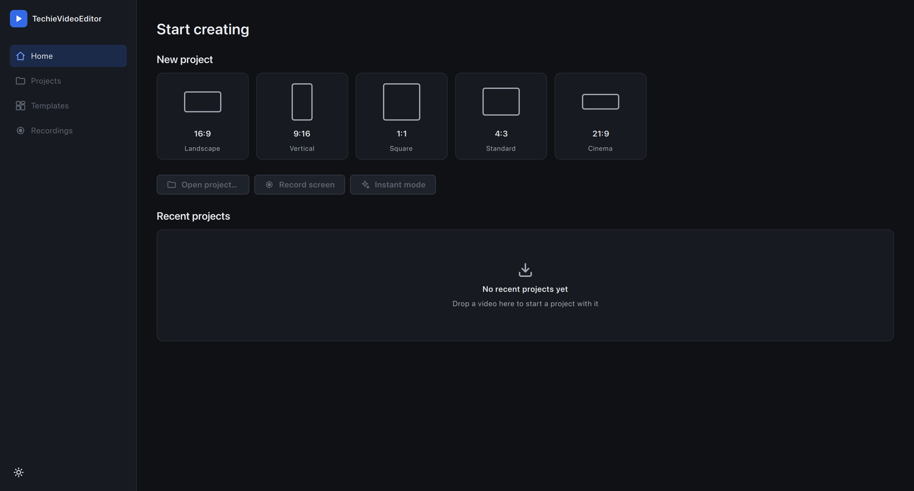 | 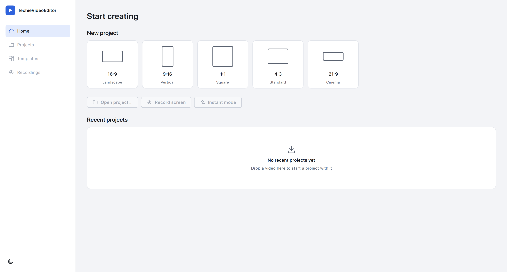 |
| Editor | 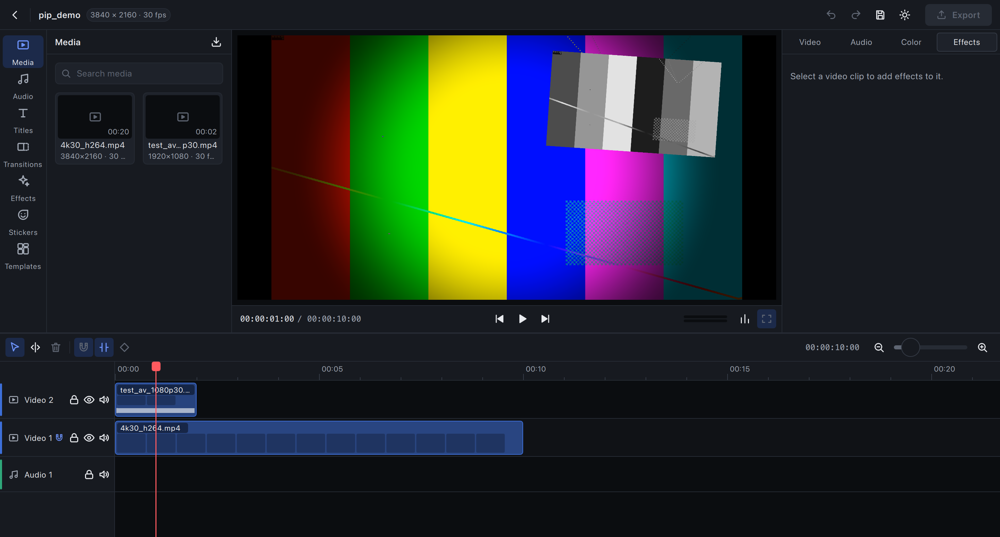 | 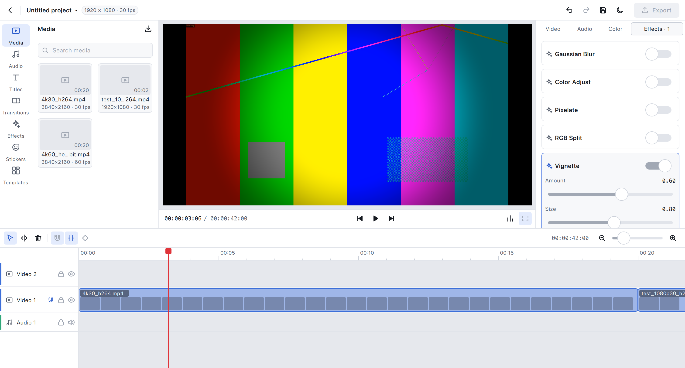 |

Screenshots are generated by the app itself:

```bash
APP=build/macos-release/app/TechieVideoEditor.app/Contents/MacOS/TechieVideoEditor
$APP --theme dark --screen home --screenshot docs/images/home-dark.png --screenshot-at 2 --quit-after 3
$APP --theme dark --effects tve.stylize.vignette,tve.glitch.rgb_split \
     --screenshot docs/images/editor-dark.png --screenshot-at 4 --quit-after 5 samples/4k30_h264.mp4
```

## Principles

1. **The picture comes first.** Neutral, low-saturation surfaces so they don't shift how
   the user perceives the video's color. Dark is the default theme.
2. **One accent.** "Techie blue" marks selection, focus and the primary action. Track
   types and the playhead have their own fixed colors so they read at a glance.
3. **Tokens only.** Components never hard-code a color, size or font; they read `Theme`.
   Switching `Theme.dark` restyles the whole app live.
4. **Accessible by test.** Every text/background pair meets WCAG 2.1 AA (4.5:1) in both
   themes, checked by `tests/qml/tst_theme.qml` on every build.

## Color tokens

`Theme.color.<name>`

| Token | Dark | Light | Use |
|---|---|---|---|
| `canvas` | `#0F1115` | `#F3F4F7` | Window background |
| `surface` | `#171A20` | `#FFFFFF` | Panels |
| `surfaceRaised` | `#1E222A` | `#F7F8FA` | Cards, inputs, selected tabs |
| `surfaceHover` | `#262B34` | `#EEF0F4` | Hovered rows and buttons |
| `surfaceSunken` | `#0B0D10` | `#E6E8ED` | Player well, timeline lanes |
| `borderSubtle` | `#262B34` | `#E1E4EA` | Dividers, card outlines |
| `borderStrong` | `#353B46` | `#CBD0D9` | Input outlines, pressed states |
| `textPrimary` | `#E8EAEE` | `#161A21` | Titles, values |
| `textSecondary` | `#A3AAB6` | `#5A6270` | Labels, captions |
| `textDisabled` | `#5E6572` | `#A1A8B4` | Unavailable controls (exempt from contrast) |
| `accent` | `#356AE6` | `#2F63DD` | Primary button fill, focus ring, active outline |
| `accentHover` | `#2F61DA` | `#2858CC` | Primary button hover |
| `accentPressed` | `#2A58C7` | `#2553C2` | Primary button pressed |
| `accentText` | `#6E95FF` | `#2A5BCC` | Accent-colored text and icons on surfaces |
| `accentSubtle` | `#1C2A4A` | `#E3EBFD` | Selected nav item / tab background |
| `textOnAccent` | `#FFFFFF` | `#FFFFFF` | Text on `accent` fills |
| `success` / `warning` / `danger` | `#3CC28A` / `#F0B44C` / `#F06464` | `#1E9E6A` / `#B87A0E` / `#D23C3C` | Status |
| `trackVideo` | `#3D6FD9` | same | Video clips and track marker |
| `trackAudio` | `#2FA77A` | same | Audio clips |
| `trackTitle` | `#A35CD1` | same | Title clips |
| `trackEffect` | `#D98A3D` | same | Adjustment/effect clips |
| `playhead` | `#FF5A5F` | `#E0343A` | Playhead (≥ 3:1 on lanes and panels) |
| `overlay` | `#B3000000` | same | Scrim behind text drawn over video |

**Contrast results** (from `tst_theme.qml`): primary text is at least 14:1 in dark and 17:1
in light; secondary text 5.4:1 or more; white on every accent state at least 4.6:1; the
playhead at least 3.6:1. Hover states darken the accent rather than lighten it, because a
lighter blue cannot hold white text at 4.5:1.

## Typography

The platform UI font (SF Pro on macOS), plus Menlo for timecodes and numeric values so
digits don't jitter as they change.

| Token | Size / weight | Use |
|---|---|---|
| `type.display` | 24 px semibold | Screen titles |
| `type.title` | 17 px semibold | Section titles on Home |
| `type.heading` | 13 px semibold | Panel headers, button labels, card titles |
| `type.body` | 13 px regular | Default text |
| `type.label` | 12 px regular | Control labels |
| `type.caption` | 11 px regular | Secondary info, ruler, clip names |
| `type.mono` | Menlo 12 px | Timecode, parameter values, stats |

## Spacing, radius, motion

- **Spacing** (4 px grid): `xxs 2 · xs 4 · s 8 · m 12 · l 16 · xl 24 · xxl 32`
- **Radius**: `s 4` (small controls, clips) · `m 6` (buttons, cards, inputs) · `l 10` (large cards) · `round`
- **Motion**: `fast 120 ms` (hover/press color) · `normal 200 ms` (panel transitions). No motion on playback-critical surfaces.

## Layout

### Editor

```
┌──────────────────────────── top bar 44 ─────────────────────────────┐
│ ←  Project name  [1920 × 1080 · 30 fps]           ↶ ↷ ☀  [Export]  │
├──────────┬───────────────────────────────────┬───────────────────────┤
│ tab rail │                                   │ Video Speed Audio … │
│   68     │            player                 │                       │
│ ──────── │         (min 480, fills)          │      inspector        │
│ library  │                                   │  320 (min 280)        │
│ 340      ├───────── transport bar 40 ────────┤                       │
│ (min 260)│ 00:00:00:00        ⏮ ⏸ ⏭     ▥ ⛶ │                       │
├──────────┴───────────────────────────────────┴───────────────────────┤
│ toolbar 36:  select split delete │ magnet snap keyframe   zoom −/+   │
├──────────────┬───────────────────────────────────────────────────────┤
│ track header │ ruler 28                                              │
│     168      │ title lane 52 · video lanes 56 · audio lanes 52       │
│              │                    (timeline 300, min 180)            │
└──────────────┴───────────────────────────────────────────────────────┘
```

All region dividers drag (`SplitView`), with a 1 px visible line and a 7 px grab area.
Sizes are `Theme.size.*` tokens.

| Region | File | Status |
|---|---|---|
| Top bar | `ui/shell/TopBar.qml` | **Live**: project name with unsaved marker and "Autosaved hh:mm", undo/redo with labels, save, theme toggle, Export (shows progress while exporting) opening `ExportDialog.qml` |
| Library | `ui/shell/LibraryPanel.qml` | **Media, Titles, Transitions and Effects tabs are live** (import, drop, drag to timeline, video thumbnails; title styles drawn by the app's text renderer, click or drag onto a track; transitions with GPU-rendered previews that play on hover, click or drag onto a cut; click an effect to add it to the selected clip); other tabs show placeholders naming their phase |
| Player | `ui/shell/PlayerPanel.qml` | **Live** timeline playback with sound, play/pause, frame step, timecode, stereo level meter, proxy toggle, stats overlay |
| Inspector | `ui/shell/InspectorPanel.qml` | **Video, Speed, Audio and Effects tabs are live** for the selected clip (placement/crop/opacity/blend, a title's Text section, speed/reverse/freeze frame, volume/fades/detach, effect stack); a selected transition replaces the tabs with its own page (kind, duration, position, settings, remove); Color tab shows the planned sections |
| Timeline | `ui/shell/TimelinePanel.qml` | **Live**: bound to the project; voice-over button opening `VoiceOverPanel.qml` (a red range marks the take being recorded); move (with snapping and track changes), trim, split, delete, scrub, zoom, track lock/hide/mute, thumbnail strips, waveforms, fade handles, speed/reverse/still badges, title clips (purple, labelled with their text), transition markers over cuts (select, delete, drop target) |

### Home

A 220 px navigation rail, then: "Start creating"; "Unsaved work" (only when there is
some: one warning-bordered card per recoverable project, Discard and Recover); one card per canvas shape (16:9, 9:16,
1:1, 4:3, 21:9; each card draws its own aspect), quick actions, and the recent-projects
area (empty state with drop target until Phase 1 saves projects).

## Components

Module `TechieVideoEditor.Theme` (`ui/theme/`):

| Component | Purpose |
|---|---|
| `Theme` | Singleton with all tokens |
| `Icon` | Monochrome SVG from `icons/`, tinted to any token color |
| `IconButton` | 28 px square tool button: hover, pressed, checked (accent-subtle), focus ring, tooltip |
| `TextButton` | `primary` / `secondary` / `ghost` labelled button with optional icon |
| `ToggleSwitch` | On/off switch in theme colours, with an optional label (sized for the indicator alone when there is none) |

The inspector's own `Swatches` component (colour row with the current colour ringed) is
used for title colours.
| `SearchField` | Text field with search icon and focus ring |
| `PanelHeader` | Panel title bar with trailing actions |
| `Section` | Collapsible inspector section |
| `Divider` | 1 px separator |
| `PlaceholderBox` | Dashed wireframe box naming the phase that fills it |

Buttons own their tooltips (`ToolTip { }` children) rather than using Qt's attached
`ToolTip`, which is one shared popup: if its button is destroyed while showing it, it stays
open and swallows the next click.

Stock Qt Quick Controls (Slider, ComboBox, ToolTip) use the **Basic** style, and
`Main.qml` maps the theme tokens onto their palette, so they follow the theme too. Use
`ToggleSwitch` rather than the stock `Switch`, whose label colour does not follow the theme.

Thumbnails come from `image://tvethumb/<url-encoded path>@<seconds>@<height>` (a leading
`!` on the path puts the request ahead of the queue; the media bin uses it). Request about
twice the displayed height for Retina screens, and round times (the timeline uses 0.25 s)
so zooming reuses cached frames.

Title previews come from `image://tvetitle/<url-encoded JSON of the title's fields and y>`,
drawn by the same renderer as the player at 320 × 180, transparent around the text (tiles
put a dusk gradient behind it).

Transition previews come from `image://tvetransition/<transition id>@<progress>`: the
transition between two generated sample pictures, rendered offscreen on the GPU and cached.
Tiles show progress 0.3 and step through 0–1 on hover.

Speed tab, dark and light:

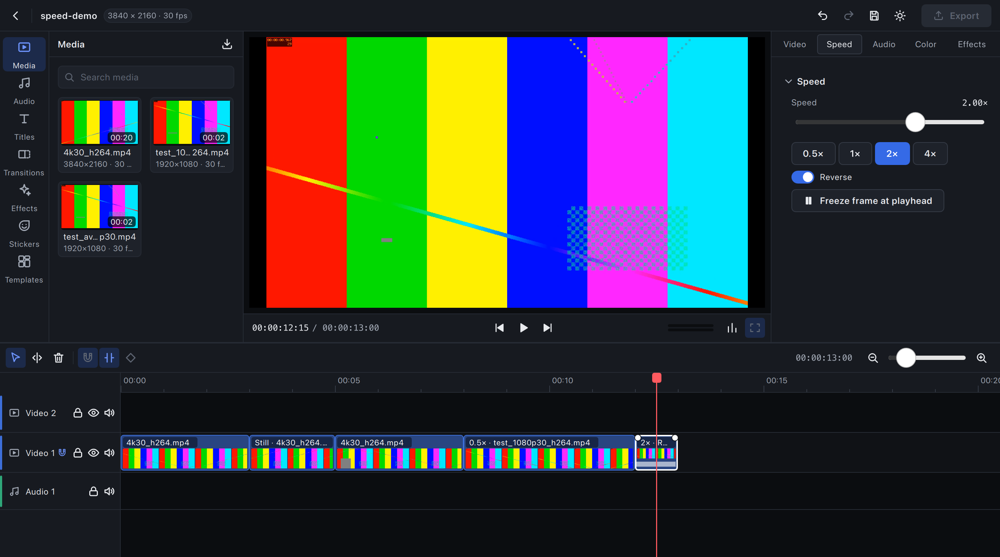
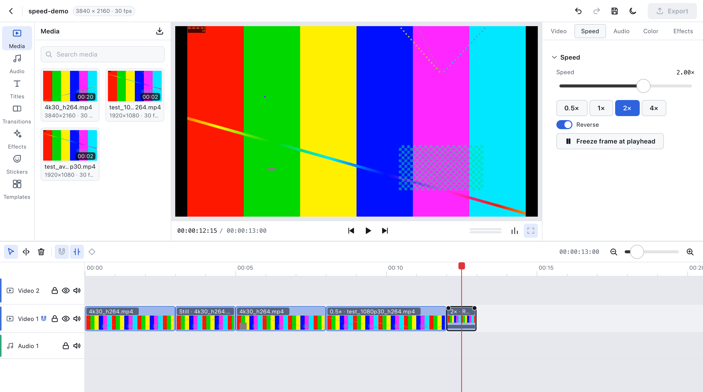

Transitions tab and a selected transition (a soft wipe between test-pattern and gradient
footage, playhead in the transition), dark and light:

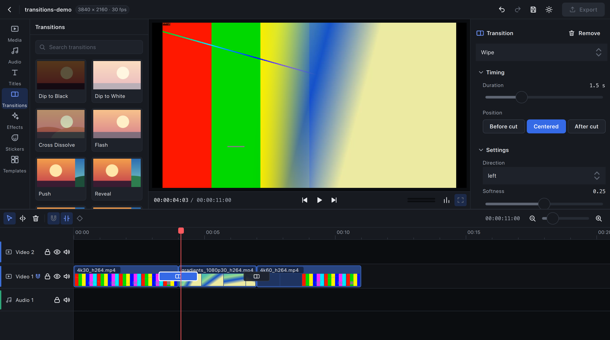
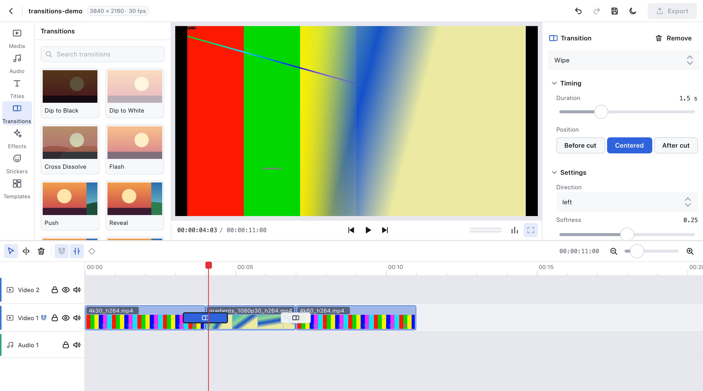

Media bin with proxies ready for the 4K files (the 1080p one needs none), and the player's
proxy toggle on, dark and light:

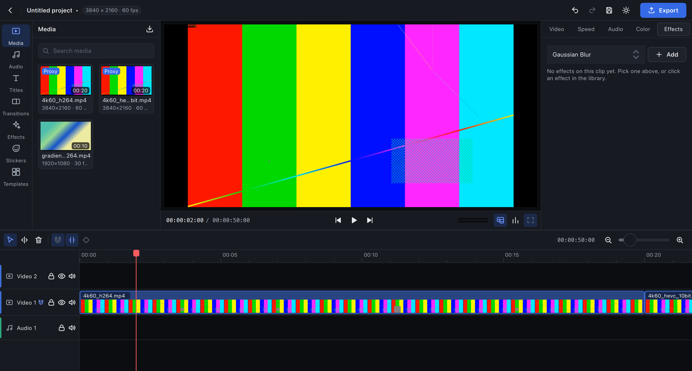
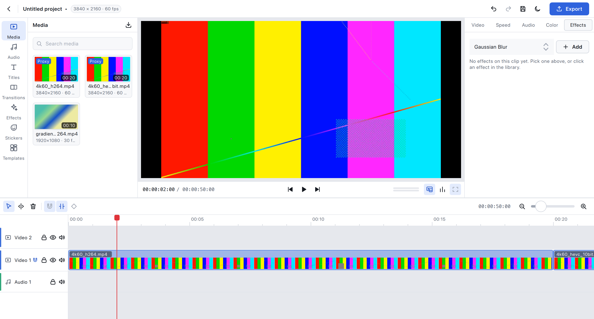

Voice-over panel (a non-modal `Popup` above the timeline toolbar's microphone button)
mid-take, with the take's range in red on the timeline, dark and light:

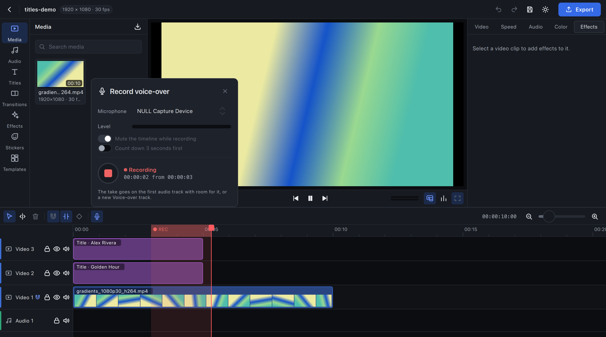
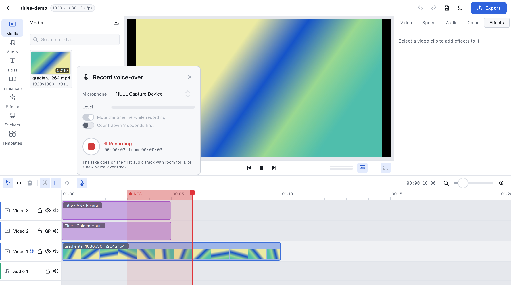

Home after a crash, offering the unsaved work back, dark and light:

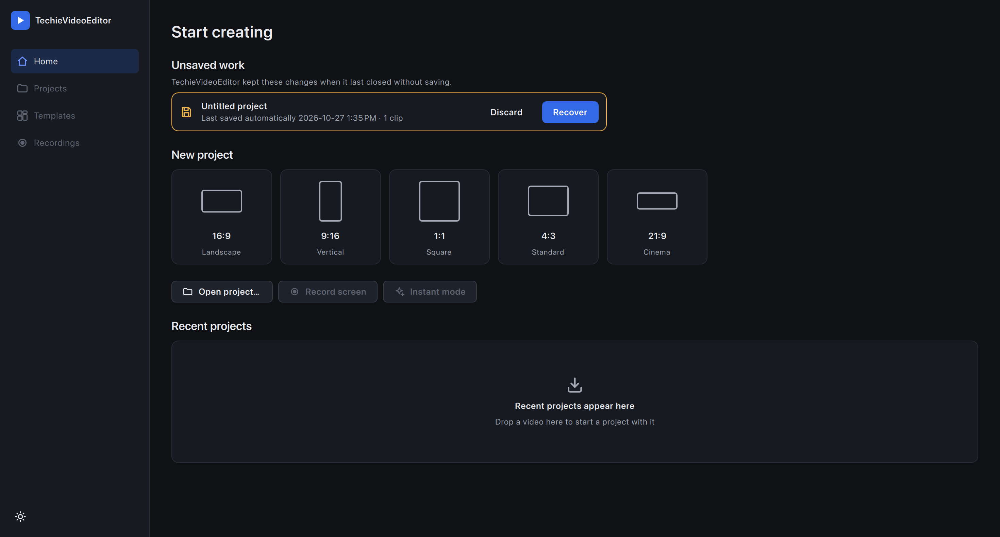
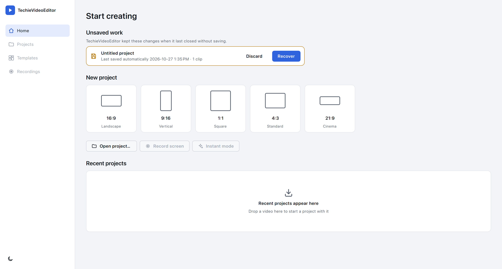

Export dialog (a modal `Popup` over a scrim), dark and light:

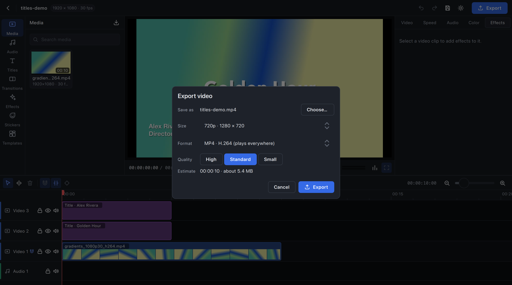
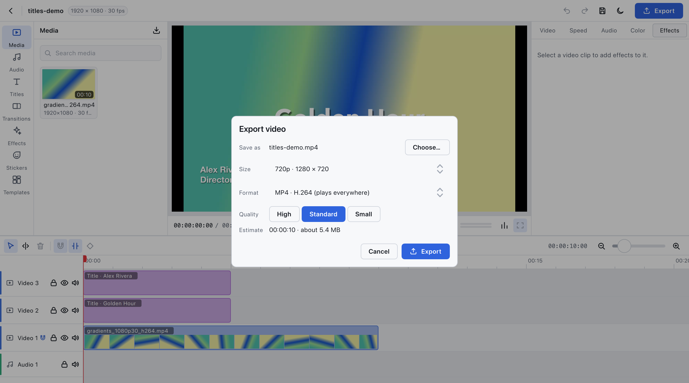

Titles tab and a selected title over gradient footage, dark and light:

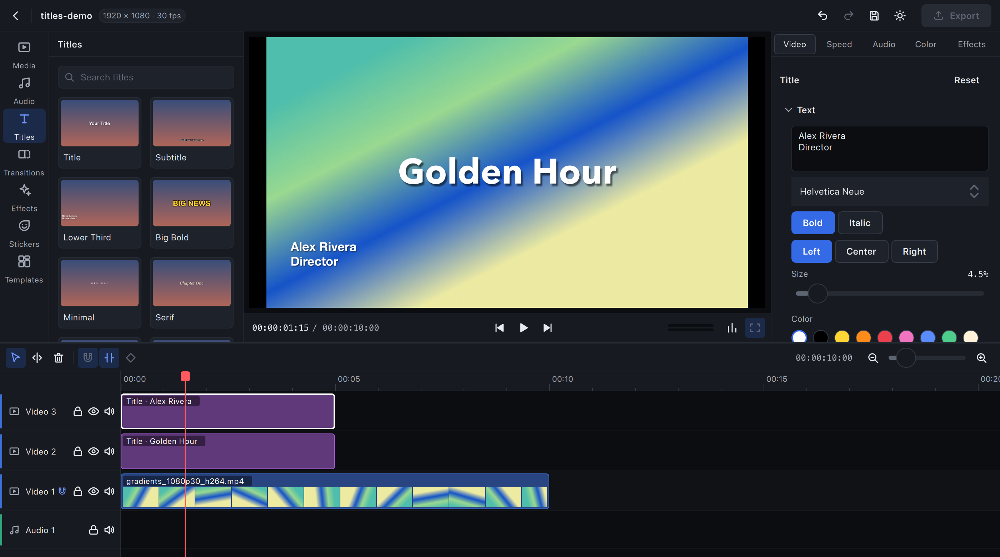
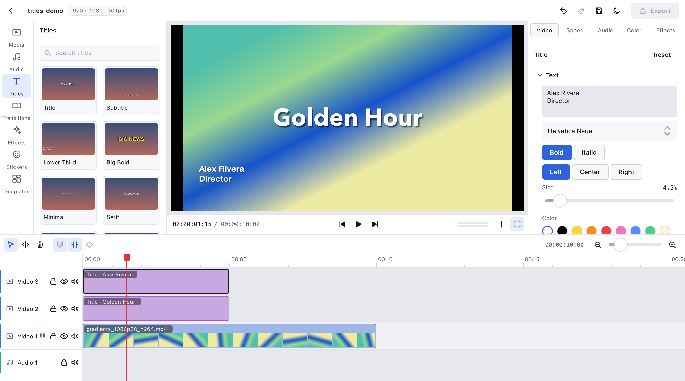

### Icons

41 original icons in `ui/theme/icons/`: 24 × 24 grid, 2 px round-capped white strokes
(filled shapes only for play/pause/skip and record). They are drawn white and tinted at
runtime, so one file serves every state and theme. New icons follow the same grid, stroke
and naming (`kebab-case.svg`); no third-party icon sets.

## Rules for new UI

1. Use tokens; add a token before adding a one-off value.
2. Text on a new background needs a row in `tst_theme.qml`.
3. Interactive elements need hover, pressed, disabled and keyboard-focus states.
4. Anything not built yet uses `PlaceholderBox` or a disabled control whose tooltip names the phase.
5. Never reproduce another product's layout, icons, illustrations or wording.
